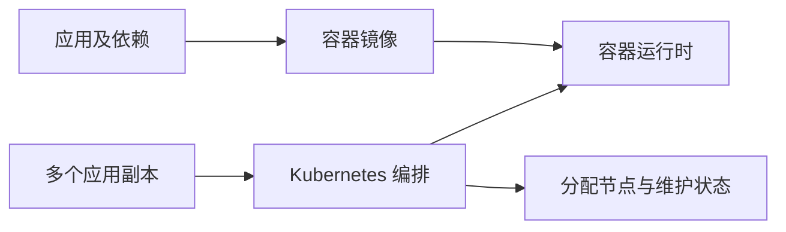

# 01 从部署难题理解 Kubernetes

理解容器编排解决什么问题，以及 Docker 与 Kubernetes 的分工。

## 核心要点

- **1. 图中为什么先有镜像，再有编排？** 镜像把应用与依赖打包，容器运行时负责启动容器。Kubernetes 在此基础上管理多个容器化应用，让部署过程可以重复执行。
- **2. 网站用户增多以后，单机部署会碰到什么困难？** 需要同时运行多个实例，还要决定它们放在哪台机器上。实例退出、机器资源不足和程序更新，都增加了人工管理成本。
- **3. Kubernetes 能帮助维护哪些事情？** 它可以维护应用副本、安排运行节点，并通过工作负载资源组织更新。网络入口和存储资源也可以通过声明进行管理。
- **4. 集群里一定要安装 Docker Engine 吗？** 不一定。现代 Kubernetes 通常通过 CRI 接口与 containerd 或 CRI-O 协作，容器运行时才是节点上实际运行容器的执行者。
- **5. 是不是所有小程序都要放进 Kubernetes？** 应根据副本数量、部署频率和运维复杂度判断。它主要解决多应用、多副本、多节点的统一管理问题，简单单实例应用不一定需要完整集群。

## 场景与示例

**购物网站从一个实例变为三个实例**

镜像负责统一运行环境；Kubernetes 负责组织副本与节点。此时仍要分别考虑应用更新、访问入口和数据库数据保存。

## 常见误区

**把 Kubernetes 理解为另一个镜像打包工具**

镜像构建与集群编排是不同职责。Kubernetes 使用镜像部署应用，不替代应用的打包过程。

## 学习衔接与来源

下一章：期望状态与协调循环。

本章以用户提供的 Kubernetes 教程为基础进行教学重组。所有完整 YAML、命令与实验步骤均为补充示例，不是原文中保留下来的代码。

---

## 本章测验

本章共 5 道单项选择题，每题 1 分。先自行选择，再展开答案；支持互动的播放器应在提交后判题。

### 第 1 题

容器镜像主要解决什么问题？

- A. 决定跨节点副本数量
- B. 统一应用及其运行依赖
- C. 生成应用访问域名
- D. 保存集群 API 状态

选择完成后展开答案

正确答案：B

答案解析：镜像打包应用与依赖，跨节点数量、域名和 API 状态属于其他职责。

### 第 2 题

节点真正创建容器的执行软件通常是什么？

- A. 应用镜像仓库
- B. kubectl 客户端
- C. 集群状态数据库
- D. 容器运行时

选择完成后展开答案

正确答案：D

答案解析：运行时执行容器创建；kubectl 发出 API 请求，etcd 保存状态。

### 第 3 题

多台机器上维护应用副本，主要属于哪项职责？

- A. 源码编译
- B. 镜像下载缓存
- C. 容器编排
- D. 数据库查询优化

选择完成后展开答案

正确答案：C

答案解析：多机副本维护属于编排，镜像统一环境但不决定跨机副本。

### 第 4 题

已有相同镜像，但需要三个实例并分散到多台机器，下一步重点是什么？

- A. 定义副本和调度需求
- B. 把三个实例写进镜像
- C. 给镜像增加数据库表
- D. 将容器端口改为三个值

选择完成后展开答案

正确答案：A

答案解析：相同镜像解决运行环境一致性，副本和节点安排需要编排声明。

### 第 5 题

关于现代 Kubernetes 与 Docker 的关系，哪项准确？

- A. 必须以 Docker Engine 作为运行时
- B. Kubernetes 自己负责所有镜像构建
- C. containerd 用来替代控制平面
- D. 不要求使用 Docker Engine

选择完成后展开答案

正确答案：D

答案解析：Kubernetes 通过 CRI 使用运行时，Docker Engine 不是必须条件。

<!-- QUIZ_DATA_START
{
  "chapter": "01",
  "questions": [
    {
      "id": 1,
      "question": "容器镜像主要解决什么问题？",
      "options": {
        "A": "决定跨节点副本数量",
        "B": "统一应用及其运行依赖",
        "C": "生成应用访问域名",
        "D": "保存集群 API 状态"
      },
      "answer": "B",
      "explanation": "镜像打包应用与依赖，跨节点数量、域名和 API 状态属于其他职责。"
    },
    {
      "id": 2,
      "question": "节点真正创建容器的执行软件通常是什么？",
      "options": {
        "A": "应用镜像仓库",
        "B": "kubectl 客户端",
        "C": "集群状态数据库",
        "D": "容器运行时"
      },
      "answer": "D",
      "explanation": "运行时执行容器创建；kubectl 发出 API 请求，etcd 保存状态。"
    },
    {
      "id": 3,
      "question": "多台机器上维护应用副本，主要属于哪项职责？",
      "options": {
        "A": "源码编译",
        "B": "镜像下载缓存",
        "C": "容器编排",
        "D": "数据库查询优化"
      },
      "answer": "C",
      "explanation": "多机副本维护属于编排，镜像统一环境但不决定跨机副本。"
    },
    {
      "id": 4,
      "question": "已有相同镜像，但需要三个实例并分散到多台机器，下一步重点是什么？",
      "options": {
        "A": "定义副本和调度需求",
        "B": "把三个实例写进镜像",
        "C": "给镜像增加数据库表",
        "D": "将容器端口改为三个值"
      },
      "answer": "A",
      "explanation": "相同镜像解决运行环境一致性，副本和节点安排需要编排声明。"
    },
    {
      "id": 5,
      "question": "关于现代 Kubernetes 与 Docker 的关系，哪项准确？",
      "options": {
        "A": "必须以 Docker Engine 作为运行时",
        "B": "Kubernetes 自己负责所有镜像构建",
        "C": "containerd 用来替代控制平面",
        "D": "不要求使用 Docker Engine"
      },
      "answer": "D",
      "explanation": "Kubernetes 通过 CRI 使用运行时，Docker Engine 不是必须条件。"
    }
  ]
}
QUIZ_DATA_END -->
