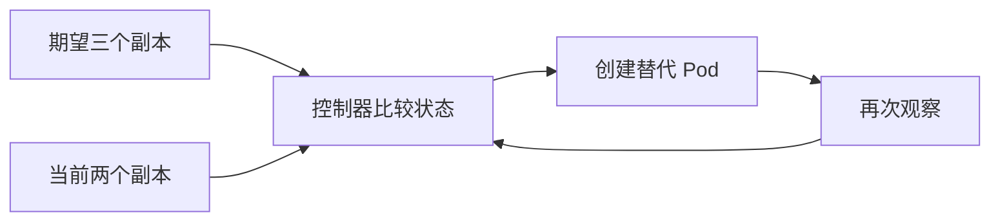

# 02 期望状态与协调循环

把“执行一次命令”转变为“持续维护一个目标”的思考方式。

## 核心要点

- **1. 图中两个状态为什么要反复比较？** 期望状态描述你希望系统是什么样，当前状态描述实际情况。协调循环持续观察差异，并采取动作推动两者接近。
- **2. 写三个副本，是否表示现在立刻有三个可用实例？** 不表示。它是目标，实际创建和启动还需要时间，也取决于节点资源、镜像和配置是否满足条件。
- **3. 少一个实例时，系统通常如何处理？** 对于受副本控制器管理的工作负载，控制器会创建替代 Pod。替代意味着新建对象，不是把原来消失的 Pod 原封不动地复活。
- **4. 控制器做完一次补充就结束了吗？** 不会。它继续观察变化，后续出现差异还会继续协调。这正是声明式管理区别于一次性操作的地方。
- **5. 如果我希望从三个副本改成两个呢？** 先修改目标副本数，再由控制器逐步减少实例。日常应让文件中的声明和临时命令保持一致，避免下一次应用旧配置时恢复旧目标。

## 场景与示例

**期望三个副本，观察到两个**

先确认差异，再由控制器创建第三个 Pod；等它启动后再次观察，实际状态才可能接近期望。

## 常见误区

**声明期望状态就等于立即成功**

声明是目标，协调是过程；可用状态还需要执行环节和运行条件配合。

## 学习衔接与来源

下一章：Cluster、控制平面与 Node。

本章以用户提供的 Kubernetes 教程为基础进行教学重组。所有完整 YAML、命令与实验步骤均为补充示例，不是原文中保留下来的代码。

---

## 本章测验

本章共 5 道单项选择题，每题 1 分。先自行选择，再展开答案；支持互动的播放器应在提交后判题。

### 第 1 题

期望状态描述什么？

- A. 上一次容器日志
- B. 节点实际内存使用量
- C. 用户希望资源达到的目标
- D. 某次 HTTP 请求结果

选择完成后展开答案

正确答案：C

答案解析：期望状态是用户声明的目标，与日志或实时测量不同。

### 第 2 题

协调循环的基本顺序是什么？

- A. 观察并比较差异，再采取动作
- B. 启动所有容器，再忽略状态
- C. 先删除全部对象，再读取目标
- D. 只在用户查询时进行比较

选择完成后展开答案

正确答案：A

答案解析：控制器先观察目标与实际差异，再采取动作并继续观察。

### 第 3 题

受副本控制器管理的 Pod 消失后，通常发生什么？

- A. 恢复原 Pod 的全部身份信息
- B. 改写应用源代码
- C. 自动增加数据库容量
- D. 创建替代 Pod

选择完成后展开答案

正确答案：D

答案解析：控制器创建替代对象，不恢复原对象的全部身份或业务内存。

### 第 4 题

目标副本为三但资源不足，只运行了两个，怎样理解？

- A. 目标已自动变成两个
- B. 目标已声明，实际尚未达到
- C. 三个副本表示三个镜像
- D. 控制器只允许两个副本

选择完成后展开答案

正确答案：B

答案解析：目标与实际可以暂时不同；资源不足不会说明目标自动变化。

### 第 5 题

临时扩容后再次 apply 旧的副本配置，哪种做法更合理？

- A. 同步维护文件中的期望副本数
- B. 把扩容记录只写进日志
- C. 依赖容器自行记忆副本数
- D. 通过修改 Pod IP 固定扩容结果

选择完成后展开答案

正确答案：A

答案解析：应同步文件中的副本目标，否则旧声明可能重新覆盖临时修改。

<!-- QUIZ_DATA_START
{
  "chapter": "02",
  "questions": [
    {
      "id": 1,
      "question": "期望状态描述什么？",
      "options": {
        "A": "上一次容器日志",
        "B": "节点实际内存使用量",
        "C": "用户希望资源达到的目标",
        "D": "某次 HTTP 请求结果"
      },
      "answer": "C",
      "explanation": "期望状态是用户声明的目标，与日志或实时测量不同。"
    },
    {
      "id": 2,
      "question": "协调循环的基本顺序是什么？",
      "options": {
        "A": "观察并比较差异，再采取动作",
        "B": "启动所有容器，再忽略状态",
        "C": "先删除全部对象，再读取目标",
        "D": "只在用户查询时进行比较"
      },
      "answer": "A",
      "explanation": "控制器先观察目标与实际差异，再采取动作并继续观察。"
    },
    {
      "id": 3,
      "question": "受副本控制器管理的 Pod 消失后，通常发生什么？",
      "options": {
        "A": "恢复原 Pod 的全部身份信息",
        "B": "改写应用源代码",
        "C": "自动增加数据库容量",
        "D": "创建替代 Pod"
      },
      "answer": "D",
      "explanation": "控制器创建替代对象，不恢复原对象的全部身份或业务内存。"
    },
    {
      "id": 4,
      "question": "目标副本为三但资源不足，只运行了两个，怎样理解？",
      "options": {
        "A": "目标已自动变成两个",
        "B": "目标已声明，实际尚未达到",
        "C": "三个副本表示三个镜像",
        "D": "控制器只允许两个副本"
      },
      "answer": "B",
      "explanation": "目标与实际可以暂时不同；资源不足不会说明目标自动变化。"
    },
    {
      "id": 5,
      "question": "临时扩容后再次 apply 旧的副本配置，哪种做法更合理？",
      "options": {
        "A": "同步维护文件中的期望副本数",
        "B": "把扩容记录只写进日志",
        "C": "依赖容器自行记忆副本数",
        "D": "通过修改 Pod IP 固定扩容结果"
      },
      "answer": "A",
      "explanation": "应同步文件中的副本目标，否则旧声明可能重新覆盖临时修改。"
    }
  ]
}
QUIZ_DATA_END -->
