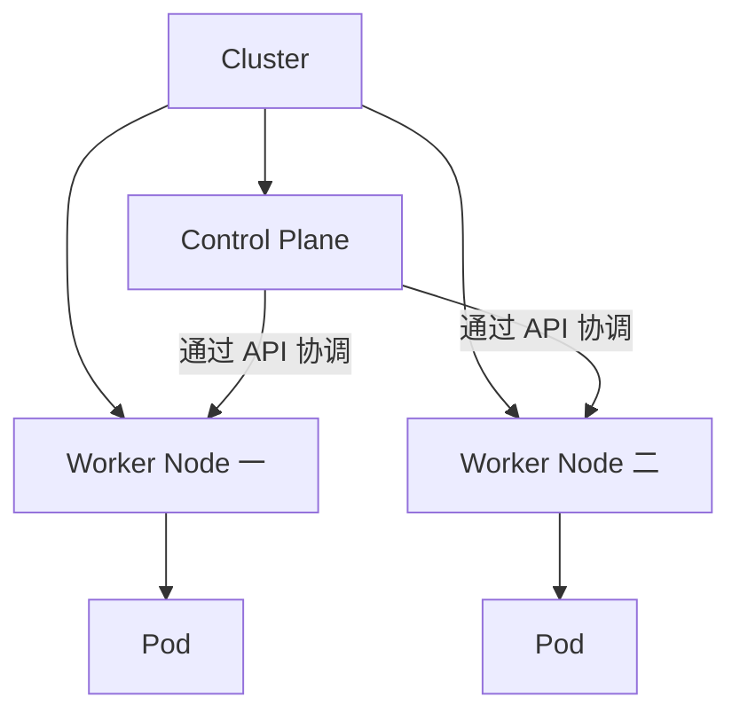

# 03 Cluster、控制平面与 Node

建立集群管理层与应用执行层的整体结构。



## 核心要点

- **1. Cluster 是一台服务器的名称吗？** Cluster 是由 Kubernetes 统一管理的整体。图中包含控制平面和工作节点，节点可以是物理机，也可以是虚拟机。
- **2. 控制平面负责什么？** 它负责 API 入口、状态保存、调度决策和持续协调。可以类比管理总部，但应用容器通常在工作节点上执行。
- **3. Node 提供什么？** Node 提供 CPU、内存，以及网络和存储相关运行条件。Pod 被安排到 Node 后，节点代理与运行时负责让容器运行。
- **4. 两个 Pod 一定要放在不同节点上吗？** 不一定。节点资源和调度约束会影响安排，副本数量本身不保证每个副本位于不同节点。
- **5. 本地学习能把管理和执行放在同一台机器吗？** 可以。本地实验环境可以同时承担控制平面和工作负载运行职责；不要把示意图中的角色划分误读成必须有多台独立机器。

## 场景与示例

**查看集群节点**

使用 kubectl get nodes 查看节点名称和状态；kubectl cluster-info 用于查看控制平面等入口信息。这些是查询命令，不是安装集群的命令。

```bash
kubectl cluster-info
kubectl get nodes
```

## 常见误区

**工作节点自己决定整个应用的副本总数**

副本目标来自资源声明和控制器，Node 主要提供执行条件。

## 学习衔接与来源

下一章：控制平面的四个核心组件。

本章以用户提供的 Kubernetes 教程为基础进行教学重组。所有完整 YAML、命令与实验步骤均为补充示例，不是原文中保留下来的代码。

---

## 本章测验

本章共 5 道单项选择题，每题 1 分。先自行选择，再展开答案；支持互动的播放器应在提交后判题。

### 第 1 题

Cluster 通常包含哪两类角色？

- A. 镜像与源码仓库
- B. 域名与数据库表
- C. 浏览器与 HTTP 客户端
- D. 控制平面与工作节点

<details>
<summary>选择完成后展开答案</summary>

正确答案：D

答案解析：集群由管理与执行角色组成，不能简化成源码或请求关系。

</details>

### 第 2 题

控制平面的主要工作是什么？

- A. 处理每一条业务 SQL
- B. 管理决策与状态协调
- C. 直接替代容器运行时
- D. 编译每个应用的源码

<details>
<summary>选择完成后展开答案</summary>

正确答案：B

答案解析：控制平面负责 API、保存、调度和协调，不执行业务 SQL。

</details>

### 第 3 题

Node 可以是什么？

- A. 物理机或虚拟机
- B. 仅能是物理机
- C. 仅能是数据库进程
- D. 只能是一个容器

<details>
<summary>选择完成后展开答案</summary>

正确答案：A

答案解析：Node 可为物理机或虚拟机，是提供运行资源的节点。

</details>

### 第 4 题

三个副本在同一节点上，能否仅凭副本数认定调度错误？

- A. 能，副本默认必须跨三个节点
- B. 能，每个节点只能放一个 Pod
- C. 不能，需结合调度约束和资源
- D. 不能，因为 Node 不参与调度

<details>
<summary>选择完成后展开答案</summary>

正确答案：C

答案解析：副本数量不保证跨节点分布，安排还受资源与约束影响。

</details>

### 第 5 题

本地单机集群的正确理解是什么？

- A. 没有控制平面也能完整编排
- B. 同一机器可承担多种集群角色
- C. 每个容器就是一个控制平面
- D. 必须有三个工作节点

<details>
<summary>选择完成后展开答案</summary>

正确答案：B

答案解析：本地机器可同时承担管理与执行角色，角色不等于独立机器数量。

</details>

<!-- QUIZ_DATA_START
{
  "chapter": "03",
  "questions": [
    {
      "id": 1,
      "question": "Cluster 通常包含哪两类角色？",
      "options": {
        "A": "镜像与源码仓库",
        "B": "域名与数据库表",
        "C": "浏览器与 HTTP 客户端",
        "D": "控制平面与工作节点"
      },
      "answer": "D",
      "explanation": "集群由管理与执行角色组成，不能简化成源码或请求关系。"
    },
    {
      "id": 2,
      "question": "控制平面的主要工作是什么？",
      "options": {
        "A": "处理每一条业务 SQL",
        "B": "管理决策与状态协调",
        "C": "直接替代容器运行时",
        "D": "编译每个应用的源码"
      },
      "answer": "B",
      "explanation": "控制平面负责 API、保存、调度和协调，不执行业务 SQL。"
    },
    {
      "id": 3,
      "question": "Node 可以是什么？",
      "options": {
        "A": "物理机或虚拟机",
        "B": "仅能是物理机",
        "C": "仅能是数据库进程",
        "D": "只能是一个容器"
      },
      "answer": "A",
      "explanation": "Node 可为物理机或虚拟机，是提供运行资源的节点。"
    },
    {
      "id": 4,
      "question": "三个副本在同一节点上，能否仅凭副本数认定调度错误？",
      "options": {
        "A": "能，副本默认必须跨三个节点",
        "B": "能，每个节点只能放一个 Pod",
        "C": "不能，需结合调度约束和资源",
        "D": "不能，因为 Node 不参与调度"
      },
      "answer": "C",
      "explanation": "副本数量不保证跨节点分布，安排还受资源与约束影响。"
    },
    {
      "id": 5,
      "question": "本地单机集群的正确理解是什么？",
      "options": {
        "A": "没有控制平面也能完整编排",
        "B": "同一机器可承担多种集群角色",
        "C": "每个容器就是一个控制平面",
        "D": "必须有三个工作节点"
      },
      "answer": "B",
      "explanation": "本地机器可同时承担管理与执行角色，角色不等于独立机器数量。"
    }
  ]
}
QUIZ_DATA_END -->
