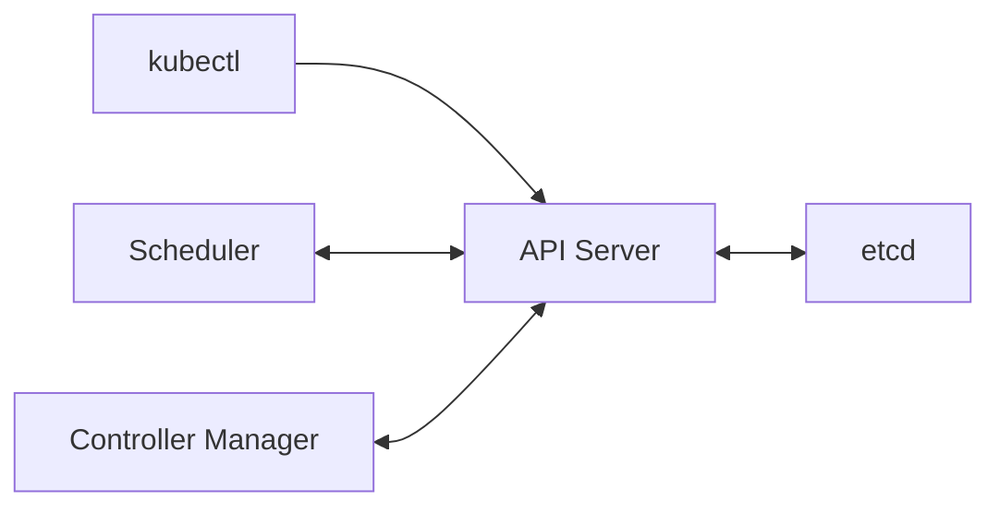

# 04 控制平面的四个核心组件

分清 API 入口、状态数据库、调度器和控制器的职责。

## 核心要点

- **1. 所有箭头为什么围绕 API Server？** API Server 是 Kubernetes API 入口，接受客户端和其他组件的请求。创建、查询和修改资源对象，都通过这套 API 协作。
- **2. etcd 保存应用数据库里的订单吗？** 这里的 etcd 保存集群 API 对象与状态，例如 Deployment 声明和 Service 定义。应用订单应由应用自己的数据库负责。
- **3. Scheduler 在什么时候工作？** 新 Pod 已创建但尚未分配节点时，Scheduler 根据资源请求和调度约束选择合适节点，并通过 API 记录分配结果。
- **4. Controller Manager 又管理什么？** 它运行多种控制器，持续比较目标与实际状态。Deployment 相关控制器、ReplicaSet 控制器等各自维护对应资源关系。
- **5. 云平台集成由谁处理？** 一些集群使用 cloud-controller-manager 对接云节点和负载均衡等基础设施。它是云环境集成组件，不是每个本地集群都要独立部署的服务。

## 场景与示例

**提交 Deployment 声明**

kubectl 将声明交给 API Server，状态被保存后，相关控制器继续协调；调度器随后处理尚未分配节点的 Pod。

## 常见误区

**调度器选择节点后直接启动容器**

调度器负责分配节点，容器启动由节点上的 kubelet 与运行时执行。

## 学习衔接与来源

下一章：节点组件与 Pod 启动流程。

本章以用户提供的 Kubernetes 教程为基础进行教学重组。所有完整 YAML、命令与实验步骤均为补充示例，不是原文中保留下来的代码。

---

## 本章测验

本章共 5 道单项选择题，每题 1 分。先自行选择，再展开答案；支持互动的播放器应在提交后判题。

### 第 1 题

哪个组件提供 Kubernetes API 入口？

- A. kube-apiserver
- B. etcd
- C. kube-scheduler
- D. containerd

选择完成后展开答案

正确答案：A

答案解析：API Server 接受资源操作请求，其他组件有各自职责。

### 第 2 题

etcd 在本章中的用途是什么？

- A. 保存应用的所有业务订单
- B. 实现容器镜像构建
- C. 保存集群对象与状态
- D. 提供 HTTP 域名路由

选择完成后展开答案

正确答案：C

答案解析：etcd 保存 Kubernetes API 对象与集群状态，不是应用订单库。

### 第 3 题

尚未分配节点的 Pod 由谁选择节点？

- A. CoreDNS
- B. Scheduler
- C. Secret
- D. Service

选择完成后展开答案

正确答案：B

答案解析：Scheduler 为尚未分配节点的 Pod 选择节点，不提供 DNS 或入口。

### 第 4 题

期望副本数与实际数量不一致，主要由哪类组件协调？

- A. 应用浏览器
- B. 镜像标签
- C. DNS 缓存
- D. 控制器

选择完成后展开答案

正确答案：D

答案解析：控制器比较期望与实际并维护资源，DNS 或镜像标签不执行协调。

### 第 5 题

cloud-controller-manager 的定位是什么？

- A. 每个集群必备的容器运行时
- B. 专门管理应用 SQL 表
- C. 对接云基础设施
- D. 用于替代 API Server

选择完成后展开答案

正确答案：C

答案解析：它对接云基础设施，不是所有本地集群必备的独立组件。

<!-- QUIZ_DATA_START
{
  "chapter": "04",
  "questions": [
    {
      "id": 1,
      "question": "哪个组件提供 Kubernetes API 入口？",
      "options": {
        "A": "kube-apiserver",
        "B": "etcd",
        "C": "kube-scheduler",
        "D": "containerd"
      },
      "answer": "A",
      "explanation": "API Server 接受资源操作请求，其他组件有各自职责。"
    },
    {
      "id": 2,
      "question": "etcd 在本章中的用途是什么？",
      "options": {
        "A": "保存应用的所有业务订单",
        "B": "实现容器镜像构建",
        "C": "保存集群对象与状态",
        "D": "提供 HTTP 域名路由"
      },
      "answer": "C",
      "explanation": "etcd 保存 Kubernetes API 对象与集群状态，不是应用订单库。"
    },
    {
      "id": 3,
      "question": "尚未分配节点的 Pod 由谁选择节点？",
      "options": {
        "A": "CoreDNS",
        "B": "Scheduler",
        "C": "Secret",
        "D": "Service"
      },
      "answer": "B",
      "explanation": "Scheduler 为尚未分配节点的 Pod 选择节点，不提供 DNS 或入口。"
    },
    {
      "id": 4,
      "question": "期望副本数与实际数量不一致，主要由哪类组件协调？",
      "options": {
        "A": "应用浏览器",
        "B": "镜像标签",
        "C": "DNS 缓存",
        "D": "控制器"
      },
      "answer": "D",
      "explanation": "控制器比较期望与实际并维护资源，DNS 或镜像标签不执行协调。"
    },
    {
      "id": 5,
      "question": "cloud-controller-manager 的定位是什么？",
      "options": {
        "A": "每个集群必备的容器运行时",
        "B": "专门管理应用 SQL 表",
        "C": "对接云基础设施",
        "D": "用于替代 API Server"
      },
      "answer": "C",
      "explanation": "它对接云基础设施，不是所有本地集群必备的独立组件。"
    }
  ]
}
QUIZ_DATA_END -->
