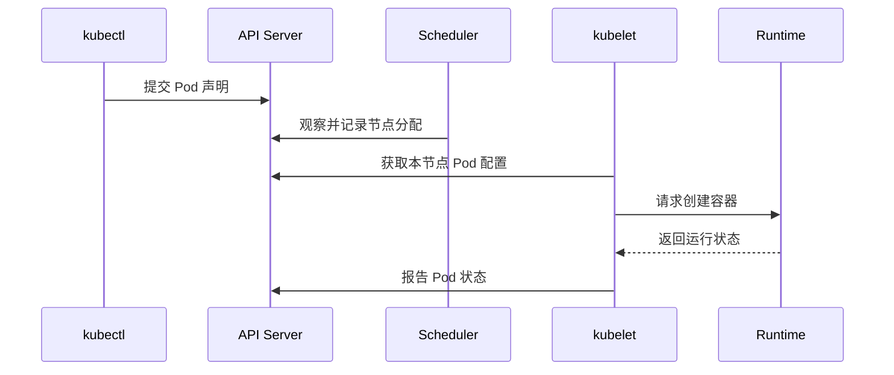

# 05 节点组件与 Pod 启动流程

跟随一个 Pod 从 API 对象到运行容器的完整路径。



## 核心要点

- **1. 时序图从哪里开始？** 从 kubectl 提交 Pod 声明开始。API Server 接收并保存对象，后续组件通过 API 观察对象变化，而不是客户端逐个登录节点启动程序。
- **2. Scheduler 完成以后，谁继续执行？** 被选中节点上的 kubelet 获取分配给本节点的 Pod 配置。它是节点代理，负责与容器运行时协作维护 Pod 运行状态。
- **3. 运行时具体做什么？** 它准备镜像，创建并启动容器，管理容器生命周期。运行时不负责为整个集群选择 Pod 应该运行在哪个节点。
- **4. 为什么时序图最后还要报告状态？** 启动不是一次性终点。kubelet 持续观察并报告状态，让控制平面能够知道实际情况，协调循环才有观察依据。
- **5. kube-proxy 是否负责创建 Pod 网络？** 采用 kube-proxy 的实现中，它维护 Service 转发规则；Pod 网络连接通常由 CNI 网络方案提供。某些网络方案会使用其他机制实现 Service 转发，因此不一定运行 kube-proxy。

## 场景与示例

**观察新建 Pod**

kubectl get pods -o wide 可以查看 Pod 状态及节点信息。先看到对象，不代表容器已经运行；应继续观察状态变化。

```bash
kubectl get pods -n k8s-learn -o wide
```

## 常见误区

**把 kubelet、运行时、网络转发组件混成一个职责**

kubelet 维护节点上的 Pod，运行时执行容器生命周期，Service 转发与 Pod 网络连接还有各自的实现。

## 学习衔接与来源

下一章：Pod 与多容器协作。

本章以用户提供的 Kubernetes 教程为基础进行教学重组。所有完整 YAML、命令与实验步骤均为补充示例，不是原文中保留下来的代码。

---

## 本章测验

本章共 5 道单项选择题，每题 1 分。先自行选择，再展开答案；支持互动的播放器应在提交后判题。

### 第 1 题

节点上的 Pod 代理是什么？

- A. kubectl
- B. kubelet
- C. etcd
- D. Helm

<details>
<summary>选择完成后展开答案</summary>

正确答案：B

答案解析：kubelet 是节点代理；kubectl 是客户端，Helm 是包管理工具。

</details>

### 第 2 题

节点分配之后，哪条执行关系正确？

- A. Scheduler 登录节点启动容器
- B. etcd 直接执行容器命令
- C. Service 创建所有容器
- D. kubelet 与运行时协作启动容器

<details>
<summary>选择完成后展开答案</summary>

正确答案：D

答案解析：节点分配后由 kubelet 与运行时协作，而非调度器直接运行容器。

</details>

### 第 3 题

容器运行时的主要职责是什么？

- A. 制定集群副本总数
- B. 生成 Service DNS 名称
- C. 创建和运行容器
- D. 解释 Ingress 域名规则

<details>
<summary>选择完成后展开答案</summary>

正确答案：C

答案解析：运行时管理容器生命周期，副本、DNS 与存储由其他机制处理。

</details>

### 第 4 题

想观察新 Pod 被安排在哪个节点，哪个命令合适？

- A. kubectl get pods -o wide
- B. kubectl scale nodes --replicas=3
- C. kubectl build pod
- D. kubectl set dns pod

<details>
<summary>选择完成后展开答案</summary>

正确答案：A

答案解析：get pods -o wide 显示更丰富信息，包括节点安排。

</details>

### 第 5 题

关于 kube-proxy，哪项准确？

- A. 它负责镜像构建
- B. 它总是直接创建所有 Pod 网络
- C. 没有它就不能保存 API 对象
- D. 某些网络方案可用其他机制实现 Service 转发

<details>
<summary>选择完成后展开答案</summary>

正确答案：D

答案解析：一些网络方案替代 kube-proxy 的转发作用，它不是镜像构建工具。

</details>

<!-- QUIZ_DATA_START
{
  "chapter": "05",
  "questions": [
    {
      "id": 1,
      "question": "节点上的 Pod 代理是什么？",
      "options": {
        "A": "kubectl",
        "B": "kubelet",
        "C": "etcd",
        "D": "Helm"
      },
      "answer": "B",
      "explanation": "kubelet 是节点代理；kubectl 是客户端，Helm 是包管理工具。"
    },
    {
      "id": 2,
      "question": "节点分配之后，哪条执行关系正确？",
      "options": {
        "A": "Scheduler 登录节点启动容器",
        "B": "etcd 直接执行容器命令",
        "C": "Service 创建所有容器",
        "D": "kubelet 与运行时协作启动容器"
      },
      "answer": "D",
      "explanation": "节点分配后由 kubelet 与运行时协作，而非调度器直接运行容器。"
    },
    {
      "id": 3,
      "question": "容器运行时的主要职责是什么？",
      "options": {
        "A": "制定集群副本总数",
        "B": "生成 Service DNS 名称",
        "C": "创建和运行容器",
        "D": "解释 Ingress 域名规则"
      },
      "answer": "C",
      "explanation": "运行时管理容器生命周期，副本、DNS 与存储由其他机制处理。"
    },
    {
      "id": 4,
      "question": "想观察新 Pod 被安排在哪个节点，哪个命令合适？",
      "options": {
        "A": "kubectl get pods -o wide",
        "B": "kubectl scale nodes --replicas=3",
        "C": "kubectl build pod",
        "D": "kubectl set dns pod"
      },
      "answer": "A",
      "explanation": "get pods -o wide 显示更丰富信息，包括节点安排。"
    },
    {
      "id": 5,
      "question": "关于 kube-proxy，哪项准确？",
      "options": {
        "A": "它负责镜像构建",
        "B": "它总是直接创建所有 Pod 网络",
        "C": "没有它就不能保存 API 对象",
        "D": "某些网络方案可用其他机制实现 Service 转发"
      },
      "answer": "D",
      "explanation": "一些网络方案替代 kube-proxy 的转发作用，它不是镜像构建工具。"
    }
  ]
}
QUIZ_DATA_END -->
