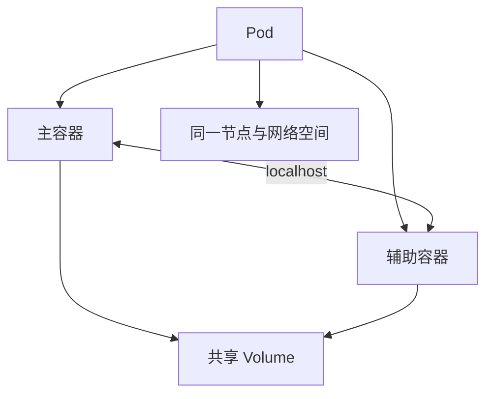

# 06 Pod 与多容器协作

理解最小部署单位，以及适合放进同一 Pod 的容器关系。

## 核心要点

- **1. Pod 与容器是什么关系？** Pod 是 Kubernetes 最小的可部署计算单位，包含一个或多个容器。最常见的是一个 Pod 运行一个主要应用容器。
- **2. 同一个 Pod 的容器如何通信？** 它们共享网络命名空间，具有同一 Pod IP 和端口空间，能通过 localhost 通信。因此两个进程也不能随意占用相同监听端口。
- **3. 文件是不是也自动全部共享？** 不是。容器各有自己的文件系统，需要配置共享 Volume，并挂载到各个容器，才能共享指定文件目录。
- **4. 调度器会把两个容器分别安排到不同节点吗？** 不会把同一个 Pod 内的容器独立拆开调度。它调度的是 Pod，Pod 内容器作为一个整体在同一节点运行。
- **5. Web 服务和数据库适合塞进同一个 Pod 吗？** 如果需要独立扩容和更新，通常应放到不同 Pod。适合放在一起的是紧密协作、共同参与生命周期的主程序与辅助程序。

## 场景与示例

**主程序与日志辅助容器**

主程序写入配置好的共享 Volume，辅助容器读取该目录。它们共享指定目录，不代表整个容器文件系统合并。

## 常见误区

**Pod 内的容器越多越好**

应先看是否需要共同生命周期。需要独立管理的应用应拆成不同 Pod。

## 学习衔接与来源

下一章：读懂 YAML 并创建第一个 Pod。

本章以用户提供的 Kubernetes 教程为基础进行教学重组。所有完整 YAML、命令与实验步骤均为补充示例，不是原文中保留下来的代码。

---

## 本章测验

本章共 5 道单项选择题，每题 1 分。先自行选择，再展开答案；支持互动的播放器应在提交后判题。

### 第 1 题

Kubernetes 最小可部署计算单位是什么？

- A. 单独容器进程
- B. Namespace
- C. Pod
- D. Node

选择完成后展开答案

正确答案：C

答案解析：Pod 是部署与调度单位，可包含一个或多个容器。

### 第 2 题

同一 Pod 内两个容器通常可通过什么访问彼此？

- A. localhost
- B. 不同集群入口域名
- C. 独立 NodePort
- D. 固定外部负载均衡器

选择完成后展开答案

正确答案：A

答案解析：同 Pod 共享网络空间，因此通常可以用 localhost 通信。

### 第 3 题

同一 Pod 内共享文件需要什么？

- A. 只设置相同镜像名
- B. 只使用相同容器名称
- C. 只把端口声明为一致
- D. 配置并共同挂载 Volume

选择完成后展开答案

正确答案：D

答案解析：文件共享需显式共同挂载 Volume，同名镜像或标签不共享文件。

### 第 4 题

两个服务需要独立扩容和更新，通常怎样部署？

- A. 强制放入同一 Pod
- B. 分别放到不同 Pod
- C. 把两个服务放进 etcd
- D. 只为它们修改同一个容器端口

选择完成后展开答案

正确答案：B

答案解析：独立扩容和更新需求通常要求独立 Pod 生命周期。

### 第 5 题

同一个 Pod 的调度方式是什么？

- A. 整体调度到同一节点
- B. 每个容器默认跨节点调度
- C. 辅助容器总在控制平面执行
- D. 由 Service 分别选择容器节点

选择完成后展开答案

正确答案：A

答案解析：调度器安排整个 Pod，而不是分别把内部容器放到不同节点。

<!-- QUIZ_DATA_START
{
  "chapter": "06",
  "questions": [
    {
      "id": 1,
      "question": "Kubernetes 最小可部署计算单位是什么？",
      "options": {
        "A": "单独容器进程",
        "B": "Namespace",
        "C": "Pod",
        "D": "Node"
      },
      "answer": "C",
      "explanation": "Pod 是部署与调度单位，可包含一个或多个容器。"
    },
    {
      "id": 2,
      "question": "同一 Pod 内两个容器通常可通过什么访问彼此？",
      "options": {
        "A": "localhost",
        "B": "不同集群入口域名",
        "C": "独立 NodePort",
        "D": "固定外部负载均衡器"
      },
      "answer": "A",
      "explanation": "同 Pod 共享网络空间，因此通常可以用 localhost 通信。"
    },
    {
      "id": 3,
      "question": "同一 Pod 内共享文件需要什么？",
      "options": {
        "A": "只设置相同镜像名",
        "B": "只使用相同容器名称",
        "C": "只把端口声明为一致",
        "D": "配置并共同挂载 Volume"
      },
      "answer": "D",
      "explanation": "文件共享需显式共同挂载 Volume，同名镜像或标签不共享文件。"
    },
    {
      "id": 4,
      "question": "两个服务需要独立扩容和更新，通常怎样部署？",
      "options": {
        "A": "强制放入同一 Pod",
        "B": "分别放到不同 Pod",
        "C": "把两个服务放进 etcd",
        "D": "只为它们修改同一个容器端口"
      },
      "answer": "B",
      "explanation": "独立扩容和更新需求通常要求独立 Pod 生命周期。"
    },
    {
      "id": 5,
      "question": "同一个 Pod 的调度方式是什么？",
      "options": {
        "A": "整体调度到同一节点",
        "B": "每个容器默认跨节点调度",
        "C": "辅助容器总在控制平面执行",
        "D": "由 Service 分别选择容器节点"
      },
      "answer": "A",
      "explanation": "调度器安排整个 Pod，而不是分别把内部容器放到不同节点。"
    }
  ]
}
QUIZ_DATA_END -->
