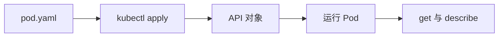

# 07 读懂 YAML 并创建第一个 Pod

用最小完整示例理解资源声明与查询命令。



## 核心要点

- **1. YAML 的四个入口字段怎么理解？** apiVersion 选择 API 版本，kind 指定资源类型，metadata 写名称等元数据，spec 描述期望配置。系统维护的 status 通常不需要手写。
- **2. 这个 Pod 实例的关键配置是什么？** 例子名为 first-pod，容器名为 web，使用 nginx:1.28 镜像，声明容器端口为八十。镜像标签是教学示例，不表示最新版。
- **3. containerPort 声明以后，外部用户就能访问了吗？** 不能仅靠它实现外部访问。它描述容器使用的端口，程序自身仍需要监听，访问入口还需要其他机制。
- **4. 提交文件以后看什么？** apply 创建或更新对象；get 查看状态列表，describe 查看资源细节，logs 查看容器输出。命令使用同一个实验 Namespace，避免查错位置。
- **5. READY 和 Running 表示一样的事情吗？** 不一样。Running 是 Pod 阶段，READY 反映容器就绪数量，RESTARTS 是重启次数；运行阶段不能替代应用是否准备接收请求的判断。

## 场景与示例

**最小 Pod 的创建步骤**

先确认已有可访问的学习集群和 kubectl 上下文，再创建 k8s-learn 命名空间，将示例保存为 pod.yaml 并 apply。随后观察状态和日志。

文件：`examples/01-pod.yaml`

```yaml
apiVersion: v1
kind: Pod
metadata:
  name: first-pod
  namespace: k8s-learn
spec:
  containers:
    - name: web
      image: nginx:1.28
      ports:
        - containerPort: 80
```

```bash
kubectl create namespace k8s-learn
kubectl apply -f examples/01-pod.yaml
kubectl get pods -n k8s-learn
kubectl describe pod first-pod -n k8s-learn
kubectl logs first-pod -n k8s-learn
```

## 常见误区

**把 YAML 中声明的端口当成公网端口**

containerPort 不是对外暴露命令；它也不会让没有监听端口的程序自动提供服务。

## 学习衔接与来源

下一章：Pod 生命周期与替代实例。

本章以用户提供的 Kubernetes 教程为基础进行教学重组。所有完整 YAML、命令与实验步骤均为补充示例，不是原文中保留下来的代码。

---

## 本章测验

本章共 5 道单项选择题，每题 1 分。先自行选择，再展开答案；支持互动的播放器应在提交后判题。

### 第 1 题

kind: Pod 表达什么？

- A. 镜像版本为 Pod
- B. 节点角色为 Pod
- C. Namespace 名为 Pod
- D. 资源类型为 Pod

<details>
<summary>选择完成后展开答案</summary>

正确答案：D

答案解析：kind 指定 API 资源类型，镜像、节点和 Namespace 使用其他字段。

</details>

### 第 2 题

通常由 Kubernetes 维护的字段是什么？

- A. kind
- B. status
- C. apiVersion
- D. metadata.name

<details>
<summary>选择完成后展开答案</summary>

正确答案：B

答案解析：status 通常由系统维护，编写声明主要关注类型、元数据与 spec。

</details>

### 第 3 题

containerPort: 80 的直接意义是什么？

- A. 声明容器使用的端口
- B. 自动分配公网入口
- C. 自动创建 Service
- D. 让应用自动监听端口

<details>
<summary>选择完成后展开答案</summary>

正确答案：A

答案解析：containerPort 声明容器端口，不自动暴露公网或启动监听。

</details>

### 第 4 题

apply 后想看 Pod 详细信息，应使用什么？

- A. kubectl create image
- B. kubectl set namespace logs
- C. kubectl describe pod
- D. kubectl scale containerPort

<details>
<summary>选择完成后展开答案</summary>

正确答案：C

答案解析：describe 用于查看对象详情，apply 管理声明，logs 查看输出。

</details>

### 第 5 题

Pod 为 Running 时，哪项理解准确？

- A. 所有业务请求必然成功
- B. 仍需区分运行阶段与就绪状态
- C. Pod 已获得固定公网 IP
- D. 容器重启次数必定为零

<details>
<summary>选择完成后展开答案</summary>

正确答案：B

答案解析：Running 与 READY 含义不同，还需检查应用是否准备接收请求。

</details>

<!-- QUIZ_DATA_START
{
  "chapter": "07",
  "questions": [
    {
      "id": 1,
      "question": "kind: Pod 表达什么？",
      "options": {
        "A": "镜像版本为 Pod",
        "B": "节点角色为 Pod",
        "C": "Namespace 名为 Pod",
        "D": "资源类型为 Pod"
      },
      "answer": "D",
      "explanation": "kind 指定 API 资源类型，镜像、节点和 Namespace 使用其他字段。"
    },
    {
      "id": 2,
      "question": "通常由 Kubernetes 维护的字段是什么？",
      "options": {
        "A": "kind",
        "B": "status",
        "C": "apiVersion",
        "D": "metadata.name"
      },
      "answer": "B",
      "explanation": "status 通常由系统维护，编写声明主要关注类型、元数据与 spec。"
    },
    {
      "id": 3,
      "question": "containerPort: 80 的直接意义是什么？",
      "options": {
        "A": "声明容器使用的端口",
        "B": "自动分配公网入口",
        "C": "自动创建 Service",
        "D": "让应用自动监听端口"
      },
      "answer": "A",
      "explanation": "containerPort 声明容器端口，不自动暴露公网或启动监听。"
    },
    {
      "id": 4,
      "question": "apply 后想看 Pod 详细信息，应使用什么？",
      "options": {
        "A": "kubectl create image",
        "B": "kubectl set namespace logs",
        "C": "kubectl describe pod",
        "D": "kubectl scale containerPort"
      },
      "answer": "C",
      "explanation": "describe 用于查看对象详情，apply 管理声明，logs 查看输出。"
    },
    {
      "id": 5,
      "question": "Pod 为 Running 时，哪项理解准确？",
      "options": {
        "A": "所有业务请求必然成功",
        "B": "仍需区分运行阶段与就绪状态",
        "C": "Pod 已获得固定公网 IP",
        "D": "容器重启次数必定为零"
      },
      "answer": "B",
      "explanation": "Running 与 READY 含义不同，还需检查应用是否准备接收请求。"
    }
  ]
}
QUIZ_DATA_END -->
