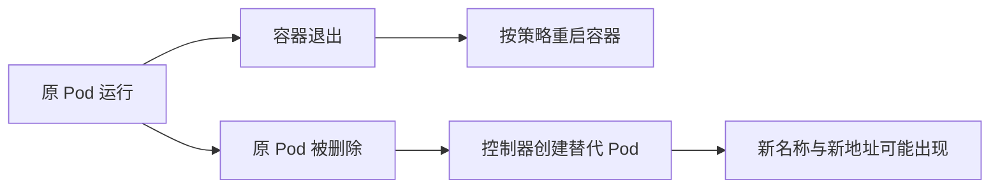

# 08 Pod 生命周期与替代实例

区分容器重启、Pod 替换和稳定运行需求。



## 核心要点

- **1. 容器重启是不是等于 Pod 被重新创建？** 不是。容器可以在同一个 Pod 中重启；Pod 被删除并替换，则会产生新的对象身份。两种过程的生命周期不同。
- **2. 原 Pod 删除后，新的 Pod 会沿用 IP 吗？** 不保证。替代 Pod 的名称、IP 和节点都可能改变；不要把 Pod IP 当成应用永久入口。
- **3. 我直接创建的独立 Pod 会自动补一份吗？** 独立 Pod 没有副本控制器替它维持数量。被删除后不会因为原 YAML 还在磁盘上就自动重建；应使用管理副本的工作负载资源。
- **4. 应用应该如何面对替代实例？** 无状态应用应允许实例互换；访问方需要稳定入口，数据需要与容器生命周期分离。这三项需求分别引出副本管理、Service 和持久存储。
- **5. 程序退出后能否恢复完全相同的现场？** 不能据此保证。重启和替代提供的是重新运行机会，不负责恢复应用未持久化的内存状态或业务进度。

## 场景与示例

**删除实验用 first-pod**

使用 kubectl delete pod first-pod -n k8s-learn 后，再查询同名对象。此独立 Pod 没有控制器补充；删除命令只适用于自己创建的学习对象。

```bash
kubectl delete pod first-pod -n k8s-learn
kubectl get pods -n k8s-learn
```

## 常见误区

**所有 Pod 都会自动恢复到原样**

副本重建依赖控制器，名称和地址未必相同，应用内存状态也不会因此自动恢复。

## 学习衔接与来源

下一章：Deployment、ReplicaSet 与 Pod。

本章以用户提供的 Kubernetes 教程为基础进行教学重组。所有完整 YAML、命令与实验步骤均为补充示例，不是原文中保留下来的代码。

---

## 本章测验

本章共 5 道单项选择题，每题 1 分。先自行选择，再展开答案；支持互动的播放器应在提交后判题。

### 第 1 题

容器在原 Pod 中重启，属于什么？

- A. 容器生命周期变化
- B. 一定创建新 Pod
- C. 一定迁移到新 Node
- D. 一定重新申请 PVC

<details>
<summary>选择完成后展开答案</summary>

正确答案：A

答案解析：原 Pod 内重启容器不等于创建新的 Pod 对象。

</details>

### 第 2 题

替代 Pod 的 IP 有什么特点？

- A. 必定保留原 IP
- B. 必定成为公网地址
- C. 可能不同于原 Pod
- D. 等于 Namespace 名称

<details>
<summary>选择完成后展开答案</summary>

正确答案：C

答案解析：替代 Pod 地址可能改变，因此客户端需要稳定访问抽象。

</details>

### 第 3 题

独立 Pod 被删除后，通常怎样？

- A. YAML 文件自动重新执行
- B. 没有副本控制器自动补充
- C. Service 自动重新创建它
- D. CoreDNS 自动恢复它

<details>
<summary>选择完成后展开答案</summary>

正确答案：B

答案解析：独立 Pod 没有副本控制器，删除后不会因磁盘 YAML 自动重建。

</details>

### 第 4 题

客户端长期记住 Pod IP，实例替换后有什么问题？

- A. 镜像会自动改变
- B. CPU 请求会翻倍
- C. 所有 Namespace 会被合并
- D. 保存的地址可能失效

<details>
<summary>选择完成后展开答案</summary>

正确答案：D

答案解析：长期记住 Pod IP 可能在替代后失效，与镜像和 CPU 无直接关系。

</details>

### 第 5 题

控制器重建实例能直接保证什么？

- A. 恢复全部内存状态
- B. 恢复尚未提交的业务交易
- C. 按目标重新创建运行实例
- D. 为业务生成数据库备份

<details>
<summary>选择完成后展开答案</summary>

正确答案：C

答案解析：控制器维护运行实例，不负责恢复业务内存、交易或生成备份。

</details>

<!-- QUIZ_DATA_START
{
  "chapter": "08",
  "questions": [
    {
      "id": 1,
      "question": "容器在原 Pod 中重启，属于什么？",
      "options": {
        "A": "容器生命周期变化",
        "B": "一定创建新 Pod",
        "C": "一定迁移到新 Node",
        "D": "一定重新申请 PVC"
      },
      "answer": "A",
      "explanation": "原 Pod 内重启容器不等于创建新的 Pod 对象。"
    },
    {
      "id": 2,
      "question": "替代 Pod 的 IP 有什么特点？",
      "options": {
        "A": "必定保留原 IP",
        "B": "必定成为公网地址",
        "C": "可能不同于原 Pod",
        "D": "等于 Namespace 名称"
      },
      "answer": "C",
      "explanation": "替代 Pod 地址可能改变，因此客户端需要稳定访问抽象。"
    },
    {
      "id": 3,
      "question": "独立 Pod 被删除后，通常怎样？",
      "options": {
        "A": "YAML 文件自动重新执行",
        "B": "没有副本控制器自动补充",
        "C": "Service 自动重新创建它",
        "D": "CoreDNS 自动恢复它"
      },
      "answer": "B",
      "explanation": "独立 Pod 没有副本控制器，删除后不会因磁盘 YAML 自动重建。"
    },
    {
      "id": 4,
      "question": "客户端长期记住 Pod IP，实例替换后有什么问题？",
      "options": {
        "A": "镜像会自动改变",
        "B": "CPU 请求会翻倍",
        "C": "所有 Namespace 会被合并",
        "D": "保存的地址可能失效"
      },
      "answer": "D",
      "explanation": "长期记住 Pod IP 可能在替代后失效，与镜像和 CPU 无直接关系。"
    },
    {
      "id": 5,
      "question": "控制器重建实例能直接保证什么？",
      "options": {
        "A": "恢复全部内存状态",
        "B": "恢复尚未提交的业务交易",
        "C": "按目标重新创建运行实例",
        "D": "为业务生成数据库备份"
      },
      "answer": "C",
      "explanation": "控制器维护运行实例，不负责恢复业务内存、交易或生成备份。"
    }
  ]
}
QUIZ_DATA_END -->
