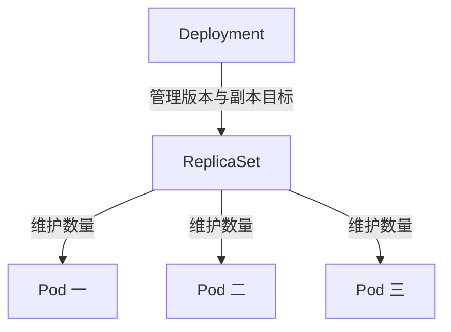

# 09 Deployment、ReplicaSet 与 Pod

看懂应用副本的三层管理关系。



## 核心要点

- **1. 图中最上面为什么是 Deployment？** 日常部署可互换的 Web 或 API 副本时，通常直接创建 Deployment。它描述应用如何运行和更新，并管理 ReplicaSet。
- **2. ReplicaSet 的角色是什么？** 它努力维持一组符合条件的 Pod 达到目标数量。Pod 真正运行容器，ReplicaSet 本身不是业务程序实例。
- **3. replicas、selector 和 template 怎么对应？** replicas 是数量目标；selector.matchLabels 是匹配条件；template 是创建新 Pod 的模板，模板标签必须符合选择条件。
- **4. 为什么不手工管理每一个 Pod？** 控制器可以用同一个模板创建替代实例，并协调数量变化。手工 Pod 难以持续保证副本数量，也缺少 Deployment 的更新管理。
- **5. Service 在这个链条里创建 Pod 吗？** 不会。创建和管理副本是工作负载控制器的职责，访问入口属于另一组关系，后面单独学习。

## 场景与示例

**创建 web Deployment**

示例声明三个 nginx 副本，Pod 标签为 app=web。apply 后用 get deployment、get rs 和 get pods 分别查看三层对象。

文件：`examples/02-deployment.yaml`

```yaml
apiVersion: apps/v1
kind: Deployment
metadata:
  name: web
  namespace: k8s-learn
spec:
  replicas: 3
  selector:
    matchLabels:
      app: web
  template:
    metadata:
      labels:
        app: web
    spec:
      containers:
        - name: web
          image: nginx:1.27
          ports:
            - containerPort: 80
          readinessProbe:
            httpGet:
              path: /
              port: 80
            initialDelaySeconds: 2
            periodSeconds: 3
```

```bash
kubectl apply -f examples/02-deployment.yaml
kubectl get deployment,rs,pods -n k8s-learn
```

补充：readinessProbe 检查根路径 HTTP 响应，帮助区分容器运行与可接收流量；不代表已覆盖应用全部业务健康条件。

## 常见误区

**Deployment 就是正在处理请求的一个容器**

Deployment 是资源声明和管理对象，真正执行应用的是它管理的 Pod 中的容器。

## 学习衔接与来源

下一章：扩缩容与滚动更新。

本章以用户提供的 Kubernetes 教程为基础进行教学重组。所有完整 YAML、命令与实验步骤均为补充示例，不是原文中保留下来的代码。

---

## 本章测验

本章共 5 道单项选择题，每题 1 分。先自行选择，再展开答案；支持互动的播放器应在提交后判题。

### 第 1 题

普通可互换的 Web 副本通常由什么管理？

- A. ConfigMap
- B. Deployment
- C. PV
- D. CoreDNS

<details>
<summary>选择完成后展开答案</summary>

正确答案：B

答案解析：Deployment 适合可互换长期应用副本，配置和存储资源不管理副本。

</details>

### 第 2 题

三层关系正确的是哪项？

- A. Pod 管理 Deployment，Deployment 管理 Node
- B. Service 创建 ReplicaSet，ReplicaSet 创建 etcd
- C. Node 创建 Helm，Helm 创建 API Server
- D. Deployment 管理 ReplicaSet，ReplicaSet 管理 Pod

<details>
<summary>选择完成后展开答案</summary>

正确答案：D

答案解析：Deployment 管理 ReplicaSet，ReplicaSet 维护 Pod 数量，Pod 运行容器。

</details>

### 第 3 题

template 的作用是什么？

- A. 记录 HTTP 请求历史
- B. 声明整个集群节点数量
- C. 定义新 Pod 的配置
- D. 保存所有镜像文件

<details>
<summary>选择完成后展开答案</summary>

正确答案：C

答案解析：template 定义新 Pod 配置，而非请求记录或集群节点数。

</details>

### 第 4 题

selector 为 app=web 时，模板标签应怎样设置？

- A. 包含 app=web
- B. 只能包含 app=api
- C. 删除所有标签
- D. 使用 Node 名称代替标签

<details>
<summary>选择完成后展开答案</summary>

正确答案：A

答案解析：模板标签应符合 selector；app=web 的选择条件需要相应标签。

</details>

### 第 5 题

Deployment 与 Service 的职责有什么区别？

- A. 两者都负责保存数据库文件
- B. 前者只负责 DNS，后者负责副本
- C. Service 是 Deployment 的容器
- D. 前者管理副本，后者提供访问抽象

<details>
<summary>选择完成后展开答案</summary>

正确答案：D

答案解析：Deployment 管理工作负载，Service 提供访问关系，两者职责不同。

</details>

<!-- QUIZ_DATA_START
{
  "chapter": "09",
  "questions": [
    {
      "id": 1,
      "question": "普通可互换的 Web 副本通常由什么管理？",
      "options": {
        "A": "ConfigMap",
        "B": "Deployment",
        "C": "PV",
        "D": "CoreDNS"
      },
      "answer": "B",
      "explanation": "Deployment 适合可互换长期应用副本，配置和存储资源不管理副本。"
    },
    {
      "id": 2,
      "question": "三层关系正确的是哪项？",
      "options": {
        "A": "Pod 管理 Deployment，Deployment 管理 Node",
        "B": "Service 创建 ReplicaSet，ReplicaSet 创建 etcd",
        "C": "Node 创建 Helm，Helm 创建 API Server",
        "D": "Deployment 管理 ReplicaSet，ReplicaSet 管理 Pod"
      },
      "answer": "D",
      "explanation": "Deployment 管理 ReplicaSet，ReplicaSet 维护 Pod 数量，Pod 运行容器。"
    },
    {
      "id": 3,
      "question": "template 的作用是什么？",
      "options": {
        "A": "记录 HTTP 请求历史",
        "B": "声明整个集群节点数量",
        "C": "定义新 Pod 的配置",
        "D": "保存所有镜像文件"
      },
      "answer": "C",
      "explanation": "template 定义新 Pod 配置，而非请求记录或集群节点数。"
    },
    {
      "id": 4,
      "question": "selector 为 app=web 时，模板标签应怎样设置？",
      "options": {
        "A": "包含 app=web",
        "B": "只能包含 app=api",
        "C": "删除所有标签",
        "D": "使用 Node 名称代替标签"
      },
      "answer": "A",
      "explanation": "模板标签应符合 selector；app=web 的选择条件需要相应标签。"
    },
    {
      "id": 5,
      "question": "Deployment 与 Service 的职责有什么区别？",
      "options": {
        "A": "两者都负责保存数据库文件",
        "B": "前者只负责 DNS，后者负责副本",
        "C": "Service 是 Deployment 的容器",
        "D": "前者管理副本，后者提供访问抽象"
      },
      "answer": "D",
      "explanation": "Deployment 管理工作负载，Service 提供访问关系，两者职责不同。"
    }
  ]
}
QUIZ_DATA_END -->
