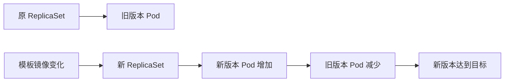

# 10 扩缩容与滚动更新

把数量调整和版本替换区分开，并理解可用性的条件。



## 核心要点

- **1. 把副本数改为五，发生的是版本更新吗？** 不是。扩缩容改变数量目标，控制器增加或减少 Pod；如果 Pod 模板没有变化，它们仍使用原来的版本配置。
- **2. 什么时候会触发 Deployment 的新一轮版本发布？** Pod 模板发生变化，例如容器镜像更新。Deployment 会创建新的 ReplicaSet，并按照滚动更新策略逐渐替换旧版本。
- **3. 为什么新旧版本会短时间共存？** 滚动更新需要逐步增加新副本，再逐步减少旧副本。图中展示的是概念过程，具体数量由更新策略和副本目标决定。
- **4. 滚动更新一定没有中断吗？** 不能保证。新版本必须正常启动并通过就绪检测，还要有适合的可用副本配置；“逐步替换”本身不是业务零中断承诺。
- **5. 怎么确认更新进度？** 使用 rollout status 查看发布是否完成；get pods 看实际实例。set image 和 scale 是临时修改声明的命令，后续仍要同步维护 YAML 文件。

## 场景与示例

**先扩容再更换教学镜像**

scale 将 web 的副本改为五；set image 将容器 web 的教学标签从 nginx:1.27 改为 nginx:1.28；rollout status 等待发布结果。示例标签不代表最新版。

```bash
kubectl scale deployment web --replicas=5 -n k8s-learn
kubectl set image deployment/web web=nginx:1.28 -n k8s-learn
kubectl rollout status deployment/web -n k8s-learn
kubectl get pods -n k8s-learn
```

## 常见误区

**只要出现新 ReplicaSet，就证明全部新 Pod 已可用**

ReplicaSet 创建和应用发布完成是两个阶段，要继续观察就绪与 rollout 状态。

## 学习衔接与来源

下一章：Service 的稳定入口与标签选择。

本章以用户提供的 Kubernetes 教程为基础进行教学重组。所有完整 YAML、命令与实验步骤均为补充示例，不是原文中保留下来的代码。

---

## 本章测验

本章共 5 道单项选择题，每题 1 分。先自行选择，再展开答案；支持互动的播放器应在提交后判题。

### 第 1 题

scale 主要调整什么？

- A. 镜像仓库地址的 DNS
- B. API 版本
- C. 目标副本数量
- D. PVC 回收策略

<details>
<summary>选择完成后展开答案</summary>

正确答案：C

答案解析：scale 改变数量目标，不改变镜像或 API 版本。

</details>

### 第 2 题

哪种变化通常触发新 ReplicaSet？

- A. Pod 模板镜像变化
- B. 只查询 Pod 列表
- C. 只读取容器日志
- D. 只查看 Namespace

<details>
<summary>选择完成后展开答案</summary>

正确答案：A

答案解析：模板镜像变化会引发发布，读取列表或日志不会改变模板。

</details>

### 第 3 题

滚动更新的典型过程是什么？

- A. 必须先删除全部旧副本
- B. 必须在每个 Pod 内覆盖镜像
- C. 只修改 Service 名称
- D. 逐步增加新副本并减少旧副本

<details>
<summary>选择完成后展开答案</summary>

正确答案：D

答案解析：滚动更新逐步增加新副本并减少旧副本，不要求先删全部旧副本。

</details>

### 第 4 题

新版本没有准备接收流量，发布要关注什么？

- A. Markdown 文件编号
- B. 应用启动与就绪检测
- C. Pod 名称长度
- D. 本地终端字体

<details>
<summary>选择完成后展开答案</summary>

正确答案：B

答案解析：不中断需要新应用正常启动、就绪与适当可用副本条件。

</details>

### 第 5 题

怎样较直接地查看 web 发布是否完成？

- A. kubectl rollout status deployment/web
- B. kubectl get configmap web
- C. kubectl logs namespace/web
- D. kubectl apply --rollout-only web

<details>
<summary>选择完成后展开答案</summary>

正确答案：A

答案解析：rollout status 直接观察 Deployment 发布进度，其他命令用途不同。

</details>

<!-- QUIZ_DATA_START
{
  "chapter": "10",
  "questions": [
    {
      "id": 1,
      "question": "scale 主要调整什么？",
      "options": {
        "A": "镜像仓库地址的 DNS",
        "B": "API 版本",
        "C": "目标副本数量",
        "D": "PVC 回收策略"
      },
      "answer": "C",
      "explanation": "scale 改变数量目标，不改变镜像或 API 版本。"
    },
    {
      "id": 2,
      "question": "哪种变化通常触发新 ReplicaSet？",
      "options": {
        "A": "Pod 模板镜像变化",
        "B": "只查询 Pod 列表",
        "C": "只读取容器日志",
        "D": "只查看 Namespace"
      },
      "answer": "A",
      "explanation": "模板镜像变化会引发发布，读取列表或日志不会改变模板。"
    },
    {
      "id": 3,
      "question": "滚动更新的典型过程是什么？",
      "options": {
        "A": "必须先删除全部旧副本",
        "B": "必须在每个 Pod 内覆盖镜像",
        "C": "只修改 Service 名称",
        "D": "逐步增加新副本并减少旧副本"
      },
      "answer": "D",
      "explanation": "滚动更新逐步增加新副本并减少旧副本，不要求先删全部旧副本。"
    },
    {
      "id": 4,
      "question": "新版本没有准备接收流量，发布要关注什么？",
      "options": {
        "A": "Markdown 文件编号",
        "B": "应用启动与就绪检测",
        "C": "Pod 名称长度",
        "D": "本地终端字体"
      },
      "answer": "B",
      "explanation": "不中断需要新应用正常启动、就绪与适当可用副本条件。"
    },
    {
      "id": 5,
      "question": "怎样较直接地查看 web 发布是否完成？",
      "options": {
        "A": "kubectl rollout status deployment/web",
        "B": "kubectl get configmap web",
        "C": "kubectl logs namespace/web",
        "D": "kubectl apply --rollout-only web"
      },
      "answer": "A",
      "explanation": "rollout status 直接观察 Deployment 发布进度，其他命令用途不同。"
    }
  ]
}
QUIZ_DATA_END -->
