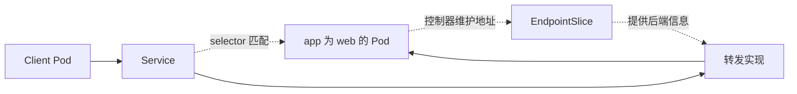

# 11 Service 的稳定入口与标签选择

理解 Service 为什么不会直接绑定 Deployment。



## 核心要点

- **1. Pod IP 会变化，客户端该找谁？** 客户端通常访问 Service 提供的稳定入口。Service 表达后端访问抽象，后端 Pod 可以替换，客户端不用逐个记住 Pod IP。
- **2. Service 是直接绑定一个 Deployment 吗？** 通常不是。带 selector 的 Service 根据 Pod 标签寻找后端，即使 Pod 由不同控制器创建，只要条件符合也可能被选中。
- **3. EndpointSlice 为什么在图中？** 相关控制器维护后端端点信息，EndpointSlice 记录这些网络地址和条件。转发实现依据后端信息把请求送到合适实例。
- **4. 标签匹配就说明马上能接收业务流量吗？** 还需要考虑就绪状态等端点条件。默认场景中，应让准备好的后端接收流量，不要把标签匹配等同于业务服务已经正常。
- **5. Service 能负责把少掉的 Pod 补回来吗？** 不能。它负责访问抽象，工作负载控制器才负责创建和维护副本。入口存在，也可能暂时没有可用后端。

## 场景与示例

**给 app=web 的 Pod 一个入口**

创建 selector 为 app=web 的 web-service，再查询 Service 和 EndpointSlice。观察的是资源及后端对应关系，不是声称 Service 内有一个专门的业务进程。

文件：`examples/03-service.yaml`

```yaml
apiVersion: v1
kind: Service
metadata:
  name: web-service
  namespace: k8s-learn
spec:
  type: ClusterIP
  selector:
    app: web
  ports:
    - port: 80
      targetPort: 80
      protocol: TCP
```

```bash
kubectl apply -f examples/03-service.yaml
kubectl get service web-service -n k8s-learn
kubectl get endpointslices -n k8s-learn -l kubernetes.io/service-name=web-service
```

## 常见误区

**Service 就是运行 Web 程序的那个容器**

Kubernetes Service 是网络资源；Web 程序运行在 Pod 容器里，两者不是同一个对象。

## 学习衔接与来源

下一章：Service 端口与四种类型。

本章以用户提供的 Kubernetes 教程为基础进行教学重组。所有完整 YAML、命令与实验步骤均为补充示例，不是原文中保留下来的代码。

---

## 本章测验

本章共 5 道单项选择题，每题 1 分。先自行选择，再展开答案；支持互动的播放器应在提交后判题。

### 第 1 题

Service 主要提供什么？

- A. 永久的业务文件备份
- B. 镜像编译功能
- C. 容器进程的启动脚本
- D. 稳定的后端访问抽象

<details>
<summary>选择完成后展开答案</summary>

正确答案：D

答案解析：Service 提供稳定访问抽象，不保存备份或编译应用。

</details>

### 第 2 题

带 selector 的 Service 通常根据什么选择后端？

- A. Deployment 文件名
- B. Pod Label
- C. 镜像下载时间
- D. Node CPU 型号

<details>
<summary>选择完成后展开答案</summary>

正确答案：B

答案解析：带 selector 的 Service 依据 Pod 标签选择后端，不依据文件名。

</details>

### 第 3 题

EndpointSlice 主要记录什么？

- A. Service 后端网络端点信息
- B. 应用源码
- C. 镜像全部文件
- D. 用户浏览器 Cookie

<details>
<summary>选择完成后展开答案</summary>

正确答案：A

答案解析：EndpointSlice 记录端点地址与条件，不存储源码或镜像文件。

</details>

### 第 4 题

Pod 标签为 app=api，但 Service 选择 app=web，会怎样？

- A. Service 自动修改它的标签
- B. Service 自动创建 API 容器
- C. 该 Pod 不符合此选择条件
- D. Deployment 自动改名为 web

<details>
<summary>选择完成后展开答案</summary>

正确答案：C

答案解析：标签 app=api 不满足 app=web 条件，Service 不自动修改标签。

</details>

### 第 5 题

Service 存在但没有可用后端，能否据此保证访问成功？

- A. 能，Service 自己处理业务
- B. 不能，需要实际可用端点
- C. 能，etcd 会代替应用响应
- D. 能，Service 自动补齐全部 Pod

<details>
<summary>选择完成后展开答案</summary>

正确答案：B

答案解析：入口资源可存在而无可用后端；Service 不自行处理业务或补 Pod。

</details>

<!-- QUIZ_DATA_START
{
  "chapter": "11",
  "questions": [
    {
      "id": 1,
      "question": "Service 主要提供什么？",
      "options": {
        "A": "永久的业务文件备份",
        "B": "镜像编译功能",
        "C": "容器进程的启动脚本",
        "D": "稳定的后端访问抽象"
      },
      "answer": "D",
      "explanation": "Service 提供稳定访问抽象，不保存备份或编译应用。"
    },
    {
      "id": 2,
      "question": "带 selector 的 Service 通常根据什么选择后端？",
      "options": {
        "A": "Deployment 文件名",
        "B": "Pod Label",
        "C": "镜像下载时间",
        "D": "Node CPU 型号"
      },
      "answer": "B",
      "explanation": "带 selector 的 Service 依据 Pod 标签选择后端，不依据文件名。"
    },
    {
      "id": 3,
      "question": "EndpointSlice 主要记录什么？",
      "options": {
        "A": "Service 后端网络端点信息",
        "B": "应用源码",
        "C": "镜像全部文件",
        "D": "用户浏览器 Cookie"
      },
      "answer": "A",
      "explanation": "EndpointSlice 记录端点地址与条件，不存储源码或镜像文件。"
    },
    {
      "id": 4,
      "question": "Pod 标签为 app=api，但 Service 选择 app=web，会怎样？",
      "options": {
        "A": "Service 自动修改它的标签",
        "B": "Service 自动创建 API 容器",
        "C": "该 Pod 不符合此选择条件",
        "D": "Deployment 自动改名为 web"
      },
      "answer": "C",
      "explanation": "标签 app=api 不满足 app=web 条件，Service 不自动修改标签。"
    },
    {
      "id": 5,
      "question": "Service 存在但没有可用后端，能否据此保证访问成功？",
      "options": {
        "A": "能，Service 自己处理业务",
        "B": "不能，需要实际可用端点",
        "C": "能，etcd 会代替应用响应",
        "D": "能，Service 自动补齐全部 Pod"
      },
      "answer": "B",
      "explanation": "入口资源可存在而无可用后端；Service 不自行处理业务或补 Pod。"
    }
  ]
}
QUIZ_DATA_END -->
