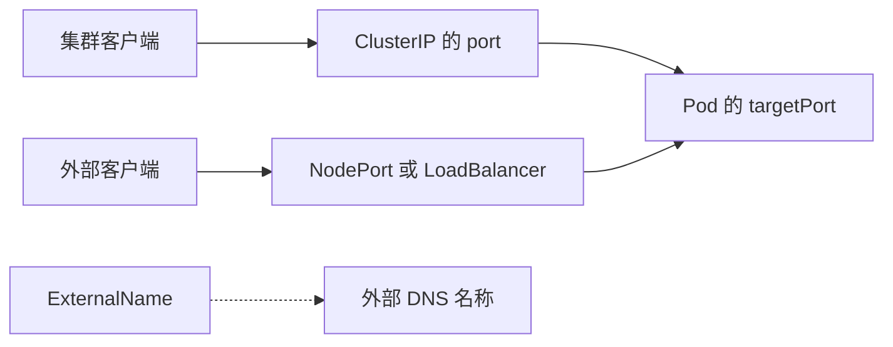

# 12 Service 端口与四种类型

区分服务端口、容器端口以及内部和外部入口。



## 核心要点

- **1. port 和 targetPort 为什么可以不同？** port 是 Service 暴露的端口，targetPort 是后端接收请求的端口。例如 Service 的八十端口可以转到监听八零八零端口的应用。
- **2. ClusterIP 用在什么场景？** 它是默认 Service 类型，通常用于集群内部访问。Web 调 API、API 访问数据库，都可以使用这类入口。
- **3. NodePort 从外部怎样访问？** 通过可达的节点 IP 与分配的节点端口访问，前提是地址和网络端口确实可达。请求可以转发到其他节点上的合适 Pod。
- **4. LoadBalancer 会自动给所有环境一个公网 IP 吗？** 不会。它依赖云平台或负载均衡控制器的支持，入口是否公网还取决于实际配置，本地实验集群可能没有现成实现。
- **5. ExternalName 和另外几种有什么不同？** 它把服务名称映射到外部 DNS 名称，主要体现为 DNS 别名，不按普通 ClusterIP 的方式转发到选中的 Pod。

## 场景与示例

**应用监听 8080，内部入口希望使用 80**

Service 声明 port 为八十、targetPort 为八零八零；这要求后端程序真的监听八零八零。主线实验中的 nginx 仍监听八十，不要混用这两组配置。

独立端口映射片段，假设应用已监听 8080；不是主线 Nginx 实验配置：

```yaml
ports:
  - port: 80
    targetPort: 8080
    protocol: TCP
```

| 类型 | 入口或行为 | 关键条件 |
| --- | --- | --- |
| ClusterIP | 集群内部入口 | 后端可用 |
| NodePort | 节点地址加端口 | 节点地址与端口可达 |
| LoadBalancer | 外部负载均衡入口 | 有支持实现，公网或私网由配置决定 |
| ExternalName | 外部名称的 DNS 别名 | 外部名称可解析 |

## 常见误区

**声明 LoadBalancer 就一定立即获得公网地址**

基础设施实现和入口配置决定结果。资源声明和入口可达性需要分别确认。

## 学习衔接与来源

下一章：CoreDNS 与跨 Namespace 通信。

本章以用户提供的 Kubernetes 教程为基础进行教学重组。所有完整 YAML、命令与实验步骤均为补充示例，不是原文中保留下来的代码。

---

## 本章测验

本章共 5 道单项选择题，每题 1 分。先自行选择，再展开答案；支持互动的播放器应在提交后判题。

### 第 1 题

默认 Service 类型是什么？

- A. ClusterIP
- B. NodePort
- C. LoadBalancer
- D. ExternalName

<details>
<summary>选择完成后展开答案</summary>

正确答案：A

答案解析：ClusterIP 是默认 Service 类型，用于典型内部访问。

</details>

### 第 2 题

port: 80、targetPort: 8080 表示什么？

- A. Pod 80 转至 Service 8080
- B. Node 固定开放 8080
- C. Service 80 转至后端 8080
- D. 程序自动改为监听 80

<details>
<summary>选择完成后展开答案</summary>

正确答案：C

答案解析：port 是服务端口，targetPort 是后端端口，程序仍需实际监听。

</details>

### 第 3 题

外部通过节点地址加指定节点端口访问，常对应什么类型？

- A. ClusterIP
- B. NodePort
- C. ExternalName
- D. Headless 作为独立类型

<details>
<summary>选择完成后展开答案</summary>

正确答案：B

答案解析：NodePort 通过可达节点地址及节点端口提供入口。

</details>

### 第 4 题

本地创建 LoadBalancer 后没有外部入口，首先应核对什么前提？

- A. 是否把 kind 改为 Pod
- B. 是否删除所有标签
- C. 是否把 nginx 文件改为 JSON
- D. 是否有支持它的负载均衡实现

<details>
<summary>选择完成后展开答案</summary>

正确答案：D

答案解析：LoadBalancer 需要支持实现，声明本身不保证本地获得外部地址。

</details>

### 第 5 题

ExternalName 主要提供哪项功能？

- A. 直接维持应用副本
- B. 自动创建云磁盘
- C. 映射外部 DNS 名称
- D. 自动复制数据库

<details>
<summary>选择完成后展开答案</summary>

正确答案：C

答案解析：ExternalName 提供 DNS 别名，不维护副本或自动创建磁盘。

</details>

<!-- QUIZ_DATA_START
{
  "chapter": "12",
  "questions": [
    {
      "id": 1,
      "question": "默认 Service 类型是什么？",
      "options": {
        "A": "ClusterIP",
        "B": "NodePort",
        "C": "LoadBalancer",
        "D": "ExternalName"
      },
      "answer": "A",
      "explanation": "ClusterIP 是默认 Service 类型，用于典型内部访问。"
    },
    {
      "id": 2,
      "question": "port: 80、targetPort: 8080 表示什么？",
      "options": {
        "A": "Pod 80 转至 Service 8080",
        "B": "Node 固定开放 8080",
        "C": "Service 80 转至后端 8080",
        "D": "程序自动改为监听 80"
      },
      "answer": "C",
      "explanation": "port 是服务端口，targetPort 是后端端口，程序仍需实际监听。"
    },
    {
      "id": 3,
      "question": "外部通过节点地址加指定节点端口访问，常对应什么类型？",
      "options": {
        "A": "ClusterIP",
        "B": "NodePort",
        "C": "ExternalName",
        "D": "Headless 作为独立类型"
      },
      "answer": "B",
      "explanation": "NodePort 通过可达节点地址及节点端口提供入口。"
    },
    {
      "id": 4,
      "question": "本地创建 LoadBalancer 后没有外部入口，首先应核对什么前提？",
      "options": {
        "A": "是否把 kind 改为 Pod",
        "B": "是否删除所有标签",
        "C": "是否把 nginx 文件改为 JSON",
        "D": "是否有支持它的负载均衡实现"
      },
      "answer": "D",
      "explanation": "LoadBalancer 需要支持实现，声明本身不保证本地获得外部地址。"
    },
    {
      "id": 5,
      "question": "ExternalName 主要提供哪项功能？",
      "options": {
        "A": "直接维持应用副本",
        "B": "自动创建云磁盘",
        "C": "映射外部 DNS 名称",
        "D": "自动复制数据库"
      },
      "answer": "C",
      "explanation": "ExternalName 提供 DNS 别名，不维护副本或自动创建磁盘。"
    }
  ]
}
QUIZ_DATA_END -->
