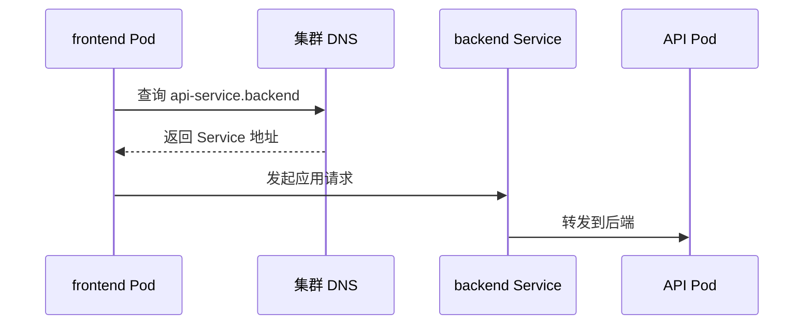

# 13 CoreDNS 与跨 Namespace 通信

用名字寻找 Service，并理解逻辑分组和网络通信的区别。



## 核心要点

- **1. 这个时序图为什么先查询 DNS？** 应用使用名称找入口时，需要名称解析。集群 DNS 常见实现是 CoreDNS，它把符合规则的 Service 名称解析成地址。
- **2. 同一个 Namespace 里怎么写服务名？** 通常直接使用短名，例如 web-service。完整名称还包含 Namespace、svc 和集群域名，便于理解解析结构。
- **3. 完整名称长什么样？** 例如 web-service.k8s-learn.svc.cluster.local。cluster.local 是常见集群域名，但并非所有集群都使用这个值。
- **4. frontend 里的 Pod 怎样找 backend 的 API？** 可以使用 api-service.backend，或采用实际集群域名的完整名称。图中先解析名字，再发送请求，这不是 DNS 在代理业务流量。
- **5. Namespace 不同是不是天然不能通信？** 不是。Namespace 划分逻辑资源空间，不自动阻止网络通信；网络是否允许还取决于其他网络控制配置。

## 场景与示例

**在实验集群内访问 web-service**

临时客户端 Pod 执行 wget，访问 http://web-service.k8s-learn.svc.cluster.local。示例假设集群域名为 cluster.local；如果集群改过域名，需要相应调整。

```bash
kubectl run dns-client -n k8s-learn --rm -i --restart=Never --image=busybox:1.37 -- wget -qO- http://web-service.k8s-learn.svc.cluster.local
```

## 常见误区

**CoreDNS 查出地址以后还替应用处理所有 HTTP 请求**

DNS 负责名称解析，后续应用流量走服务访问路径。

## 学习衔接与来源

下一章：Ingress 规则与 Controller。

本章以用户提供的 Kubernetes 教程为基础进行教学重组。所有完整 YAML、命令与实验步骤均为补充示例，不是原文中保留下来的代码。

---

## 本章测验

本章共 5 道单项选择题，每题 1 分。先自行选择，再展开答案；支持互动的播放器应在提交后判题。

### 第 1 题

CoreDNS 常承担什么职责？

- A. 应用副本更新
- B. 集群内名称解析
- C. 磁盘动态供给
- D. 容器镜像构建

<details>
<summary>选择完成后展开答案</summary>

正确答案：B

答案解析：CoreDNS 常提供集群 DNS 名称解析，不管理副本或磁盘。

</details>

### 第 2 题

同 Namespace 的 Service 通常可用什么访问？

- A. 仅能用公网域名
- B. 必须使用 Node 名称
- C. 必须使用镜像摘要
- D. Service 短名

<details>
<summary>选择完成后展开答案</summary>

正确答案：D

答案解析：同 Namespace 通常可用短名，跨空间可包含 Namespace。

</details>

### 第 3 题

api-service.backend 中 backend 表示什么？

- A. 容器运行时
- B. Service 协议
- C. 目标 Namespace
- D. 应用镜像标签

<details>
<summary>选择完成后展开答案</summary>

正确答案：C

答案解析：backend 指目标资源空间，不是协议或镜像版本。

</details>

### 第 4 题

frontend Pod 访问 backend Service，应怎样理解？

- A. 跨 Namespace 通信可能允许
- B. 不同 Namespace 天然禁止通信
- C. DNS 会把两个 Namespace 合并
- D. 必须把 Service 改成 Deployment

<details>
<summary>选择完成后展开答案</summary>

正确答案：A

答案解析：Namespace 不天然阻止通信，其他网络策略和配置会影响结果。

</details>

### 第 5 题

关于 cluster.local，哪项正确？

- A. 是所有 Service 固定公网域名
- B. 是必须写死的 Node 名称
- C. 是 kubelet 的容器镜像
- D. 是常见但可配置的集群域名

<details>
<summary>选择完成后展开答案</summary>

正确答案：D

答案解析：cluster.local 是常见可配置域名，不是固定公网域名。

</details>

<!-- QUIZ_DATA_START
{
  "chapter": "13",
  "questions": [
    {
      "id": 1,
      "question": "CoreDNS 常承担什么职责？",
      "options": {
        "A": "应用副本更新",
        "B": "集群内名称解析",
        "C": "磁盘动态供给",
        "D": "容器镜像构建"
      },
      "answer": "B",
      "explanation": "CoreDNS 常提供集群 DNS 名称解析，不管理副本或磁盘。"
    },
    {
      "id": 2,
      "question": "同 Namespace 的 Service 通常可用什么访问？",
      "options": {
        "A": "仅能用公网域名",
        "B": "必须使用 Node 名称",
        "C": "必须使用镜像摘要",
        "D": "Service 短名"
      },
      "answer": "D",
      "explanation": "同 Namespace 通常可用短名，跨空间可包含 Namespace。"
    },
    {
      "id": 3,
      "question": "api-service.backend 中 backend 表示什么？",
      "options": {
        "A": "容器运行时",
        "B": "Service 协议",
        "C": "目标 Namespace",
        "D": "应用镜像标签"
      },
      "answer": "C",
      "explanation": "backend 指目标资源空间，不是协议或镜像版本。"
    },
    {
      "id": 4,
      "question": "frontend Pod 访问 backend Service，应怎样理解？",
      "options": {
        "A": "跨 Namespace 通信可能允许",
        "B": "不同 Namespace 天然禁止通信",
        "C": "DNS 会把两个 Namespace 合并",
        "D": "必须把 Service 改成 Deployment"
      },
      "answer": "A",
      "explanation": "Namespace 不天然阻止通信，其他网络策略和配置会影响结果。"
    },
    {
      "id": 5,
      "question": "关于 cluster.local，哪项正确？",
      "options": {
        "A": "是所有 Service 固定公网域名",
        "B": "是必须写死的 Node 名称",
        "C": "是 kubelet 的容器镜像",
        "D": "是常见但可配置的集群域名"
      },
      "answer": "D",
      "explanation": "cluster.local 是常见可配置域名，不是固定公网域名。"
    }
  ]
}
QUIZ_DATA_END -->
