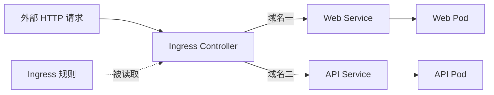

# 14 Ingress 规则与 Controller

区分 HTTP 路由规则和真正实现入口的程序。



## 核心要点

- **1. 多个域名为什么可以共用一个入口？** Ingress 描述基于域名或路径的 HTTP 路由规则。Controller 读取规则，把不同请求交给对应 Service，Service 再提供后端访问关系。
- **2. 只 apply Ingress YAML 可以吗？** 通常不够。必须有可用的 Controller，并让资源匹配它提供的 IngressClass；还要让外部地址和域名解析指向可访问入口。
- **3. 示例应该填哪个 ingressClassName？** 填写自己集群实际提供的类名，先用 get ingressclass 确认。示例用 learn-class 演示字段关系，不指定你安装某个实现，也不能直接假定该类已经存在。
- **4. SNMP 或任意 UDP 流量能套用这个例子吗？** 基础 Ingress API 主要面向 HTTP 和 HTTPS 路由。其他协议通常要选合适的 Service 暴露方式，不能把 HTTP 域名规则当成通用协议转发。
- **5. Gateway API 是什么关系？** 它是另一个入口路由 API 体系。Ingress API 已冻结但仍可使用，后续新入口设计可以继续学习 Gateway API；本章先掌握规则与实现的区别。

## 场景与示例

**www.example.com 交给 web-service**

示例使用 networking.k8s.io/v1、Prefix 路径和 Service 端口八十。域名是占位示例，Controller、IngressClass 与外部解析都需要预先配置。

```bash
kubectl get ingressclass
```

条件性示例：先将 learn-class 替换为已有类名，再配置域名与入口。

```yaml
apiVersion: networking.k8s.io/v1
kind: Ingress
metadata:
  name: web-entry
  namespace: k8s-learn
spec:
  ingressClassName: learn-class
  rules:
    - host: www.example.com
      http:
        paths:
          - path: /
            pathType: Prefix
            backend:
              service:
                name: web-service
                port:
                  number: 80
```

IngressClass 指定实际 Controller。资源有效不等于外部域名已解析或入口已开放。

## 常见误区

**Ingress 资源本身就是一个已运行的反向代理**

Ingress 是规则对象；转发由 Controller 及其相关数据路径实现。

## 学习衔接与来源

下一章：Namespace、Label 与 Selector。

本章以用户提供的 Kubernetes 教程为基础进行教学重组。所有完整 YAML、命令与实验步骤均为补充示例，不是原文中保留下来的代码。补充核对依据：[官方文档](https://kubernetes.io/docs/concepts/services-networking/ingress/)。

---

## 本章测验

本章共 5 道单项选择题，每题 1 分。先自行选择，再展开答案；支持互动的播放器应在提交后判题。

### 第 1 题

Ingress 资源主要描述什么？

- A. 容器镜像构建参数
- B. 节点副本数
- C. HTTP 路由规则
- D. 数据库备份时间

<details>
<summary>选择完成后展开答案</summary>

正确答案：C

答案解析：Ingress 描述 HTTP 路由规则，不定义副本或存储。

</details>

### 第 2 题

实际读取 Ingress 并实现入口的是谁？

- A. Ingress Controller
- B. etcd
- C. PVC
- D. Job

<details>
<summary>选择完成后展开答案</summary>

正确答案：A

答案解析：Controller 读取规则并实现入口，单独资源不等于运行代理。

</details>

### 第 3 题

ingressClassName 应怎样选择？

- A. 永远填任意字符串都能工作
- B. 必须填 Deployment 名称
- C. 必须填 Pod IP
- D. 匹配集群实际可用的类名

<details>
<summary>选择完成后展开答案</summary>

正确答案：D

答案解析：类名需匹配实际可用 IngressClass，任意字符串无法保证生效。

</details>

### 第 4 题

只有 Ingress YAML，域名却不可访问，哪项前提必须核对？

- A. 容器文件名是否两位数字
- B. Controller、类与入口解析是否配置
- C. Secret 是否叫 ingress
- D. ReplicaSet 是否等于域名

<details>
<summary>选择完成后展开答案</summary>

正确答案：B

答案解析：Controller、类匹配、外部入口和 DNS 都影响可达性。

</details>

### 第 5 题

关于协议范围，哪项准确？

- A. 基础 Ingress 主要用于 HTTP 与 HTTPS
- B. 基础 Ingress 自动覆盖所有 UDP
- C. 所有 TCP 流量必须使用 Ingress
- D. NodePort 只支持网页路径匹配

<details>
<summary>选择完成后展开答案</summary>

正确答案：A

答案解析：基础 Ingress API 面向 HTTP/HTTPS，其他协议需合适暴露机制。

</details>

<!-- QUIZ_DATA_START
{
  "chapter": "14",
  "questions": [
    {
      "id": 1,
      "question": "Ingress 资源主要描述什么？",
      "options": {
        "A": "容器镜像构建参数",
        "B": "节点副本数",
        "C": "HTTP 路由规则",
        "D": "数据库备份时间"
      },
      "answer": "C",
      "explanation": "Ingress 描述 HTTP 路由规则，不定义副本或存储。"
    },
    {
      "id": 2,
      "question": "实际读取 Ingress 并实现入口的是谁？",
      "options": {
        "A": "Ingress Controller",
        "B": "etcd",
        "C": "PVC",
        "D": "Job"
      },
      "answer": "A",
      "explanation": "Controller 读取规则并实现入口，单独资源不等于运行代理。"
    },
    {
      "id": 3,
      "question": "ingressClassName 应怎样选择？",
      "options": {
        "A": "永远填任意字符串都能工作",
        "B": "必须填 Deployment 名称",
        "C": "必须填 Pod IP",
        "D": "匹配集群实际可用的类名"
      },
      "answer": "D",
      "explanation": "类名需匹配实际可用 IngressClass，任意字符串无法保证生效。"
    },
    {
      "id": 4,
      "question": "只有 Ingress YAML，域名却不可访问，哪项前提必须核对？",
      "options": {
        "A": "容器文件名是否两位数字",
        "B": "Controller、类与入口解析是否配置",
        "C": "Secret 是否叫 ingress",
        "D": "ReplicaSet 是否等于域名"
      },
      "answer": "B",
      "explanation": "Controller、类匹配、外部入口和 DNS 都影响可达性。"
    },
    {
      "id": 5,
      "question": "关于协议范围，哪项准确？",
      "options": {
        "A": "基础 Ingress 主要用于 HTTP 与 HTTPS",
        "B": "基础 Ingress 自动覆盖所有 UDP",
        "C": "所有 TCP 流量必须使用 Ingress",
        "D": "NodePort 只支持网页路径匹配"
      },
      "answer": "A",
      "explanation": "基础 Ingress API 面向 HTTP/HTTPS，其他协议需合适暴露机制。"
    }
  ]
}
QUIZ_DATA_END -->
