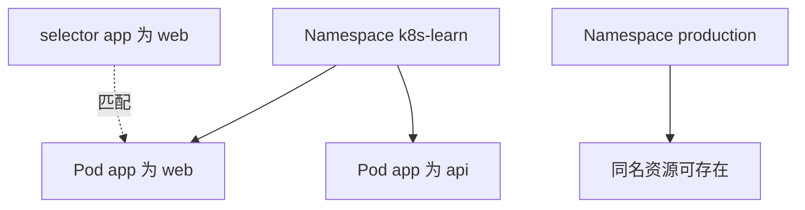

# 15 Namespace、Label 与 Selector

用逻辑空间和标签把资源组织起来，并避免选错后端。



## 核心要点

- **1. Namespace 最先解决什么问题？** 它划分逻辑资源空间，便于按团队、项目或环境管理。两个不同 Namespace 中可以存在同名的 Service。
- **2. 所有资源都有 Namespace 吗？** 不是。Pod、Deployment、Service 和 PVC 是常见命名空间资源；Node、PV 和 StorageClass 是集群范围资源。
- **3. Label 与资源名称有什么不同？** Label 是键值标签，用于分类和选择，一个资源可以有多个标签。名称识别对象，标签让一组对象满足相同选择条件。
- **4. selector 怎么判断是否匹配？** 例如 app=web 只匹配带有这个键值标签的对象。主线例子中 Deployment 模板标签和 Service selector 都使用 app=web，才能形成预期关系。
- **5. 不写 Namespace 时命令会到哪里？** 通常使用当前 kubectl 上下文的 Namespace，默认常为 default。实验命令统一写 -n k8s-learn，以减少操作和查询位置不一致的问题。

## 场景与示例

**查看一个 Namespace 中的标签**

kubectl get pods -n k8s-learn --show-labels 显示标签；再用 -l app=web 筛选。修改查询条件不会自动修改 Pod 标签。

```bash
kubectl get namespaces
kubectl get pods -n k8s-learn --show-labels
kubectl get pods -n k8s-learn -l app=web
```

## 常见误区

**Namespace 就是一套完全独立的集群**

它是集群内逻辑分组，不代表独立控制平面，也不天然阻止跨 Namespace 网络通信。

## 学习衔接与来源

下一章：ConfigMap 与配置注入。

本章以用户提供的 Kubernetes 教程为基础进行教学重组。所有完整 YAML、命令与实验步骤均为补充示例，不是原文中保留下来的代码。

---

## 本章测验

本章共 5 道单项选择题，每题 1 分。先自行选择，再展开答案；支持互动的播放器应在提交后判题。

### 第 1 题

Namespace 的基本作用是什么？

- A. 创建独立容器运行时
- B. 替代集群控制平面
- C. 固定 Pod IP
- D. 划分逻辑资源空间

<details>
<summary>选择完成后展开答案</summary>

正确答案：D

答案解析：Namespace 是逻辑资源空间，不建立独立控制平面。

</details>

### 第 2 题

哪个资源通常是集群范围的？

- A. Pod
- B. PV
- C. ConfigMap
- D. PVC

<details>
<summary>选择完成后展开答案</summary>

正确答案：B

答案解析：PV 是集群范围资源；Pod、ConfigMap、PVC 属于 Namespace。

</details>

### 第 3 题

Label 的形式通常是什么？

- A. 键值对
- B. 完整容器文件系统
- C. 节点登录口令
- D. 固定公网地址

<details>
<summary>选择完成后展开答案</summary>

正确答案：A

答案解析：Label 是分类键值对，一个资源可有多个标签。

</details>

### 第 4 题

只查询 app=web 的 Pod，应增加什么条件？

- A. --image=web
- B. --kind=label
- C. -l app=web
- D. --port=web

<details>
<summary>选择完成后展开答案</summary>

正确答案：C

答案解析：-l app=web 按标签过滤查询，不修改资源标签。

</details>

### 第 5 题

两个 Namespace 中都存在 web-service，怎样理解？

- A. 一定是重复创建错误
- B. 可存在同名资源，所属空间不同
- C. 两者必须共享同一 Pod
- D. 其中一个自动删除另一个

<details>
<summary>选择完成后展开答案</summary>

正确答案：B

答案解析：不同 Namespace 中可有同名资源，完整身份包含所属空间。

</details>

<!-- QUIZ_DATA_START
{
  "chapter": "15",
  "questions": [
    {
      "id": 1,
      "question": "Namespace 的基本作用是什么？",
      "options": {
        "A": "创建独立容器运行时",
        "B": "替代集群控制平面",
        "C": "固定 Pod IP",
        "D": "划分逻辑资源空间"
      },
      "answer": "D",
      "explanation": "Namespace 是逻辑资源空间，不建立独立控制平面。"
    },
    {
      "id": 2,
      "question": "哪个资源通常是集群范围的？",
      "options": {
        "A": "Pod",
        "B": "PV",
        "C": "ConfigMap",
        "D": "PVC"
      },
      "answer": "B",
      "explanation": "PV 是集群范围资源；Pod、ConfigMap、PVC 属于 Namespace。"
    },
    {
      "id": 3,
      "question": "Label 的形式通常是什么？",
      "options": {
        "A": "键值对",
        "B": "完整容器文件系统",
        "C": "节点登录口令",
        "D": "固定公网地址"
      },
      "answer": "A",
      "explanation": "Label 是分类键值对，一个资源可有多个标签。"
    },
    {
      "id": 4,
      "question": "只查询 app=web 的 Pod，应增加什么条件？",
      "options": {
        "A": "--image=web",
        "B": "--kind=label",
        "C": "-l app=web",
        "D": "--port=web"
      },
      "answer": "C",
      "explanation": "-l app=web 按标签过滤查询，不修改资源标签。"
    },
    {
      "id": 5,
      "question": "两个 Namespace 中都存在 web-service，怎样理解？",
      "options": {
        "A": "一定是重复创建错误",
        "B": "可存在同名资源，所属空间不同",
        "C": "两者必须共享同一 Pod",
        "D": "其中一个自动删除另一个"
      },
      "answer": "B",
      "explanation": "不同 Namespace 中可有同名资源，完整身份包含所属空间。"
    }
  ]
}
QUIZ_DATA_END -->
