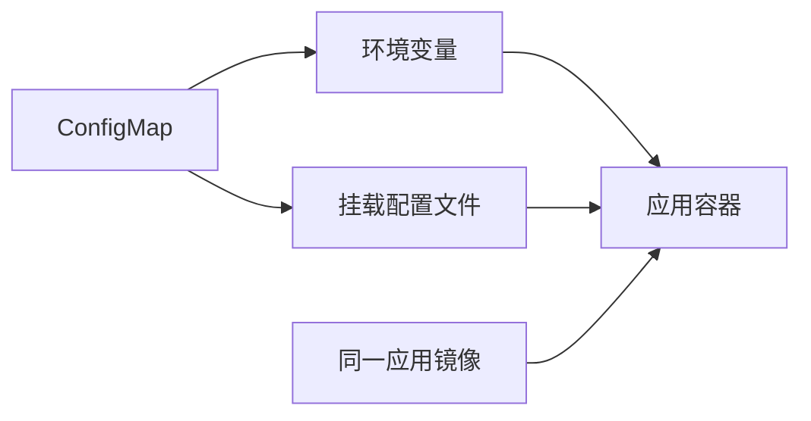

# 16 ConfigMap 与配置注入

让应用镜像与环境配置分开，并理解更新何时生效。



## 核心要点

- **1. 为什么不把数据库地址写死在镜像里？** 开发和生产环境的配置可能不同。ConfigMap 保存非敏感配置，让同一镜像在不同环境中读取不同参数。
- **2. ConfigMap 里适合放什么？** 日志级别、环境名称、非敏感服务地址等。密码和令牌属于另一类配置，不应该因为方便就混进普通配置示例。
- **3. 应用怎样拿到 ConfigMap？** 可以通过环境变量注入，也可以挂载为文件。示例使用 configMapKeyRef 精确引用 app-config 里的 LOG_LEVEL，而不是复制配置到镜像。
- **4. 改 ConfigMap 后，环境变量会马上变吗？** 已经运行的容器通常不会自动获得新的环境变量值。应让容器重新创建，再由应用启动时读取；更新资源与更新进程环境是两个动作。
- **5. 挂载文件是不是无条件立即生效？** 普通挂载文件可以最终更新，但不是立即保证，应用还要重新读取；使用 subPath 挂载时不会自动接收更新。应用是否热加载也需要单独考虑。

## 场景与示例

**为容器注入 LOG_LEVEL**

先创建 app-config，再在 Pod 或 Deployment 模板中引用 LOG_LEVEL。此引用只提供数据；程序必须自己读取环境变量才会改变日志行为。

```yaml
apiVersion: v1
kind: ConfigMap
metadata:
  name: app-config
  namespace: k8s-learn
data:
  LOG_LEVEL: "INFO"
  DB_HOST: "db-service"
```

Deployment 中 containers 列表某个容器的配置片段：

```yaml
env:
  - name: LOG_LEVEL
    valueFrom:
      configMapKeyRef:
        name: app-config
        key: LOG_LEVEL
```

引用不会自动改变 Nginx 的日志行为，应用须实际读取此键。

## 常见误区

**创建配置资源就会自动修改应用行为**

ConfigMap 提供配置，应用读取并使用配置；是否生效还取决于注入方式和程序行为。

## 学习衔接与来源

下一章：Secret 与敏感配置边界。

本章以用户提供的 Kubernetes 教程为基础进行教学重组。所有完整 YAML、命令与实验步骤均为补充示例，不是原文中保留下来的代码。补充核对依据：[官方文档](https://kubernetes.io/docs/concepts/configuration/configmap/)。

---

## 本章测验

本章共 5 道单项选择题，每题 1 分。先自行选择，再展开答案；支持互动的播放器应在提交后判题。

### 第 1 题

ConfigMap 适合保存什么？

- A. 非敏感应用配置
- B. 数据库备份文件
- C. 所有容器镜像层
- D. 节点运行时二进制

<details>
<summary>选择完成后展开答案</summary>

正确答案：A

答案解析：ConfigMap 用于非敏感应用配置，不是文件备份或镜像存储。

</details>

### 第 2 题

configMapKeyRef 的用途是什么？

- A. 给 Pod 分配节点
- B. 创建 Service 后端
- C. 引用 ConfigMap 中某个键
- D. 加密应用密码

<details>
<summary>选择完成后展开答案</summary>

正确答案：C

答案解析：configMapKeyRef 引用指定对象中的键，不负责调度或加密。

</details>

### 第 3 题

通过环境变量注入后，更新配置通常怎样获得新值？

- A. 原进程环境变量立即改变
- B. 重新创建容器后读取
- C. 只重命名 Service
- D. 只查询一次 etcd

<details>
<summary>选择完成后展开答案</summary>

正确答案：B

答案解析：容器环境通常在启动时确定，配置变更需重新创建后读取。

</details>

### 第 4 题

ConfigMap 已有 LOG_LEVEL，但应用行为没变，哪项解释合理？

- A. ConfigMap 会自动改写源码
- B. 所有镜像都自动支持该键
- C. Service 必須转成 ExternalName
- D. 程序仍需读取并使用该配置

<details>
<summary>选择完成后展开答案</summary>

正确答案：D

答案解析：应用须读取并使用该键，配置资源不会自动改写程序行为。

</details>

### 第 5 题

关于配置文件挂载更新，哪项准确？

- A. 所有文件挂载都立即热更新
- B. 文件挂载等于环境变量实时变化
- C. 需考虑更新延迟、读取行为和 subPath 限制
- D. ConfigMap 无法挂载为文件

<details>
<summary>选择完成后展开答案</summary>

正确答案：C

答案解析：普通文件更新也有边界，subPath 不自动更新，应用须重新读取。

</details>

<!-- QUIZ_DATA_START
{
  "chapter": "16",
  "questions": [
    {
      "id": 1,
      "question": "ConfigMap 适合保存什么？",
      "options": {
        "A": "非敏感应用配置",
        "B": "数据库备份文件",
        "C": "所有容器镜像层",
        "D": "节点运行时二进制"
      },
      "answer": "A",
      "explanation": "ConfigMap 用于非敏感应用配置，不是文件备份或镜像存储。"
    },
    {
      "id": 2,
      "question": "configMapKeyRef 的用途是什么？",
      "options": {
        "A": "给 Pod 分配节点",
        "B": "创建 Service 后端",
        "C": "引用 ConfigMap 中某个键",
        "D": "加密应用密码"
      },
      "answer": "C",
      "explanation": "configMapKeyRef 引用指定对象中的键，不负责调度或加密。"
    },
    {
      "id": 3,
      "question": "通过环境变量注入后，更新配置通常怎样获得新值？",
      "options": {
        "A": "原进程环境变量立即改变",
        "B": "重新创建容器后读取",
        "C": "只重命名 Service",
        "D": "只查询一次 etcd"
      },
      "answer": "B",
      "explanation": "容器环境通常在启动时确定，配置变更需重新创建后读取。"
    },
    {
      "id": 4,
      "question": "ConfigMap 已有 LOG_LEVEL，但应用行为没变，哪项解释合理？",
      "options": {
        "A": "ConfigMap 会自动改写源码",
        "B": "所有镜像都自动支持该键",
        "C": "Service 必須转成 ExternalName",
        "D": "程序仍需读取并使用该配置"
      },
      "answer": "D",
      "explanation": "应用须读取并使用该键，配置资源不会自动改写程序行为。"
    },
    {
      "id": 5,
      "question": "关于配置文件挂载更新，哪项准确？",
      "options": {
        "A": "所有文件挂载都立即热更新",
        "B": "文件挂载等于环境变量实时变化",
        "C": "需考虑更新延迟、读取行为和 subPath 限制",
        "D": "ConfigMap 无法挂载为文件"
      },
      "answer": "C",
      "explanation": "普通文件更新也有边界，subPath 不自动更新，应用须重新读取。"
    }
  ]
}
QUIZ_DATA_END -->
