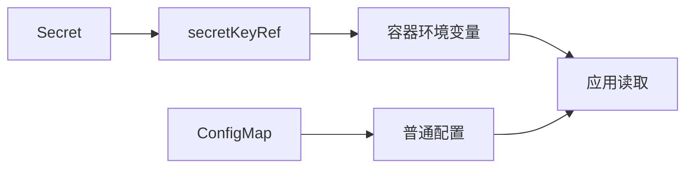

# 17 Secret 与敏感配置边界

学会引用敏感配置，同时避免把编码误认为加密。



## 核心要点

- **1. Secret 和 ConfigMap 的使用角色有什么区别？** Secret 用于密码、令牌等敏感配置；ConfigMap 用于普通配置。二者都能被容器引用，但用途和管理要求不同。
- **2. data 和 stringData 怎么理解？** data 的值使用 base64 表示，stringData 可以接受字符串，由 API 转换处理。字符串写法便于教学，但文件仍包含敏感信息。
- **3. base64 是否已经把密码加密了？** 不是。编码不是加密，Secret 默认也不是独立的加密保险箱；不能仅凭资源类型就认定密码被安全保护。
- **4. 引用 Secret 时密码会自动变成应用配置吗？** secretKeyRef 可以注入指定环境变量，例如 DB_PASSWORD。应用仍需读取并用于连接，引用本身不完成数据库连接或密码轮换。
- **5. 修改 Secret 后原来的进程环境会变吗？** 环境变量方式通常需要重新创建容器才能获得新值。教学示例使用演示密码，不应把它当成真实环境的口令。

## 场景与示例

**注入 DB_PASSWORD**

创建 db-secret，再通过 secretKeyRef 引用 password 键；示例只说明资源和环境变量关系，不执行真实数据库登录。

```yaml
apiVersion: v1
kind: Secret
metadata:
  name: db-secret
  namespace: k8s-learn
type: Opaque
stringData:
  password: "local-learning-only"
```

容器配置片段：

```yaml
env:
  - name: DB_PASSWORD
    valueFrom:
      secretKeyRef:
        name: db-secret
        key: password
```

这是公开的本地教学密码，不是生产配置。

## 常见误区

**Secret 的名字说明数据永远不可见**

Secret 是敏感数据资源，实际保护还依赖集群配置与访问管理，base64 不提供保密性。

## 学习衔接与来源

下一章：Volume 与 emptyDir 的生命周期。

本章以用户提供的 Kubernetes 教程为基础进行教学重组。所有完整 YAML、命令与实验步骤均为补充示例，不是原文中保留下来的代码。补充核对依据：[官方文档](https://kubernetes.io/docs/concepts/configuration/secret/)。

---

## 本章测验

本章共 5 道单项选择题，每题 1 分。先自行选择，再展开答案；支持互动的播放器应在提交后判题。

### 第 1 题

数据库口令通常放在哪种资源？

- A. Service
- B. Secret
- C. ReplicaSet
- D. NodePort

<details>
<summary>选择完成后展开答案</summary>

正确答案：B

答案解析：口令等敏感配置通常用 Secret，网络与副本资源用途不同。

</details>

### 第 2 题

stringData 的主要作用是什么？

- A. 自动生成数据库表
- B. 提供公网 DNS
- C. 分配容器资源
- D. 接受字符串形式的数据

<details>
<summary>选择完成后展开答案</summary>

正确答案：D

答案解析：stringData 接受字符串并由 API 转换，文件仍包含敏感值。

</details>

### 第 3 题

base64 表示什么？

- A. 默认强加密
- B. 数据库备份算法
- C. 编码方式
- D. 节点认证协议

<details>
<summary>选择完成后展开答案</summary>

正确答案：C

答案解析：base64 是编码，不能等同于加密或保密保证。

</details>

### 第 4 题

DB_PASSWORD 已注入但数据库仍未连接，哪项理解合理？

- A. 应用仍需读取参数并执行连接
- B. Secret 自动执行 SQL
- C. Secret 自动创建数据库实例
- D. 环境变量会替应用实现驱动

<details>
<summary>选择完成后展开答案</summary>

正确答案：A

答案解析：注入参数不是执行数据库连接，驱动和程序逻辑仍由应用实现。

</details>

### 第 5 题

更新以环境变量注入的 Secret 后，通常还需要什么？

- A. 只把 Service 重命名
- B. 只查询 Namespace
- C. 把副本数强制改成零再永不恢复
- D. 重新创建容器读取新值

<details>
<summary>选择完成后展开答案</summary>

正确答案：D

答案解析：环境变量不会随 Secret 变化自动更新，通常需重新创建容器。

</details>

<!-- QUIZ_DATA_START
{
  "chapter": "17",
  "questions": [
    {
      "id": 1,
      "question": "数据库口令通常放在哪种资源？",
      "options": {
        "A": "Service",
        "B": "Secret",
        "C": "ReplicaSet",
        "D": "NodePort"
      },
      "answer": "B",
      "explanation": "口令等敏感配置通常用 Secret，网络与副本资源用途不同。"
    },
    {
      "id": 2,
      "question": "stringData 的主要作用是什么？",
      "options": {
        "A": "自动生成数据库表",
        "B": "提供公网 DNS",
        "C": "分配容器资源",
        "D": "接受字符串形式的数据"
      },
      "answer": "D",
      "explanation": "stringData 接受字符串并由 API 转换，文件仍包含敏感值。"
    },
    {
      "id": 3,
      "question": "base64 表示什么？",
      "options": {
        "A": "默认强加密",
        "B": "数据库备份算法",
        "C": "编码方式",
        "D": "节点认证协议"
      },
      "answer": "C",
      "explanation": "base64 是编码，不能等同于加密或保密保证。"
    },
    {
      "id": 4,
      "question": "DB_PASSWORD 已注入但数据库仍未连接，哪项理解合理？",
      "options": {
        "A": "应用仍需读取参数并执行连接",
        "B": "Secret 自动执行 SQL",
        "C": "Secret 自动创建数据库实例",
        "D": "环境变量会替应用实现驱动"
      },
      "answer": "A",
      "explanation": "注入参数不是执行数据库连接，驱动和程序逻辑仍由应用实现。"
    },
    {
      "id": 5,
      "question": "更新以环境变量注入的 Secret 后，通常还需要什么？",
      "options": {
        "A": "只把 Service 重命名",
        "B": "只查询 Namespace",
        "C": "把副本数强制改成零再永不恢复",
        "D": "重新创建容器读取新值"
      },
      "answer": "D",
      "explanation": "环境变量不会随 Secret 变化自动更新，通常需重新创建容器。"
    }
  ]
}
QUIZ_DATA_END -->
