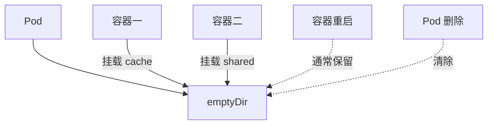

# 18 Volume 与 emptyDir 的生命周期

先理解挂载，再区分容器文件层与 Pod 临时存储。



## 核心要点

- **1. 数据写在容器可写层有什么问题？** 容器重新创建时，原来的可写层数据可能丢失。需要明确的数据挂载关系，而不是假设容器文件就是长期存储。
- **2. Volume 是什么？** 它是 Pod 配置中的存储抽象；volumes 定义来源，volumeMounts 把同名卷挂载到容器路径。路径与卷名称分别描述位置和引用。
- **3. emptyDir 能让两个容器共享文件吗？** 可以。把同一个 emptyDir 卷挂载给两个容器，就能共享相应目录；两个容器挂载的内部路径可以不同。
- **4. 容器重启与 Pod 删除对它有什么区别？** 同一 Pod 中容器重启时，emptyDir 通常保留。Pod 被删除后，该 Pod 的 emptyDir 会清除，新 Pod 获得新的临时存储。
- **5. 可以把数据库长期数据放这里吗？** 不适合作为长期持久化。它适合缓存、临时文件和同 Pod 协作数据，长期数据要考虑独立于 Pod 生命周期的存储。

## 场景与示例

**临时缓存目录 /cache**

示例将名为 cache 的 emptyDir 挂载到 /cache。写入文件可以跨同一 Pod 的容器重启保留，但不要通过删除 Pod 测试长期保留。

```yaml
apiVersion: v1
kind: Pod
metadata:
  name: cache-demo
  namespace: k8s-learn
spec:
  containers:
    - name: worker
      image: busybox:1.37
      command: ["sh", "-c", "sleep 86400"]
      volumeMounts:
        - name: cache
          mountPath: /cache
  volumes:
    - name: cache
      emptyDir: {}
```

## 常见误区

**只要挂载了 Volume 就永远不会丢数据**

Volume 有不同类型和生命周期，emptyDir 恰好是与 Pod 生命周期绑定的临时存储。

## 学习衔接与来源

下一章：PV、PVC 与真实存储。

本章以用户提供的 Kubernetes 教程为基础进行教学重组。所有完整 YAML、命令与实验步骤均为补充示例，不是原文中保留下来的代码。

---

## 本章测验

本章共 5 道单项选择题，每题 1 分。先自行选择，再展开答案；支持互动的播放器应在提交后判题。

### 第 1 题

Volume 在 Pod 中的角色是什么？

- A. 服务域名
- B. 副本控制器
- C. 存储抽象
- D. 镜像版本

<details>
<summary>选择完成后展开答案</summary>

正确答案：C

答案解析：Volume 是 Pod 的存储抽象，不是网络或副本资源。

</details>

### 第 2 题

volumeMounts 主要描述什么？

- A. 容器内挂载路径及卷引用
- B. Node 的公网地址
- C. Service 的选择条件
- D. 部署的滚动更新序号

<details>
<summary>选择完成后展开答案</summary>

正确答案：A

答案解析：volumeMounts 指定容器路径和卷引用，volumes 定义来源。

</details>

### 第 3 题

同一 Pod 中容器重启后，emptyDir 通常怎样？

- A. 立即清除
- B. 自动迁移到所有节点
- C. 自动成为数据库备份
- D. 仍保留

<details>
<summary>选择完成后展开答案</summary>

正确答案：D

答案解析：emptyDir 随 Pod 存在，容器重启时通常仍保留。

</details>

### 第 4 题

需要两个紧密协作容器共享临时文件，哪个合适？

- A. 仅设置相同标签
- B. 共同挂载 emptyDir
- C. 各自写入独立可写层
- D. 仅共用相同镜像标签

<details>
<summary>选择完成后展开答案</summary>

正确答案：B

答案解析：共同挂载同一个 emptyDir 可共享临时文件，标签和镜像不共享文件。

</details>

### 第 5 题

Pod 删除并重新创建后，原 emptyDir 数据怎样？

- A. 不随新 Pod 保留
- B. 始终自动恢复
- C. 由 CoreDNS 保存
- D. 由 Service 自动复制

<details>
<summary>选择完成后展开答案</summary>

正确答案：A

答案解析：Pod 删除后其 emptyDir 清除，新 Pod 不继承原临时卷。

</details>

<!-- QUIZ_DATA_START
{
  "chapter": "18",
  "questions": [
    {
      "id": 1,
      "question": "Volume 在 Pod 中的角色是什么？",
      "options": {
        "A": "服务域名",
        "B": "副本控制器",
        "C": "存储抽象",
        "D": "镜像版本"
      },
      "answer": "C",
      "explanation": "Volume 是 Pod 的存储抽象，不是网络或副本资源。"
    },
    {
      "id": 2,
      "question": "volumeMounts 主要描述什么？",
      "options": {
        "A": "容器内挂载路径及卷引用",
        "B": "Node 的公网地址",
        "C": "Service 的选择条件",
        "D": "部署的滚动更新序号"
      },
      "answer": "A",
      "explanation": "volumeMounts 指定容器路径和卷引用，volumes 定义来源。"
    },
    {
      "id": 3,
      "question": "同一 Pod 中容器重启后，emptyDir 通常怎样？",
      "options": {
        "A": "立即清除",
        "B": "自动迁移到所有节点",
        "C": "自动成为数据库备份",
        "D": "仍保留"
      },
      "answer": "D",
      "explanation": "emptyDir 随 Pod 存在，容器重启时通常仍保留。"
    },
    {
      "id": 4,
      "question": "需要两个紧密协作容器共享临时文件，哪个合适？",
      "options": {
        "A": "仅设置相同标签",
        "B": "共同挂载 emptyDir",
        "C": "各自写入独立可写层",
        "D": "仅共用相同镜像标签"
      },
      "answer": "B",
      "explanation": "共同挂载同一个 emptyDir 可共享临时文件，标签和镜像不共享文件。"
    },
    {
      "id": 5,
      "question": "Pod 删除并重新创建后，原 emptyDir 数据怎样？",
      "options": {
        "A": "不随新 Pod 保留",
        "B": "始终自动恢复",
        "C": "由 CoreDNS 保存",
        "D": "由 Service 自动复制"
      },
      "answer": "A",
      "explanation": "Pod 删除后其 emptyDir 清除，新 Pod 不继承原临时卷。"
    }
  ]
}
QUIZ_DATA_END -->
