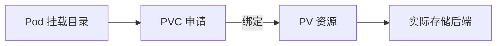

# 19 PV、PVC 与真实存储

理解应用申请、资源绑定与数据实际落盘的位置。



## 核心要点

- **1. 图中的数据最终在哪里？** 最终在云磁盘、NFS、本地持久卷等实际存储后端。PV 是 Kubernetes 里登记的持久存储资源，不是把所有数据写进 API 对象。
- **2. PVC 表达什么？** 它表达应用的存储申请，比如需要五 Gi 容量和某种访问模式。PVC 通过绑定关系获得 PV，不是一个自己装文件的容器。
- **3. Pod 怎样使用存储？** Pod 的 volumes 引用 PVC 名称，容器再将卷挂载到指定目录。Pod 和被引用的 PVC 应在同一 Namespace，PV 则是集群范围资源。
- **4. ReadWriteOnce 是不是只允许一个 Pod？** 不是。它表达以读写方式在单个节点挂载；同节点的多个 Pod 可能使用该卷。访问模式不应该被简化成 Pod 数量限制。
- **5. Pod 删除以后数据就一定安全了吗？** 不一定。新 Pod 可能重新挂载原卷，但结果还取决于存储类型、回收策略和实际删除操作；持久化也不等于备份。

## 场景与示例

**请求 5Gi 并挂载 /data**

data-pvc 请求五 Gi，Pod data-writer 挂载到 /data。前提是存在匹配 PV 或可用默认 StorageClass，先观察 PVC 是否绑定，再执行写文件。

存储申请：

```yaml
apiVersion: v1
kind: PersistentVolumeClaim
metadata:
  name: data-pvc
  namespace: k8s-learn
spec:
  accessModes:
    - ReadWriteOnce
  resources:
    requests:
      storage: 5Gi
```

消费者：

```yaml
apiVersion: v1
kind: Pod
metadata:
  name: data-writer
  namespace: k8s-learn
spec:
  containers:
    - name: writer
      image: busybox:1.37
      command: ["sh", "-c", "sleep 86400"]
      volumeMounts:
        - name: data
          mountPath: /data
  volumes:
    - name: data
      persistentVolumeClaim:
        claimName: data-pvc
```

需有匹配 PV 或可用默认 StorageClass；WaitForFirstConsumer 的存储类可能等到消费者参与调度后才绑定。

## 常见误区

**PVC 就是磁盘本身，并且自动提供备份**

PVC 是申请和绑定对象，实际数据在后端存储；备份需要独立机制。

## 学习衔接与来源

下一章：StorageClass 与动态供给。

本章以用户提供的 Kubernetes 教程为基础进行教学重组。所有完整 YAML、命令与实验步骤均为补充示例，不是原文中保留下来的代码。

---

## 本章测验

本章共 5 道单项选择题，每题 1 分。先自行选择，再展开答案；支持互动的播放器应在提交后判题。

### 第 1 题

PVC 主要表达什么？

- A. 容器镜像内容
- B. HTTP 路由规则
- C. 应用副本数量
- D. 存储需求与申请

<details>
<summary>选择完成后展开答案</summary>

正确答案：D

答案解析：PVC 表达容量、访问模式等存储申请，不装镜像或管理副本。

</details>

### 第 2 题

正确关系是哪项？

- A. PV 创建 Deployment，Deployment 创建 PVC
- B. Pod 引用 PVC，PVC 绑定 PV，PV 对应存储
- C. PVC 保存容器镜像，Service 挂载 PVC
- D. Pod 把所有文件写进 Namespace

<details>
<summary>选择完成后展开答案</summary>

正确答案：B

答案解析：Pod 引用 PVC，PVC 绑定 PV，PV 对应实际存储后端。

</details>

### 第 3 题

ReadWriteOnce 通常限制什么？

- A. 读写挂载所在节点
- B. 只能被一个 Pod 使用
- C. 只能保存一个文件
- D. 只能在 default 中创建

<details>
<summary>选择完成后展开答案</summary>

正确答案：A

答案解析：ReadWriteOnce 限制单节点读写挂载，不等于只能一个 Pod。

</details>

### 第 4 题

PVC 一直未绑定时，首先核对哪个前提？

- A. Service 是否有公网域名
- B. Pod 名称是否等于 PVC 容量
- C. 匹配 PV 或可用的存储供给机制
- D. ConfigMap 是否包含端口

<details>
<summary>选择完成后展开答案</summary>

正确答案：C

答案解析：绑定依赖匹配 PV 或存储供给条件，HTTP 域名与绑定无关。

</details>

### 第 5 题

使用持久卷是否天然等于数据库备份？

- A. 等于，每次写入都是独立备份
- B. 不等于，备份是另一项需求
- C. 等于，PVC 自动保留所有历史版本
- D. 等于，所有云磁盘都可直接替代备份

<details>
<summary>选择完成后展开答案</summary>

正确答案：B

答案解析：持久化不自动保存独立备份，删除或底层故障仍可影响数据。

</details>

<!-- QUIZ_DATA_START
{
  "chapter": "19",
  "questions": [
    {
      "id": 1,
      "question": "PVC 主要表达什么？",
      "options": {
        "A": "容器镜像内容",
        "B": "HTTP 路由规则",
        "C": "应用副本数量",
        "D": "存储需求与申请"
      },
      "answer": "D",
      "explanation": "PVC 表达容量、访问模式等存储申请，不装镜像或管理副本。"
    },
    {
      "id": 2,
      "question": "正确关系是哪项？",
      "options": {
        "A": "PV 创建 Deployment，Deployment 创建 PVC",
        "B": "Pod 引用 PVC，PVC 绑定 PV，PV 对应存储",
        "C": "PVC 保存容器镜像，Service 挂载 PVC",
        "D": "Pod 把所有文件写进 Namespace"
      },
      "answer": "B",
      "explanation": "Pod 引用 PVC，PVC 绑定 PV，PV 对应实际存储后端。"
    },
    {
      "id": 3,
      "question": "ReadWriteOnce 通常限制什么？",
      "options": {
        "A": "读写挂载所在节点",
        "B": "只能被一个 Pod 使用",
        "C": "只能保存一个文件",
        "D": "只能在 default 中创建"
      },
      "answer": "A",
      "explanation": "ReadWriteOnce 限制单节点读写挂载，不等于只能一个 Pod。"
    },
    {
      "id": 4,
      "question": "PVC 一直未绑定时，首先核对哪个前提？",
      "options": {
        "A": "Service 是否有公网域名",
        "B": "Pod 名称是否等于 PVC 容量",
        "C": "匹配 PV 或可用的存储供给机制",
        "D": "ConfigMap 是否包含端口"
      },
      "answer": "C",
      "explanation": "绑定依赖匹配 PV 或存储供给条件，HTTP 域名与绑定无关。"
    },
    {
      "id": 5,
      "question": "使用持久卷是否天然等于数据库备份？",
      "options": {
        "A": "等于，每次写入都是独立备份",
        "B": "不等于，备份是另一项需求",
        "C": "等于，PVC 自动保留所有历史版本",
        "D": "等于，所有云磁盘都可直接替代备份"
      },
      "answer": "B",
      "explanation": "持久化不自动保存独立备份，删除或底层故障仍可影响数据。"
    }
  ]
}
QUIZ_DATA_END -->
