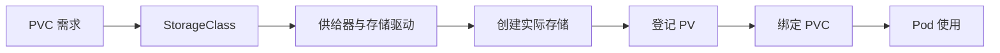

# 20 StorageClass 与动态供给

理解 PVC 请求如何转化为实际存储，以及延迟绑定的意义。



## 核心要点

- **1. 为什么需要 StorageClass？** 它描述一类存储及供给参数，让应用按需求申请，而不必在每个 PVC 中写底层磁盘细节。不同存储类的性能与能力可能不同。
- **2. 动态供给的过程是什么？** PVC 请求使用某个 StorageClass，对应供给器和存储驱动创建实际卷并登记 PV，随后建立绑定，让 Pod 可以使用。不是 PVC 自己创建磁盘。
- **3. 不写 storageClassName 会怎样？** 常见情况是使用默认 StorageClass；没有默认类时，需要已有匹配 PV 等条件。应先查询集群能力，而不是假设每个集群都有相同类名。
- **4. 为什么有时要等 Pod 使用后才绑定？** WaitForFirstConsumer 会等待使用者的调度上下文，便于结合节点和存储拓扑选择位置。这种 Pending 不一定是配置错误。
- **5. 云环境与本地存储是否行为完全一样？** 不是。云磁盘、共享文件存储和本地卷对跨节点使用有不同条件；实际能力取决于存储驱动、存储类参数和底层系统。

## 场景与示例

**查询而不是猜测存储类名**

先 get storageclass，再 get pvc 和 get pv。若集群使用延迟绑定，应创建相应消费者后继续观察；示例不提供可通用于所有云平台的 StorageClass 配置。

```bash
kubectl get storageclass
kubectl get pvc -n k8s-learn
kubectl get pv
```

| 观察 | 解释 |
| --- | --- |
| Bound | PVC 已建立卷绑定 |
| Pending 且无可用类或匹配 PV | 供给前提可能不足 |
| Pending 且 WaitForFirstConsumer | 可能在等待消费者调度 |

PV 的回收策略影响删除 PVC 后底层卷的处理；不要把 Delete 策略理解为保留数据。

## 常见误区

**看到 Pending 就立即认定动态供给失败**

需要区分没有供给条件与等待使用者调度等正常阶段，先检查绑定模式和实际资源。

## 学习衔接与来源

下一章：StatefulSet 的身份与独立存储。

本章以用户提供的 Kubernetes 教程为基础进行教学重组。所有完整 YAML、命令与实验步骤均为补充示例，不是原文中保留下来的代码。补充核对依据：[官方文档](https://kubernetes.io/docs/concepts/storage/persistent-volumes/)。

---

## 本章测验

本章共 5 道单项选择题，每题 1 分。先自行选择，再展开答案；支持互动的播放器应在提交后判题。

### 第 1 题

StorageClass 描述什么？

- A. 存储类别与供给参数
- B. Pod 标签集合
- C. HTTP 访问路径
- D. 容器日志格式

<details>
<summary>选择完成后展开答案</summary>

正确答案：A

答案解析：StorageClass 描述存储类别和供给参数，不描述标签或路由。

</details>

### 第 2 题

动态供给的典型顺序是什么？

- A. Pod 直接把数据保存到 Service
- B. CoreDNS 先创建磁盘，再创建 YAML
- C. PVC 请求，经供给机制创建卷和 PV，再绑定
- D. etcd 自动复制所有应用文件到 Node

<details>
<summary>选择完成后展开答案</summary>

正确答案：C

答案解析：动态供给经存储机制创建实际卷和 PV，再建立 PVC 绑定。

</details>

### 第 3 题

不指定类名时，哪个条件应先确认？

- A. Service 是否名为 storage
- B. 集群是否有可用默认 StorageClass
- C. Pod 镜像是否包含 kubectl
- D. Namespace 是否叫 default

<details>
<summary>选择完成后展开答案</summary>

正确答案：B

答案解析：未指定类名时应核对默认类是否可用，不能猜测所有集群相同。

</details>

### 第 4 题

使用 WaitForFirstConsumer 的 PVC 暂时 Pending，哪项合理？

- A. 必然是 YAML 缩进错误
- B. 必然是磁盘已经损坏
- C. 必然是请求容量为零
- D. 可能在等待消费者调度上下文

<details>
<summary>选择完成后展开答案</summary>

正确答案：D

答案解析：WaitForFirstConsumer 可能等待消费者调度，Pending 不必然是错误。

</details>

### 第 5 题

存储能否跨节点使用主要取决于什么？

- A. Markdown 编号
- B. Service 短名
- C. 驱动、存储类型与配置
- D. speaker 的顺序

<details>
<summary>选择完成后展开答案</summary>

正确答案：C

答案解析：跨节点能力依赖存储类型、驱动与配置，而非服务名称或文件编号。

</details>

<!-- QUIZ_DATA_START
{
  "chapter": "20",
  "questions": [
    {
      "id": 1,
      "question": "StorageClass 描述什么？",
      "options": {
        "A": "存储类别与供给参数",
        "B": "Pod 标签集合",
        "C": "HTTP 访问路径",
        "D": "容器日志格式"
      },
      "answer": "A",
      "explanation": "StorageClass 描述存储类别和供给参数，不描述标签或路由。"
    },
    {
      "id": 2,
      "question": "动态供给的典型顺序是什么？",
      "options": {
        "A": "Pod 直接把数据保存到 Service",
        "B": "CoreDNS 先创建磁盘，再创建 YAML",
        "C": "PVC 请求，经供给机制创建卷和 PV，再绑定",
        "D": "etcd 自动复制所有应用文件到 Node"
      },
      "answer": "C",
      "explanation": "动态供给经存储机制创建实际卷和 PV，再建立 PVC 绑定。"
    },
    {
      "id": 3,
      "question": "不指定类名时，哪个条件应先确认？",
      "options": {
        "A": "Service 是否名为 storage",
        "B": "集群是否有可用默认 StorageClass",
        "C": "Pod 镜像是否包含 kubectl",
        "D": "Namespace 是否叫 default"
      },
      "answer": "B",
      "explanation": "未指定类名时应核对默认类是否可用，不能猜测所有集群相同。"
    },
    {
      "id": 4,
      "question": "使用 WaitForFirstConsumer 的 PVC 暂时 Pending，哪项合理？",
      "options": {
        "A": "必然是 YAML 缩进错误",
        "B": "必然是磁盘已经损坏",
        "C": "必然是请求容量为零",
        "D": "可能在等待消费者调度上下文"
      },
      "answer": "D",
      "explanation": "WaitForFirstConsumer 可能等待消费者调度，Pending 不必然是错误。"
    },
    {
      "id": 5,
      "question": "存储能否跨节点使用主要取决于什么？",
      "options": {
        "A": "Markdown 编号",
        "B": "Service 短名",
        "C": "驱动、存储类型与配置",
        "D": "speaker 的顺序"
      },
      "answer": "C",
      "explanation": "跨节点能力依赖存储类型、驱动与配置，而非服务名称或文件编号。"
    }
  ]
}
QUIZ_DATA_END -->
