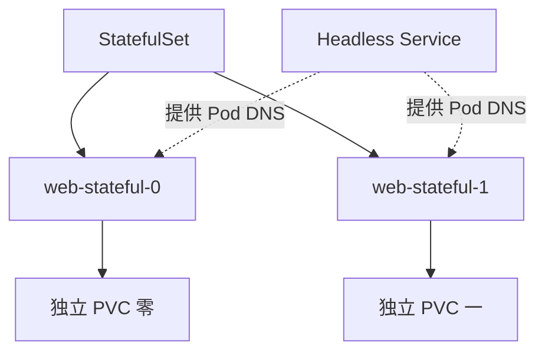

# 21 StatefulSet 的身份与独立存储

把稳定 Pod 身份、Headless Service 与每副本 PVC 联系起来。



## 核心要点

- **1. 什么时候需要稳定身份？** 数据库节点等有状态系统可能需要固定序号、对应存储和可预测名称。StatefulSet 管理这些 Kubernetes 身份和生命周期需求。
- **2. web-stateful-0 被替换以后会怎样？** 它可以重新创建同名 Pod，并关联该序号对应的原 PVC。稳定身份不等于原容器内存状态被恢复，也不表示地址永远不变。
- **3. Headless Service 为什么写 clusterIP: None？** 它不提供普通的统一虚拟 ClusterIP，而可以通过集群 DNS 暴露对应 Pod 地址。StatefulSet 的 serviceName 引用它，组成可预测的 Pod 网络名称。
- **4. volumeClaimTemplates 的作用是什么？** 为每个 Pod 创建各自的 PVC；示例中 claim 模板名为 data，Pod 名为 web-stateful-0，对应 PVC 名为 data-web-stateful-0。
- **5. 三个数据库 Pod 就会自动同步数据吗？** 不会。StatefulSet 提供身份和存储管理，数据库复制、主从切换和数据一致性仍需要数据库系统自身配置。缩减 StatefulSet 时，PVC 默认也不会简单随 Pod 一起删除。

## 场景与示例

**用 Nginx 展示 StatefulSet 结构**

两个带序号的 Nginx Pod 各自挂载独立 PVC，通过 Headless Service 形成网络名称。它只演示 Kubernetes 资源结构，不演示数据库复制。

```yaml
apiVersion: v1
kind: Service
metadata:
  name: stateful-headless
  namespace: k8s-learn
spec:
  clusterIP: None
  selector:
    app: stateful-web
  ports:
    - port: 80
      targetPort: 80
---
apiVersion: apps/v1
kind: StatefulSet
metadata:
  name: web-stateful
  namespace: k8s-learn
spec:
  serviceName: stateful-headless
  replicas: 2
  selector:
    matchLabels:
      app: stateful-web
  template:
    metadata:
      labels:
        app: stateful-web
    spec:
      containers:
        - name: web
          image: nginx:1.28
          ports:
            - containerPort: 80
          volumeMounts:
            - name: data
              mountPath: /data
  volumeClaimTemplates:
    - metadata:
        name: data
      spec:
        accessModes: ["ReadWriteOnce"]
        resources:
          requests:
            storage: 1Gi
```

首个 Pod 名称：web-stateful-0；PVC 名称：data-web-stateful-0；常见 DNS 名称：web-stateful-0.stateful-headless.k8s-learn.svc.cluster.local。示例需要可用存储供给，/data 并非 Nginx 默认网页目录。

## 常见误区

**StatefulSet 是数据库自动高可用方案**

它是资源身份与生命周期机制，业务复制和故障切换不是仅凭资源类型就能获得的能力。

## 学习衔接与来源

下一章：DaemonSet 与节点级任务。

本章以用户提供的 Kubernetes 教程为基础进行教学重组。所有完整 YAML、命令与实验步骤均为补充示例，不是原文中保留下来的代码。补充核对依据：[官方文档](https://kubernetes.io/docs/concepts/workloads/controllers/statefulset/)。

---

## 本章测验

本章共 5 道单项选择题，每题 1 分。先自行选择，再展开答案；支持互动的播放器应在提交后判题。

### 第 1 题

StatefulSet 主要满足什么需求？

- A. 自动编译源码
- B. 稳定身份与对应存储
- C. 统一所有 Pod IP
- D. 替代数据库复制协议

<details>
<summary>选择完成后展开答案</summary>

正确答案：B

答案解析：StatefulSet 管理稳定身份与对应存储，不替代业务复制协议。

</details>

### 第 2 题

Headless Service 的典型配置是什么？

- A. type: StatefulSet
- B. replicas: None
- C. targetPort: PVC
- D. clusterIP: None

<details>
<summary>选择完成后展开答案</summary>

正确答案：D

答案解析：clusterIP: None 是 Headless Service 的典型配置。

</details>

### 第 3 题

volumeClaimTemplates 通常生成什么？

- A. 每副本共享同一个公网 IP
- B. 全部业务 SQL 脚本
- C. 每副本对应的 PVC
- D. 所有 Node 的镜像仓库

<details>
<summary>选择完成后展开答案</summary>

正确答案：C

答案解析：volumeClaimTemplates 为各副本提供对应 PVC，不共享公网地址。

</details>

### 第 4 题

web-stateful-0 被替换后，哪项预期合理？

- A. 同名新 Pod 可关联原对应 PVC
- B. 一定恢复原进程内存
- C. 数据库自动完成主从切换
- D. 必定保留完全相同的 Pod UID

<details>
<summary>选择完成后展开答案</summary>

正确答案：A

答案解析：替代同序号 Pod 可关联原 PVC，但 UID 与内存状态不保证保留。

</details>

### 第 5 题

创建三个数据库 Pod 是否等于复制已配置？

- A. 是，序号本身就复制业务数据
- B. 是，Headless Service 自动执行 SQL
- C. 是，PVC 自动合并所有数据
- D. 不是，还要配置数据库复制逻辑

<details>
<summary>选择完成后展开答案</summary>

正确答案：D

答案解析：数据库复制需数据库系统自身配置，序号和 PVC 不自动复制数据。

</details>

<!-- QUIZ_DATA_START
{
  "chapter": "21",
  "questions": [
    {
      "id": 1,
      "question": "StatefulSet 主要满足什么需求？",
      "options": {
        "A": "自动编译源码",
        "B": "稳定身份与对应存储",
        "C": "统一所有 Pod IP",
        "D": "替代数据库复制协议"
      },
      "answer": "B",
      "explanation": "StatefulSet 管理稳定身份与对应存储，不替代业务复制协议。"
    },
    {
      "id": 2,
      "question": "Headless Service 的典型配置是什么？",
      "options": {
        "A": "type: StatefulSet",
        "B": "replicas: None",
        "C": "targetPort: PVC",
        "D": "clusterIP: None"
      },
      "answer": "D",
      "explanation": "clusterIP: None 是 Headless Service 的典型配置。"
    },
    {
      "id": 3,
      "question": "volumeClaimTemplates 通常生成什么？",
      "options": {
        "A": "每副本共享同一个公网 IP",
        "B": "全部业务 SQL 脚本",
        "C": "每副本对应的 PVC",
        "D": "所有 Node 的镜像仓库"
      },
      "answer": "C",
      "explanation": "volumeClaimTemplates 为各副本提供对应 PVC，不共享公网地址。"
    },
    {
      "id": 4,
      "question": "web-stateful-0 被替换后，哪项预期合理？",
      "options": {
        "A": "同名新 Pod 可关联原对应 PVC",
        "B": "一定恢复原进程内存",
        "C": "数据库自动完成主从切换",
        "D": "必定保留完全相同的 Pod UID"
      },
      "answer": "A",
      "explanation": "替代同序号 Pod 可关联原 PVC，但 UID 与内存状态不保证保留。"
    },
    {
      "id": 5,
      "question": "创建三个数据库 Pod 是否等于复制已配置？",
      "options": {
        "A": "是，序号本身就复制业务数据",
        "B": "是，Headless Service 自动执行 SQL",
        "C": "是，PVC 自动合并所有数据",
        "D": "不是，还要配置数据库复制逻辑"
      },
      "answer": "D",
      "explanation": "数据库复制需数据库系统自身配置，序号和 PVC 不自动复制数据。"
    }
  ]
}
QUIZ_DATA_END -->
