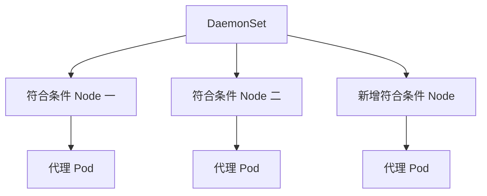

# 22 DaemonSet 与节点级任务

理解副本随符合条件的节点变化，而不是随 replicas 变化。



## 核心要点

- **1. DaemonSet 为什么适合日志代理？** 节点级代理需要在符合条件的每个节点运行一份。DaemonSet 围绕节点覆盖维护 Pod，而不是要求任意位置总共运行某个数量。
- **2. 增加一个 Node 会怎样？** 如果新增节点符合条件，DaemonSet 通常会为它创建相应 Pod。节点条件、选择规则与调度限制仍然影响覆盖范围。
- **3. 和 Deployment 最大的区别是什么？** Deployment 主要根据 replicas 管理总副本目标；DaemonSet 主要根据符合条件的节点管理覆盖，两者不是相同的数量模型。
- **4. 普通 Web 服务应该默认使用它吗？** 通常不是。Web 副本更常根据业务负载独立扩缩容，不需要在每台节点固定一份，应选择合适的工作负载。
- **5. 示例运行的代理真的收集系统日志了吗？** 没有。教学 YAML 只运行一个周期输出文本的容器，用来观察节点覆盖；真正日志代理还需要具体软件和日志来源配置。

## 场景与示例

**观察 demo-agent 的节点分布**

apply 后用 get daemonset 和 get pods -o wide 查看状态。演示容器输出节点代理的概念文本，不将它宣传为已经配置的监控系统。

```yaml
apiVersion: apps/v1
kind: DaemonSet
metadata:
  name: demo-agent
  namespace: k8s-learn
spec:
  selector:
    matchLabels:
      app: demo-agent
  template:
    metadata:
      labels:
        app: demo-agent
    spec:
      containers:
        - name: agent
          image: busybox:1.37
          command: ["sh", "-c", "while true; do echo agent-demo; sleep 60; done"]
```

```bash
kubectl get daemonset -n k8s-learn
kubectl get pods -n k8s-learn -l app=demo-agent -o wide
```

本例观察符合条件节点的覆盖，不提供真实日志收集能力。

## 常见误区

**DaemonSet 无条件覆盖所有节点**

它覆盖符合条件的节点，节点选择与调度限制仍然有效。

## 学习衔接与来源

下一章：Job 与 CronJob 的完成语义。

本章以用户提供的 Kubernetes 教程为基础进行教学重组。所有完整 YAML、命令与实验步骤均为补充示例，不是原文中保留下来的代码。

---

## 本章测验

本章共 5 道单项选择题，每题 1 分。先自行选择，再展开答案；支持互动的播放器应在提交后判题。

### 第 1 题

DaemonSet 的核心目标是什么？

- A. 保持任意位置的固定总副本
- B. 按时间创建一次任务
- C. 覆盖符合条件的节点
- D. 给所有容器分配公网 IP

<details>
<summary>选择完成后展开答案</summary>

正确答案：C

答案解析：DaemonSet 围绕符合条件节点覆盖，不以任意总副本数量为目标。

</details>

### 第 2 题

新增符合条件节点时，通常怎样？

- A. 为该节点提供对应 Pod
- B. 所有旧 Pod 都必须删除
- C. 自动增加数据库表
- D. 自动创建 Ingress 域名

<details>
<summary>选择完成后展开答案</summary>

正确答案：A

答案解析：新增符合条件节点通常会得到代理 Pod，不需删除所有旧实例。

</details>

### 第 3 题

Deployment 与 DaemonSet 的数量依据怎样不同？

- A. 前者只能一个副本，后者只能两个
- B. 前者运行容器，后者只保存文件
- C. 前者维护 DNS，后者维护 PVC
- D. 前者以副本目标为主，后者以节点覆盖为主

<details>
<summary>选择完成后展开答案</summary>

正确答案：D

答案解析：Deployment 以 replicas 为主，DaemonSet 以节点覆盖为主。

</details>

### 第 4 题

每台适合的节点要运行一份日志代理，哪种资源合适？

- A. ExternalName
- B. DaemonSet
- C. ConfigMap
- D. CronJob

<details>
<summary>选择完成后展开答案</summary>

正确答案：B

答案解析：每个合适节点一个代理符合 DaemonSet 的生命周期模型。

</details>

### 第 5 题

教学示例输出代理文本，能否认定日志采集已完成？

- A. 不能，还需真实代理和采集配置
- B. 能，DaemonSet 自动读取全部日志
- C. 能，busybox 自动上传监控数据
- D. 能，每节点一个 Pod 就代表采集成功

<details>
<summary>选择完成后展开答案</summary>

正确答案：A

答案解析：教学输出不是采集能力，需真实代理和日志来源配置。

</details>

<!-- QUIZ_DATA_START
{
  "chapter": "22",
  "questions": [
    {
      "id": 1,
      "question": "DaemonSet 的核心目标是什么？",
      "options": {
        "A": "保持任意位置的固定总副本",
        "B": "按时间创建一次任务",
        "C": "覆盖符合条件的节点",
        "D": "给所有容器分配公网 IP"
      },
      "answer": "C",
      "explanation": "DaemonSet 围绕符合条件节点覆盖，不以任意总副本数量为目标。"
    },
    {
      "id": 2,
      "question": "新增符合条件节点时，通常怎样？",
      "options": {
        "A": "为该节点提供对应 Pod",
        "B": "所有旧 Pod 都必须删除",
        "C": "自动增加数据库表",
        "D": "自动创建 Ingress 域名"
      },
      "answer": "A",
      "explanation": "新增符合条件节点通常会得到代理 Pod，不需删除所有旧实例。"
    },
    {
      "id": 3,
      "question": "Deployment 与 DaemonSet 的数量依据怎样不同？",
      "options": {
        "A": "前者只能一个副本，后者只能两个",
        "B": "前者运行容器，后者只保存文件",
        "C": "前者维护 DNS，后者维护 PVC",
        "D": "前者以副本目标为主，后者以节点覆盖为主"
      },
      "answer": "D",
      "explanation": "Deployment 以 replicas 为主，DaemonSet 以节点覆盖为主。"
    },
    {
      "id": 4,
      "question": "每台适合的节点要运行一份日志代理，哪种资源合适？",
      "options": {
        "A": "ExternalName",
        "B": "DaemonSet",
        "C": "ConfigMap",
        "D": "CronJob"
      },
      "answer": "B",
      "explanation": "每个合适节点一个代理符合 DaemonSet 的生命周期模型。"
    },
    {
      "id": 5,
      "question": "教学示例输出代理文本，能否认定日志采集已完成？",
      "options": {
        "A": "不能，还需真实代理和采集配置",
        "B": "能，DaemonSet 自动读取全部日志",
        "C": "能，busybox 自动上传监控数据",
        "D": "能，每节点一个 Pod 就代表采集成功"
      },
      "answer": "A",
      "explanation": "教学输出不是采集能力，需真实代理和日志来源配置。"
    }
  ]
}
QUIZ_DATA_END -->
