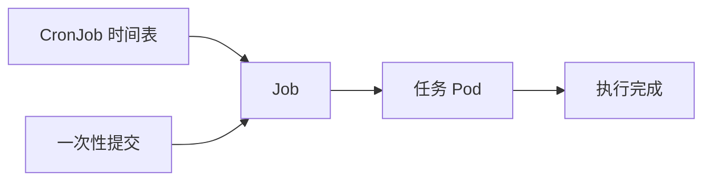

# 23 Job 与 CronJob 的完成语义

为一次性和定时任务选择资源，并明确时区与重复执行边界。



## 核心要点

- **1. 一次导入任务为什么不优先用 Deployment？** 导入执行完成后需要结束，而 Deployment 面向持续维持运行副本。Job 用于执行直到完成，更符合一次性批处理需求。
- **2. CronJob 和 Job 是什么关系？** CronJob 按时间表创建 Job，Job 再管理任务 Pod。定时规则和任务执行是不同层次。
- **3. 每天日本时间凌晨两点应该怎么声明？** schedule 使用零、二、星号、星号、星号的 Cron 表达式，并明确 timeZone 为 Asia/Tokyo。只写表达式不能自动说明它是日本时间。
- **4. 一次任务是否保证应用逻辑严格只执行一次？** 不能。任务可能重试或出现重复执行，业务处理需要支持幂等，即重复执行也不会产生重复的最终业务效果。
- **5. 示例 echo completed 能证明数据整理成功吗？** 只能证明教学命令完成。真实任务需要自己的处理程序和业务验证；concurrencyPolicy: Forbid 可以避免同一 CronJob 的任务并发重叠，但不等于严格只执行一次。

## 场景与示例

**一次性与每天定时输出**

Job 示例输出 completed 后退出；CronJob 用日本时区每天两点创建相似 Job。查看 Job 完成状态与日志，不把定时创建资源等同于真实数据处理完成。

```yaml
apiVersion: batch/v1
kind: Job
metadata:
  name: once-demo
  namespace: k8s-learn
spec:
  backoffLimit: 2
  template:
    spec:
      restartPolicy: Never
      containers:
        - name: task
          image: busybox:1.37
          command: ["sh", "-c", "echo completed"]
```

```yaml
apiVersion: batch/v1
kind: CronJob
metadata:
  name: daily-demo
  namespace: k8s-learn
spec:
  schedule: "0 2 * * *"
  timeZone: "Asia/Tokyo"
  concurrencyPolicy: Forbid
  jobTemplate:
    spec:
      template:
        spec:
          restartPolicy: Never
          containers:
            - name: task
              image: busybox:1.37
              command: ["sh", "-c", "echo scheduled-demo"]
```

```bash
kubectl get jobs,cronjobs -n k8s-learn
kubectl logs job/once-demo -n k8s-learn
```

timeZone 字段要求集群支持该字段（Kubernetes 1.27 起稳定）。定时运行不会自动证明业务处理正确。

## 常见误区

**CronJob 天然保证每个计划点精确执行一次**

调度与重试存在执行边界；应显式设置时区，并让重要业务具备幂等性。

## 学习衔接与来源

下一章：kubectl 与 Helm 的分工。

本章以用户提供的 Kubernetes 教程为基础进行教学重组。所有完整 YAML、命令与实验步骤均为补充示例，不是原文中保留下来的代码。补充核对依据：[官方文档](https://kubernetes.io/docs/concepts/workloads/controllers/cron-jobs/)。

---

## 本章测验

本章共 5 道单项选择题，每题 1 分。先自行选择，再展开答案；支持互动的播放器应在提交后判题。

### 第 1 题

执行完成后结束的批任务通常选什么？

- A. Deployment
- B. Service
- C. PV
- D. Job

<details>
<summary>选择完成后展开答案</summary>

正确答案：D

答案解析：Job 适合执行直到完成的任务，Deployment 维持长期运行副本。

</details>

### 第 2 题

CronJob 的管理关系是什么？

- A. CronJob 创建 Service，Service 创建 Node
- B. CronJob 创建 Job，Job 管理 Pod
- C. Pod 创建 CronJob，CronJob 创建 etcd
- D. Job 创建 StorageClass，StorageClass 创建域名

<details>
<summary>选择完成后展开答案</summary>

正确答案：B

答案解析：CronJob 按时间表创建 Job，Job 再管理任务 Pod。

</details>

### 第 3 题

明确日本时间应设置哪个字段？

- A. timeZone: Asia/Tokyo
- B. namespace: Asia/Tokyo
- C. targetPort: Tokyo
- D. replicas: Tokyo

<details>
<summary>选择完成后展开答案</summary>

正确答案：A

答案解析：timeZone 指定解释 schedule 的时区，Namespace 和端口不是时区。

</details>

### 第 4 题

重要批处理可能重试，应用应该怎样设计？

- A. 只依赖资源名称防止所有重复
- B. 把所有状态只放进内存
- C. 使重复执行具有幂等效果
- D. 取消所有业务完成检查

<details>
<summary>选择完成后展开答案</summary>

正确答案：C

答案解析：幂等使重复执行不会产生重复最终业务效果，不能只依赖任务名称。

</details>

### 第 5 题

concurrencyPolicy: Forbid 主要限制什么？

- A. 所有集群 Job 永远只能执行一次
- B. 同一 CronJob 的任务并发重叠
- C. 任何 Namespace 的全部任务
- D. 容器日志只能输出一行

<details>
<summary>选择完成后展开答案</summary>

正确答案：B

答案解析：Forbid 限制同一 CronJob 的并发重叠，不保证严格只执行一次。

</details>

<!-- QUIZ_DATA_START
{
  "chapter": "23",
  "questions": [
    {
      "id": 1,
      "question": "执行完成后结束的批任务通常选什么？",
      "options": {
        "A": "Deployment",
        "B": "Service",
        "C": "PV",
        "D": "Job"
      },
      "answer": "D",
      "explanation": "Job 适合执行直到完成的任务，Deployment 维持长期运行副本。"
    },
    {
      "id": 2,
      "question": "CronJob 的管理关系是什么？",
      "options": {
        "A": "CronJob 创建 Service，Service 创建 Node",
        "B": "CronJob 创建 Job，Job 管理 Pod",
        "C": "Pod 创建 CronJob，CronJob 创建 etcd",
        "D": "Job 创建 StorageClass，StorageClass 创建域名"
      },
      "answer": "B",
      "explanation": "CronJob 按时间表创建 Job，Job 再管理任务 Pod。"
    },
    {
      "id": 3,
      "question": "明确日本时间应设置哪个字段？",
      "options": {
        "A": "timeZone: Asia/Tokyo",
        "B": "namespace: Asia/Tokyo",
        "C": "targetPort: Tokyo",
        "D": "replicas: Tokyo"
      },
      "answer": "A",
      "explanation": "timeZone 指定解释 schedule 的时区，Namespace 和端口不是时区。"
    },
    {
      "id": 4,
      "question": "重要批处理可能重试，应用应该怎样设计？",
      "options": {
        "A": "只依赖资源名称防止所有重复",
        "B": "把所有状态只放进内存",
        "C": "使重复执行具有幂等效果",
        "D": "取消所有业务完成检查"
      },
      "answer": "C",
      "explanation": "幂等使重复执行不会产生重复最终业务效果，不能只依赖任务名称。"
    },
    {
      "id": 5,
      "question": "concurrencyPolicy: Forbid 主要限制什么？",
      "options": {
        "A": "所有集群 Job 永远只能执行一次",
        "B": "同一 CronJob 的任务并发重叠",
        "C": "任何 Namespace 的全部任务",
        "D": "容器日志只能输出一行"
      },
      "answer": "B",
      "explanation": "Forbid 限制同一 CronJob 的并发重叠，不保证严格只执行一次。"
    }
  ]
}
QUIZ_DATA_END -->
