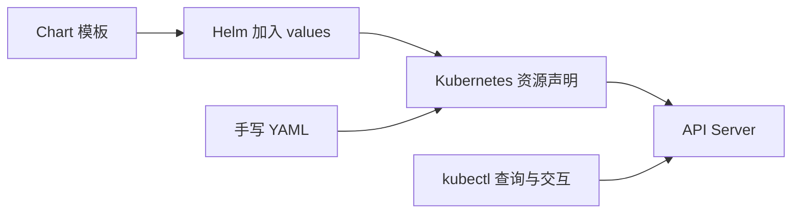

# 24 kubectl 与 Helm 的分工

理解查询、声明管理与模板打包，避免把安装包当成运行时。



## 核心要点

- **1. kubectl 是直接 SSH 到每台 Node 吗？** 不是。它主要与 API Server 交互，查询和修改资源，也能通过 API 请求读取日志、在容器中执行命令。
- **2. get、describe、logs 和 exec 怎么选？** get 看列表和简要状态，describe 看对象细节，logs 看容器输出，exec 在指定容器中执行命令。查询资源与进入容器是不同操作。
- **3. create、apply 和 delete 有什么不同？** create 创建新对象，apply 按声明创建或更新对象，delete 删除对象。主线示例优先 apply，便于持续维护同一份资源文件。
- **4. Helm 解决什么重复工作？** 它把多个资源模板整理为 Chart，用 values 提供参数，再形成一组资源声明。不同环境可以调整副本数和镜像等参数，而不复制整套 YAML。
- **5. Chart、values 和 release 怎么区分？** Chart 是包和模板，values 是参数，release 是一次安装的实例。Helm 不是容器运行时，安装成功后仍要观察实际工作负载是否可用。

## 场景与示例

**先看模板输出，再安装已有 Chart**

helm template 用于查看渲染出的声明；helm install 创建一次安装，helm list 查看安装实例。本章命令中的路径是占位的本地 Chart，课程包不伪称包含它。

```bash
kubectl get pods -n k8s-learn
kubectl describe pod first-pod -n k8s-learn
kubectl logs first-pod -n k8s-learn
kubectl exec data-writer -n k8s-learn -- ls /data
```

以下路径为已有本地 Chart 的占位示例，需替换；本课程包不包含 Chart：

```bash
helm template web-release ./my-chart -f values.yaml
helm install web-release ./my-chart -f values.yaml -n k8s-learn
helm list -n k8s-learn
```

first-pod 命令要求该独立 Pod 尚存在；若已在第 08 章删除，请查询当前实际对象。

## 常见误区

**Helm 安装成功就等于全部业务启动成功**

安装资源和业务就绪需要分别观察，最终执行仍依赖 Kubernetes 与节点组件。

## 学习衔接与来源

下一章：完整 Web 系统的资源与请求链路。

本章以用户提供的 Kubernetes 教程为基础进行教学重组。所有完整 YAML、命令与实验步骤均为补充示例，不是原文中保留下来的代码。原文在第十三章 Helm 介绍处截断，本章的完整讲解属于补充整理。补充核对依据：[官方文档](https://helm.sh/docs/topics/charts/)。

---

## 本章测验

本章共 5 道单项选择题，每题 1 分。先自行选择，再展开答案；支持互动的播放器应在提交后判题。

### 第 1 题

kubectl 主要交互对象是谁？

- A. API Server
- B. 每个 Node 的 SSH 服务
- C. 应用浏览器
- D. 镜像编译器

<details>
<summary>选择完成后展开答案</summary>

正确答案：A

答案解析：kubectl 通过 Kubernetes API 工作，不是逐节点 SSH 工具。

</details>

### 第 2 题

按文件创建或更新资源通常使用什么？

- A. logs
- B. describe
- C. apply
- D. exec

<details>
<summary>选择完成后展开答案</summary>

正确答案：C

答案解析：apply 按文件声明创建或更新，logs、describe 和 exec 有其他用途。

</details>

### 第 3 题

Helm Chart 是什么？

- A. 一个容器运行时
- B. 资源模板和相关文件组成的包
- C. 一个固定 Node IP
- D. 一种 PVC 访问模式

<details>
<summary>选择完成后展开答案</summary>

正确答案：B

答案解析：Chart 是资源模板和相关文件包，不是运行时或访问模式。

</details>

### 第 4 题

希望部署前查看模板生成的 YAML，哪个操作合适？

- A. kubectl logs
- B. helm list
- C. kubectl exec
- D. helm template

<details>
<summary>选择完成后展开答案</summary>

正确答案：D

答案解析：helm template 渲染模板便于检查，不必先创建安装实例。

</details>

### 第 5 题

release 在 Helm 中通常指什么？

- A. 一个节点上的 CPU 核心
- B. 一个 Service 端口
- C. 一次 Chart 安装实例
- D. 镜像中的独立进程

<details>
<summary>选择完成后展开答案</summary>

正确答案：C

答案解析：release 是一次 Chart 安装实例，不等于进程、端口或 CPU。

</details>

<!-- QUIZ_DATA_START
{
  "chapter": "24",
  "questions": [
    {
      "id": 1,
      "question": "kubectl 主要交互对象是谁？",
      "options": {
        "A": "API Server",
        "B": "每个 Node 的 SSH 服务",
        "C": "应用浏览器",
        "D": "镜像编译器"
      },
      "answer": "A",
      "explanation": "kubectl 通过 Kubernetes API 工作，不是逐节点 SSH 工具。"
    },
    {
      "id": 2,
      "question": "按文件创建或更新资源通常使用什么？",
      "options": {
        "A": "logs",
        "B": "describe",
        "C": "apply",
        "D": "exec"
      },
      "answer": "C",
      "explanation": "apply 按文件声明创建或更新，logs、describe 和 exec 有其他用途。"
    },
    {
      "id": 3,
      "question": "Helm Chart 是什么？",
      "options": {
        "A": "一个容器运行时",
        "B": "资源模板和相关文件组成的包",
        "C": "一个固定 Node IP",
        "D": "一种 PVC 访问模式"
      },
      "answer": "B",
      "explanation": "Chart 是资源模板和相关文件包，不是运行时或访问模式。"
    },
    {
      "id": 4,
      "question": "希望部署前查看模板生成的 YAML，哪个操作合适？",
      "options": {
        "A": "kubectl logs",
        "B": "helm list",
        "C": "kubectl exec",
        "D": "helm template"
      },
      "answer": "D",
      "explanation": "helm template 渲染模板便于检查，不必先创建安装实例。"
    },
    {
      "id": 5,
      "question": "release 在 Helm 中通常指什么？",
      "options": {
        "A": "一个节点上的 CPU 核心",
        "B": "一个 Service 端口",
        "C": "一次 Chart 安装实例",
        "D": "镜像中的独立进程"
      },
      "answer": "C",
      "explanation": "release 是一次 Chart 安装实例，不等于进程、端口或 CPU。"
    }
  ]
}
QUIZ_DATA_END -->
