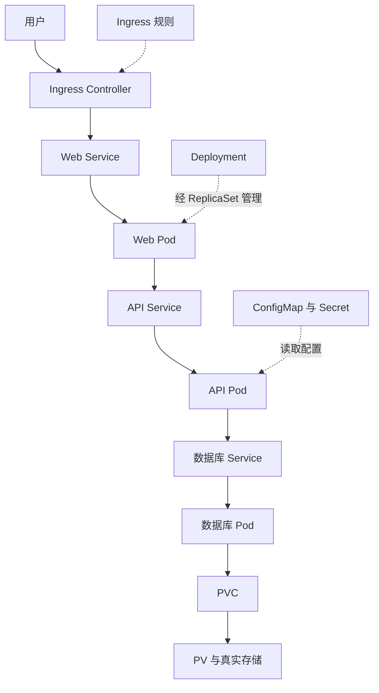

# 25 完整 Web 系统的资源与请求链路

把部署管理、请求流量、配置和存储放到同一张图中。

## 核心要点

- **1. 这张图中实线和虚线分别是什么？** 实线表示请求访问或存储引用路径，虚线表示管理与配置关系。Pod 被谁管理，与用户请求经过谁，是两条不同的链路。
- **2. 用户请求从哪儿到哪儿？** 用户访问入口，Controller 按 Ingress 规则到 Web Service，再到 Web Pod。需要调用 API 时，由 Web 应用发出另一次请求，经过 API Service 到 API Pod。
- **3. API 怎么找到数据库？** 通过数据库 Service 名称和应用连接参数。ConfigMap 与 Secret 给 API 提供普通与敏感配置，数据库 Service 仍是访问抽象，真正执行查询的是数据库容器。
- **4. 数据库记录最终写在哪里？** 数据库 Pod 挂载 PVC，PVC 绑定 PV，PV 对应真实存储。这里的持久化链路与用户流量入口不是同一职责，也不能替代数据备份。
- **5. 一个 Pod 消失时，谁管恢复，谁管访问？** 相应工作负载控制器创建替代实例；服务后端信息随变化维护，访问方继续使用稳定名称。配置资源提供参数，DNS 解析名称，各自职责不同。

## 场景与示例

**购物网站请求的一次完整旅程**

从用户到 Web，再到 API 和数据库，逐段判断谁运行程序、谁提供入口、谁供应配置、谁提供存储。本章是组合架构示意，不声称课件已部署可用购物网站。

## 常见误区

**箭头相连就意味着一个资源会创建另一个资源**

请求访问、配置引用、存储绑定和控制器管理应分别阅读，只有明确的管理链才表示创建或维护关系。

## 学习衔接与来源

下一章：动手实验：副本、访问与持久化。

本章以用户提供的 Kubernetes 教程为基础进行教学重组。所有完整 YAML、命令与实验步骤均为补充示例，不是原文中保留下来的代码。原文在第十三章 Helm 介绍处截断，本章的完整讲解属于补充整理。

---

## 本章测验

本章共 5 道单项选择题，每题 1 分。先自行选择，再展开答案；支持互动的播放器应在提交后判题。

### 第 1 题

Web Pod 的运行副本由哪条链管理？

- A. Ingress 经 Secret 管理 Pod
- B. Deployment 经 ReplicaSet 管理 Pod
- C. Service 经 DNS 管理 Pod
- D. PVC 经 PV 管理 Web 副本

选择完成后展开答案

正确答案：B

答案解析：工作负载管理链是 Deployment 到 ReplicaSet 到 Pod。

### 第 2 题

典型外部请求先经过哪条路径？

- A. PV 到 PVC 再到 Web Pod
- B. etcd 到镜像仓库再到浏览器
- C. Secret 到 Node 再到域名
- D. 入口 Controller 到 Web Service 再到 Web Pod

选择完成后展开答案

正确答案：D

答案解析：请求进入 Controller，按规则到 Service，再到 Web Pod。

### 第 3 题

API 的敏感连接参数通常由谁提供？

- A. EndpointSlice
- B. ReplicaSet
- C. Secret
- D. NodePort

选择完成后展开答案

正确答案：C

答案解析：敏感连接参数通常由 Secret 提供，端点和副本资源不保存口令。

### 第 4 题

数据库容器被替换但想重新使用原数据，应关注什么？

- A. PVC、PV 与实际存储的关联
- B. Ingress 路径的字符串长度
- C. Web 副本名称是否完全相同
- D. 浏览器是否缓存了 Markdown

选择完成后展开答案

正确答案：A

答案解析：数据保留需关注消费者与原存储关联，入口路径不保存业务文件。

### 第 5 题

架构图里的调用箭头是否必定代表资源创建关系？

- A. 是，所有调用都会创建后端
- B. 是，Service 必定创建数据库
- C. 是，PVC 会创建 Web Deployment
- D. 不是，应区分访问与管理关系

选择完成后展开答案

正确答案：D

答案解析：调用、配置引用、存储绑定和资源管理是不同种类的关系。

<!-- QUIZ_DATA_START
{
  "chapter": "25",
  "questions": [
    {
      "id": 1,
      "question": "Web Pod 的运行副本由哪条链管理？",
      "options": {
        "A": "Ingress 经 Secret 管理 Pod",
        "B": "Deployment 经 ReplicaSet 管理 Pod",
        "C": "Service 经 DNS 管理 Pod",
        "D": "PVC 经 PV 管理 Web 副本"
      },
      "answer": "B",
      "explanation": "工作负载管理链是 Deployment 到 ReplicaSet 到 Pod。"
    },
    {
      "id": 2,
      "question": "典型外部请求先经过哪条路径？",
      "options": {
        "A": "PV 到 PVC 再到 Web Pod",
        "B": "etcd 到镜像仓库再到浏览器",
        "C": "Secret 到 Node 再到域名",
        "D": "入口 Controller 到 Web Service 再到 Web Pod"
      },
      "answer": "D",
      "explanation": "请求进入 Controller，按规则到 Service，再到 Web Pod。"
    },
    {
      "id": 3,
      "question": "API 的敏感连接参数通常由谁提供？",
      "options": {
        "A": "EndpointSlice",
        "B": "ReplicaSet",
        "C": "Secret",
        "D": "NodePort"
      },
      "answer": "C",
      "explanation": "敏感连接参数通常由 Secret 提供，端点和副本资源不保存口令。"
    },
    {
      "id": 4,
      "question": "数据库容器被替换但想重新使用原数据，应关注什么？",
      "options": {
        "A": "PVC、PV 与实际存储的关联",
        "B": "Ingress 路径的字符串长度",
        "C": "Web 副本名称是否完全相同",
        "D": "浏览器是否缓存了 Markdown"
      },
      "answer": "A",
      "explanation": "数据保留需关注消费者与原存储关联，入口路径不保存业务文件。"
    },
    {
      "id": 5,
      "question": "架构图里的调用箭头是否必定代表资源创建关系？",
      "options": {
        "A": "是，所有调用都会创建后端",
        "B": "是，Service 必定创建数据库",
        "C": "是，PVC 会创建 Web Deployment",
        "D": "不是，应区分访问与管理关系"
      },
      "answer": "D",
      "explanation": "调用、配置引用、存储绑定和资源管理是不同种类的关系。"
    }
  ]
}
QUIZ_DATA_END -->
