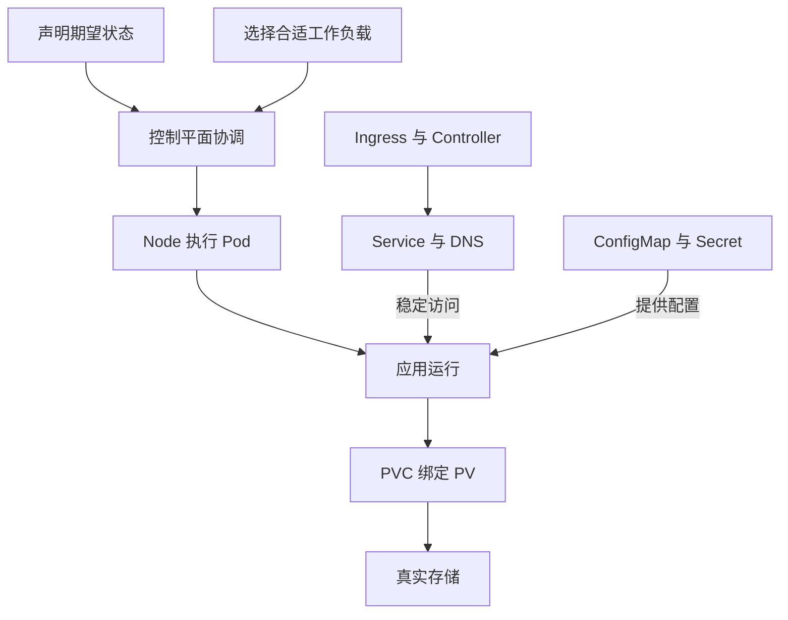

# 27 课程总结与下一步学习

用职责和关系重建全图，再选择适合的后续方向。

## 核心要点

- **1. 学完以后可以怎样复述主线？** 声明资源目标，经 API 保存，控制器协调，Scheduler 分配节点，kubelet 与运行时执行。系统继续报告状态，因此管理是持续过程。
- **2. 怎样选择常见工作负载？** 可互换长期副本用 Deployment，稳定身份用 StatefulSet，节点覆盖用 DaemonSet，一次任务用 Job，定时创建任务用 CronJob。先看生命周期，再选资源名。
- **3. 访问链路的三个关键词是什么？** Service 提供访问抽象，DNS 解析名称，Ingress 与 Controller 处理 HTTP 入口规则。Service 的 selector 选择 Pod，不是直接绑定 Deployment。
- **4. 哪些误区应该特别记住？** 运行不等于就绪，base64 不等于加密，Namespace 不天然禁止网络通信，PVC 不等于备份，StatefulSet 不自动配置数据库复制。
- **5. 接下来研究什么能帮助真正应用？** 可以继续学习探针与资源请求、Gateway API、存储回收与备份、Helm 模板。权限和高级运维属于后续方向，本课程不把它们当作已经完成的配置。

## 场景与示例

**用三个启发式问题自检**

问自己：实例可互换吗？地址变化后调用方怎样找到它？容器或 Pod 消失后哪些数据必须保留？这些问题分别帮助选择工作负载、访问机制和存储方案。

| 需求 | 资源关系 | 重点检查 |
| --- | --- | --- |
| 可互换长期副本 | Deployment → ReplicaSet → Pod | 副本与就绪 |
| 稳定身份 | StatefulSet + Headless Service + PVC | 序号与独立存储 |
| 节点代理 | DaemonSet → 合适 Node 上的 Pod | 节点覆盖 |
| 一次或定时任务 | Job / CronJob → Job → Pod | 完成与幂等 |
| 稳定访问 | Service + EndpointSlice + DNS | selector 与后端 |
| 持久数据 | Pod → PVC → PV → 后端 | 绑定、回收与备份 |

后续方向：探针与资源请求、Gateway API、存储回收与备份、Helm 模板、权限与高级运维。

## 常见误区

**记住资源名称就等于能设计系统**

还应说明每个资源何时工作、与谁协作、能保证什么，以及保证依赖哪些条件。

## 学习衔接与来源

本章结束后，可按需要选择后续方向继续学习。

本章以用户提供的 Kubernetes 教程为基础进行教学重组。所有完整 YAML、命令与实验步骤均为补充示例，不是原文中保留下来的代码。原文在第十三章 Helm 介绍处截断，本章的完整讲解属于补充整理。

---

## 本章测验

本章共 5 道单项选择题，每题 1 分。先自行选择，再展开答案；支持互动的播放器应在提交后判题。

### 第 1 题

期望状态到容器执行的主线，哪项正确？

- A. DNS 创建目标，浏览器执行容器
- B. PVC 分配节点，Service 执行镜像
- C. Helm 替代所有节点运行时
- D. API 保存目标，协调与调度后由节点执行

选择完成后展开答案

正确答案：D

答案解析：目标通过 API 保存，经协调与调度后由节点组件执行容器。

### 第 2 题

需要每个合适节点运行一个代理，应选什么？

- A. Deployment 固定一个副本
- B. DaemonSet
- C. ExternalName
- D. Job 单次运行

选择完成后展开答案

正确答案：B

答案解析：每个适合节点运行代理是 DaemonSet 的典型需求。

### 第 3 题

稳定服务名与名称解析分别主要依赖什么？

- A. Service 与集群 DNS
- B. PVC 与容器运行时
- C. Secret 与镜像仓库
- D. StatefulSet 与业务 SQL

选择完成后展开答案

正确答案：A

答案解析：Service 提供稳定访问抽象，DNS 提供名称到地址的解析。

### 第 4 题

数据库 Pod 重建后要保留数据，还要防止存储误删，哪项认识合理？

- A. PVC 自动替代所有备份
- B. Pod 同名就能保留全部数据
- C. 持久化关联与独立备份都要考虑
- D. Headless Service 保存数据库文件

选择完成后展开答案

正确答案：C

答案解析：持久化和备份不同，回收或误删可能影响数据，两者都要考虑。

### 第 5 题

新系统设计时，哪组问题最有帮助？

- A. 仅比较所有资源名称长度
- B. 实例生命周期、访问入口与数据保留需求
- C. 仅选择看起来最新的镜像标签
- D. 只统计 YAML 文件行数

选择完成后展开答案

正确答案：B

答案解析：先梳理生命周期、访问和数据保留，才能解释资源选择及职责。

<!-- QUIZ_DATA_START
{
  "chapter": "27",
  "questions": [
    {
      "id": 1,
      "question": "期望状态到容器执行的主线，哪项正确？",
      "options": {
        "A": "DNS 创建目标，浏览器执行容器",
        "B": "PVC 分配节点，Service 执行镜像",
        "C": "Helm 替代所有节点运行时",
        "D": "API 保存目标，协调与调度后由节点执行"
      },
      "answer": "D",
      "explanation": "目标通过 API 保存，经协调与调度后由节点组件执行容器。"
    },
    {
      "id": 2,
      "question": "需要每个合适节点运行一个代理，应选什么？",
      "options": {
        "A": "Deployment 固定一个副本",
        "B": "DaemonSet",
        "C": "ExternalName",
        "D": "Job 单次运行"
      },
      "answer": "B",
      "explanation": "每个适合节点运行代理是 DaemonSet 的典型需求。"
    },
    {
      "id": 3,
      "question": "稳定服务名与名称解析分别主要依赖什么？",
      "options": {
        "A": "Service 与集群 DNS",
        "B": "PVC 与容器运行时",
        "C": "Secret 与镜像仓库",
        "D": "StatefulSet 与业务 SQL"
      },
      "answer": "A",
      "explanation": "Service 提供稳定访问抽象，DNS 提供名称到地址的解析。"
    },
    {
      "id": 4,
      "question": "数据库 Pod 重建后要保留数据，还要防止存储误删，哪项认识合理？",
      "options": {
        "A": "PVC 自动替代所有备份",
        "B": "Pod 同名就能保留全部数据",
        "C": "持久化关联与独立备份都要考虑",
        "D": "Headless Service 保存数据库文件"
      },
      "answer": "C",
      "explanation": "持久化和备份不同，回收或误删可能影响数据，两者都要考虑。"
    },
    {
      "id": 5,
      "question": "新系统设计时，哪组问题最有帮助？",
      "options": {
        "A": "仅比较所有资源名称长度",
        "B": "实例生命周期、访问入口与数据保留需求",
        "C": "仅选择看起来最新的镜像标签",
        "D": "只统计 YAML 文件行数"
      },
      "answer": "B",
      "explanation": "先梳理生命周期、访问和数据保留，才能解释资源选择及职责。"
    }
  ]
}
QUIZ_DATA_END -->
