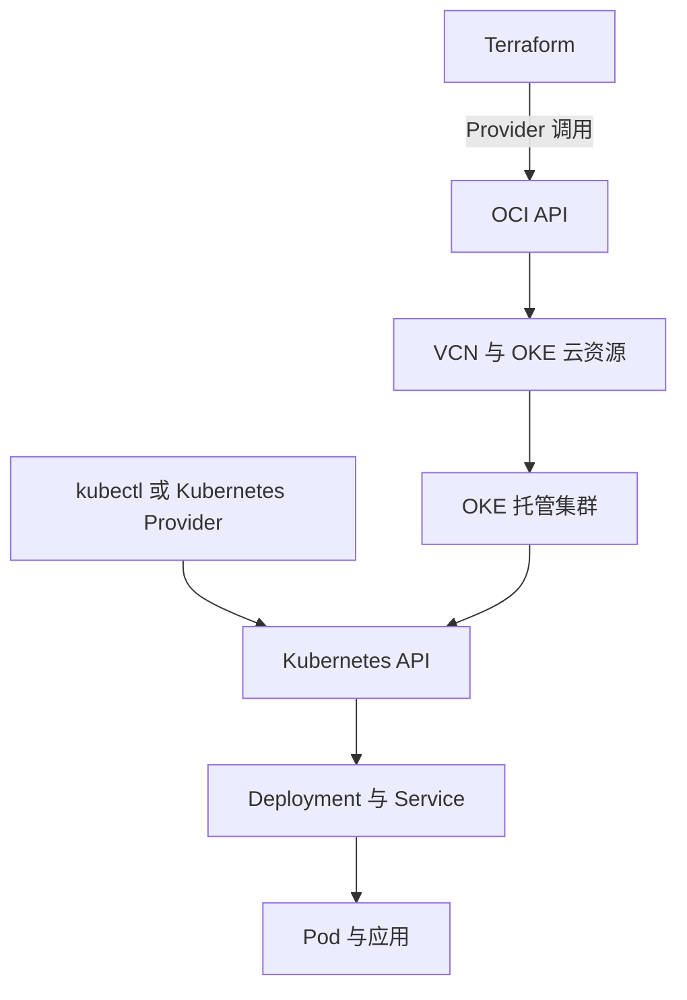

# 01 四层技术的职责全图

先区分工具、云平台、托管集群与应用运行。

## 核心要点

- **1. Terraform、OCI、OKE 和 Kubernetes 是同一类产品吗？** 不是。Terraform 是资源管理工具，OCI 提供云资源，OKE 提供托管 Kubernetes，Kubernetes 编排应用；按层次读图才不容易混淆。
- **2. OKE 和普通 Kubernetes 有什么关系？** OKE 是 OCI 提供的托管 Kubernetes 服务，不改变 Deployment、Pod 和 Service 的基本角色。它增加云网络、计算和存储集成。
- **3. 云资源和集群资源怎样区分？** VCN、OKE Cluster、Node Pool 是 OCI 资源；Namespace、Deployment、Service 是 Kubernetes API 资源。两者使用的管理接口不同。
- **4. 两个 Provider 的箭头分别指向哪里？** OCI Provider 调用 OCI API，Kubernetes Provider 调用 Kubernetes API。Terraform 可以跨层管理，但不能把两个 API 当成同一个接口。
- **5. 该怎么判断项目里的一个对象归谁管理？** 先问它属于 OCI 还是 Kubernetes，再看哪套配置声明它。应用部署在 OCI，并不表示所有对象都由 OCI Provider 直接创建。

## 场景与示例

**先画管理边界**

把 VCN 放在 OCI 一侧，把应用 Pod 放在 Kubernetes 一侧，再补上 Provider 的调用箭头。它表达接口分工，不是要求所有资源必须放在同一个 Compartment。

## 常见误区

**Terraform 永远只能管理云网络**

它也能经 Kubernetes Provider 管理集群内资源；边界由 Provider 和资源类型决定。

## 来源与学习衔接

本章基于用户提供的 Terraform + OCI + OKE 教材重新组织。输入代码块缺失，末尾在负载均衡扩展段落截断；全部完整代码、命令和实验步骤为补充，不是原文代码复原。官方核对依据见 [来源与补充说明.md](来源与补充说明.md)。

下一章：声明式管理的两种节奏。

---

## 本章测验

本章共 5 道单项选择题，每题 1 分。先自行选择，再展开答案；支持 QUIZ_DATA 的播放器应在选择后判题。

### 第 1 题

Terraform 的基本定位是什么？

- A. 托管容器运行时
- B. 资源管理与基础设施即代码工具
- C. 云存储服务
- D. 集群 DNS 实现

选择完成后展开答案

正确答案：B

答案解析：不是。Terraform 是资源管理工具，OCI 提供云资源，OKE 提供托管 Kubernetes，Kubernetes 编排应用；按层次读图才不容易混淆。

### 第 2 题

OKE 的定位是什么？

- A. Terraform 的配置语言
- B. OCI 镜像构建命令
- C. Kubernetes 应用日志文件
- D. OCI 的托管 Kubernetes 服务

选择完成后展开答案

正确答案：D

答案解析：OKE 是 OCI 提供的托管 Kubernetes 服务，不改变 Deployment、Pod 和 Service 的基本角色。它增加云网络、计算和存储集成。

### 第 3 题

哪一组属于 Kubernetes API 资源？

- A. VCN、Subnet、NAT Gateway
- B. Region、AD、Fault Domain
- C. Namespace、Deployment、Service
- D. Compute、Block Volume、OCI LB

选择完成后展开答案

正确答案：C

答案解析：VCN、OKE Cluster、Node Pool 是 OCI 资源；Namespace、Deployment、Service 是 Kubernetes API 资源。两者使用的管理接口不同。

### 第 4 题

Terraform 管理已有 OKE 内的 Namespace，应使用哪个接口？

- A. Kubernetes API
- B. 仅 OCI Compute API
- C. 仅 OCIR 镜像上传接口
- D. 仅 Block Volume 接口

选择完成后展开答案

正确答案：A

答案解析：OCI Provider 调用 OCI API，Kubernetes Provider 调用 Kubernetes API。Terraform 可以跨层管理，但不能把两个 API 当成同一个接口。

### 第 5 题

看到一个 Service，怎样判断管理方式最准确？

- A. 只看应用运行在哪家云
- B. 只看对象名称有无 OCI
- C. 只看 Terraform 文件数量
- D. 查看声明和所调用的 API

选择完成后展开答案

正确答案：D

答案解析：先问它属于 OCI 还是 Kubernetes，再看哪套配置声明它。应用部署在 OCI，并不表示所有对象都由 OCI Provider 直接创建。

<!-- QUIZ_DATA_START
{
  "chapter": "01",
  "questions": [
    {
      "id": 1,
      "question": "Terraform 的基本定位是什么？",
      "options": {
        "A": "托管容器运行时",
        "B": "资源管理与基础设施即代码工具",
        "C": "云存储服务",
        "D": "集群 DNS 实现"
      },
      "answer": "B",
      "explanation": "不是。Terraform 是资源管理工具，OCI 提供云资源，OKE 提供托管 Kubernetes，Kubernetes 编排应用；按层次读图才不容易混淆。"
    },
    {
      "id": 2,
      "question": "OKE 的定位是什么？",
      "options": {
        "A": "Terraform 的配置语言",
        "B": "OCI 镜像构建命令",
        "C": "Kubernetes 应用日志文件",
        "D": "OCI 的托管 Kubernetes 服务"
      },
      "answer": "D",
      "explanation": "OKE 是 OCI 提供的托管 Kubernetes 服务，不改变 Deployment、Pod 和 Service 的基本角色。它增加云网络、计算和存储集成。"
    },
    {
      "id": 3,
      "question": "哪一组属于 Kubernetes API 资源？",
      "options": {
        "A": "VCN、Subnet、NAT Gateway",
        "B": "Region、AD、Fault Domain",
        "C": "Namespace、Deployment、Service",
        "D": "Compute、Block Volume、OCI LB"
      },
      "answer": "C",
      "explanation": "VCN、OKE Cluster、Node Pool 是 OCI 资源；Namespace、Deployment、Service 是 Kubernetes API 资源。两者使用的管理接口不同。"
    },
    {
      "id": 4,
      "question": "Terraform 管理已有 OKE 内的 Namespace，应使用哪个接口？",
      "options": {
        "A": "Kubernetes API",
        "B": "仅 OCI Compute API",
        "C": "仅 OCIR 镜像上传接口",
        "D": "仅 Block Volume 接口"
      },
      "answer": "A",
      "explanation": "OCI Provider 调用 OCI API，Kubernetes Provider 调用 Kubernetes API。Terraform 可以跨层管理，但不能把两个 API 当成同一个接口。"
    },
    {
      "id": 5,
      "question": "看到一个 Service，怎样判断管理方式最准确？",
      "options": {
        "A": "只看应用运行在哪家云",
        "B": "只看对象名称有无 OCI",
        "C": "只看 Terraform 文件数量",
        "D": "查看声明和所调用的 API"
      },
      "answer": "D",
      "explanation": "先问它属于 OCI 还是 Kubernetes，再看哪套配置声明它。应用部署在 OCI，并不表示所有对象都由 OCI Provider 直接创建。"
    }
  ]
}
QUIZ_DATA_END -->
