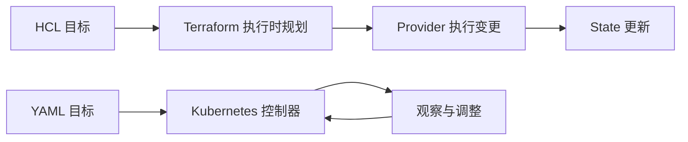

# 02 声明式管理的两种节奏

比较 Terraform 按执行规划与 Kubernetes 持续协调。

## 核心要点

- **1. 它们为什么都被称为声明式？** 都可以声明想要的状态，而不必手工写每一步操作。但相似的输入思想不代表运行机制相同。
- **2. Terraform 平时会一直守着资源吗？** 通常不会。它在执行 plan、apply 等命令时读取、规划和变更，不是默认持续后台维护所有云对象的控制器。
- **3. Kubernetes 的控制器怎样不同？** 它持续观察期望与实际的差异，维护应用副本等目标。删除受管 Pod 后，即使不再运行 Terraform，也可能创建替代实例。
- **4. State 和 etcd 记录的是一样的东西吗？** State 记录 Terraform 管理对象与远程资源的关系，etcd 支撑 Kubernetes API 对象状态。它们不是彼此可交换的数据库。
- **5. 手工改了云资源，Terraform 会立刻改回吗？** 通常不会立即发生。后续需要刷新与规划，判断配置和远程状态差异，再决定是否应用变更。

## 场景与示例

**同样声明两个副本**

Terraform Kubernetes Provider 可以提交 Deployment，但实际维护两个 Pod 的循环仍由 Kubernetes 控制器执行。

## 常见误区

**terraform apply 和 kubectl apply 的效果完全相同**

它们调用接口、管理边界和状态记录不同；同名 apply 不等于同一种控制过程。

## 来源与学习衔接

本章基于用户提供的 Terraform + OCI + OKE 教材重新组织。输入代码块缺失，末尾在负载均衡扩展段落截断；全部完整代码、命令和实验步骤为补充，不是原文代码复原。官方核对依据见 [来源与补充说明.md](来源与补充说明.md)。

下一章：Provider 与资源地址。

---

## 本章测验

本章共 5 道单项选择题，每题 1 分。先自行选择，再展开答案；支持 QUIZ_DATA 的播放器应在选择后判题。

### 第 1 题

声明式配置主要描述什么？

- A. 每一次鼠标点击的位置
- B. 全部容器日志内容
- C. 希望达到的资源状态
- D. 用户请求的完整历史

选择完成后展开答案

正确答案：C

答案解析：都可以声明想要的状态，而不必手工写每一步操作。但相似的输入思想不代表运行机制相同。

### 第 2 题

Terraform 的典型协调节奏是什么？

- A. 执行命令时规划与调整
- B. 默认持续后台修复所有云变化
- C. 每次 Pod 启动时强制执行
- D. 只在浏览器刷新时运行

选择完成后展开答案

正确答案：A

答案解析：通常不会。它在执行 plan、apply 等命令时读取、规划和变更，不是默认持续后台维护所有云对象的控制器。

### 第 3 题

受管 Pod 被删除后谁通常创建替代实例？

- A. 本地 Terraform 文件自己执行
- B. OCIR 仓库
- C. Compartment
- D. Kubernetes 工作负载控制器

选择完成后展开答案

正确答案：D

答案解析：它持续观察期望与实际的差异，维护应用副本等目标。删除受管 Pod 后，即使不再运行 Terraform，也可能创建替代实例。

### 第 4 题

State 与 etcd 的关系是什么？

- A. 保存完全一样的资源内容
- B. 分别服务于两套管理系统
- C. State 自动替换集群 etcd
- D. etcd 自动成为 Terraform Backend

选择完成后展开答案

正确答案：B

答案解析：State 记录 Terraform 管理对象与远程资源的关系，etcd 支撑 Kubernetes API 对象状态。它们不是彼此可交换的数据库。

### 第 5 题

手工改云资源后应怎样理解？

- A. 后续规划可能发现差异
- B. Terraform 必定瞬间恢复
- C. Kubernetes 自动修复所有云资源
- D. 本地 HCL 自动变成远程值

选择完成后展开答案

正确答案：A

答案解析：通常不会立即发生。后续需要刷新与规划，判断配置和远程状态差异，再决定是否应用变更。

<!-- QUIZ_DATA_START
{
  "chapter": "02",
  "questions": [
    {
      "id": 1,
      "question": "声明式配置主要描述什么？",
      "options": {
        "A": "每一次鼠标点击的位置",
        "B": "全部容器日志内容",
        "C": "希望达到的资源状态",
        "D": "用户请求的完整历史"
      },
      "answer": "C",
      "explanation": "都可以声明想要的状态，而不必手工写每一步操作。但相似的输入思想不代表运行机制相同。"
    },
    {
      "id": 2,
      "question": "Terraform 的典型协调节奏是什么？",
      "options": {
        "A": "执行命令时规划与调整",
        "B": "默认持续后台修复所有云变化",
        "C": "每次 Pod 启动时强制执行",
        "D": "只在浏览器刷新时运行"
      },
      "answer": "A",
      "explanation": "通常不会。它在执行 plan、apply 等命令时读取、规划和变更，不是默认持续后台维护所有云对象的控制器。"
    },
    {
      "id": 3,
      "question": "受管 Pod 被删除后谁通常创建替代实例？",
      "options": {
        "A": "本地 Terraform 文件自己执行",
        "B": "OCIR 仓库",
        "C": "Compartment",
        "D": "Kubernetes 工作负载控制器"
      },
      "answer": "D",
      "explanation": "它持续观察期望与实际的差异，维护应用副本等目标。删除受管 Pod 后，即使不再运行 Terraform，也可能创建替代实例。"
    },
    {
      "id": 4,
      "question": "State 与 etcd 的关系是什么？",
      "options": {
        "A": "保存完全一样的资源内容",
        "B": "分别服务于两套管理系统",
        "C": "State 自动替换集群 etcd",
        "D": "etcd 自动成为 Terraform Backend"
      },
      "answer": "B",
      "explanation": "State 记录 Terraform 管理对象与远程资源的关系，etcd 支撑 Kubernetes API 对象状态。它们不是彼此可交换的数据库。"
    },
    {
      "id": 5,
      "question": "手工改云资源后应怎样理解？",
      "options": {
        "A": "后续规划可能发现差异",
        "B": "Terraform 必定瞬间恢复",
        "C": "Kubernetes 自动修复所有云资源",
        "D": "本地 HCL 自动变成远程值"
      },
      "answer": "A",
      "explanation": "通常不会立即发生。后续需要刷新与规划，判断配置和远程状态差异，再决定是否应用变更。"
    }
  ]
}
QUIZ_DATA_END -->
