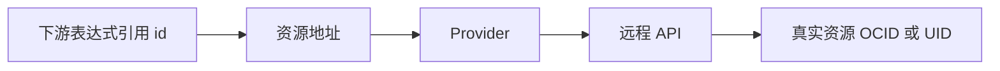

# 03 Provider 与资源地址

读懂资源类型、配置名、远程 ID 和引用关系。



## 核心要点

- **1. Provider 是云账户本身吗？** 不是。Provider 是 Terraform 与外部系统沟通的插件，认证配置告诉它怎样访问目标 API。账号和目标服务由配置决定。
- **2. oci_core_vcn.demo 里两部分表示什么？** 前面是资源类型，后面是本地配置名。这是 Terraform 资源地址，不是实际 VCN 的 OCID，也不要求和云显示名称一样。
- **3. 远程 ID 从哪里来？** Provider 创建或读取真实对象后得到 ID 和属性，并让它们参与 State 和引用。OCI 常使用 OCID 来标识远程资源。
- **4. 写 oci_core_vcn.demo.id 有什么意义？** 它取被管理 VCN 的 ID，并在表达式依赖中连接上下游资源。Terraform 可以据此安排创建顺序，而不是只看文件行序。
- **5. 资源引用和 Service selector 容易混吗？** 引用属于 Terraform 依赖图，selector 属于 Kubernetes 标签匹配。它们都体现关系，但执行时机与机制不同。

## 场景与示例

**VCN ID 被 Cluster 使用**

Cluster 的 vcn_id 引用 VCN 的 id，表示使用这张网络；并不能据此推断完整子网、路由和节点配置已经齐全。

```hcl
vcn_id = oci_core_vcn.demo.id
```

## 常见误区

**把 .tf 文件排好顺序就控制了资源创建顺序**

Terraform 主要依据依赖图执行，文件名和文本顺序不是资源依赖机制。

## 来源与学习衔接

本章基于用户提供的 Terraform + OCI + OKE 教材重新组织。输入代码块缺失，末尾在负载均衡扩展段落截断；全部完整代码、命令和实验步骤为补充，不是原文代码复原。官方核对依据见 [来源与补充说明.md](来源与补充说明.md)。

下一章：Terraform 工程与执行流程。

---

## 本章测验

本章共 5 道单项选择题，每题 1 分。先自行选择，再展开答案；支持 QUIZ_DATA 的播放器应在选择后判题。

### 第 1 题

Provider 的核心作用是什么？

- A. 替代整个云账户
- B. 持续运行所有容器
- C. 存储所有业务订单
- D. 把资源操作映射到目标 API

<details>
<summary>选择完成后展开答案</summary>

正确答案：D

答案解析：不是。Provider 是 Terraform 与外部系统沟通的插件，认证配置告诉它怎样访问目标 API。账号和目标服务由配置决定。

</details>

### 第 2 题

oci_core_vcn.demo 表示什么？

- A. 实际公网 IP
- B. Terraform 中的资源地址
- C. Kubernetes Pod 名称
- D. OCI 认证口令

<details>
<summary>选择完成后展开答案</summary>

正确答案：B

答案解析：前面是资源类型，后面是本地配置名。这是 Terraform 资源地址，不是实际 VCN 的 OCID，也不要求和云显示名称一样。

</details>

### 第 3 题

VCN 的实际 OCID 与本地配置名怎样对应？

- A. 通过资源属性与 State 关联
- B. 必须由同一字符串组成
- C. 由 Pod 标签自动生成
- D. 由浏览器 Cookie 保存

<details>
<summary>选择完成后展开答案</summary>

正确答案：A

答案解析：Provider 创建或读取真实对象后得到 ID 和属性，并让它们参与 State 和引用。OCI 常使用 OCID 来标识远程资源。

</details>

### 第 4 题

下游引用上游资源 id 会帮助建立什么？

- A. Pod Label Selector
- B. HTTP 路由规则
- C. 资源依赖关系
- D. 容器共享文件系统

<details>
<summary>选择完成后展开答案</summary>

正确答案：C

答案解析：它取被管理 VCN 的 ID，并在表达式依赖中连接上下游资源。Terraform 可以据此安排创建顺序，而不是只看文件行序。

</details>

### 第 5 题

Service selector 与 Terraform 引用的正确比较是什么？

- A. 两者都直接调用 OCI API
- B. 一个匹配标签，一个表达依赖
- C. 两者都按文件行序创建对象
- D. 两者都保存镜像内容

<details>
<summary>选择完成后展开答案</summary>

正确答案：B

答案解析：引用属于 Terraform 依赖图，selector 属于 Kubernetes 标签匹配。它们都体现关系，但执行时机与机制不同。

</details>

<!-- QUIZ_DATA_START
{
  "chapter": "03",
  "questions": [
    {
      "id": 1,
      "question": "Provider 的核心作用是什么？",
      "options": {
        "A": "替代整个云账户",
        "B": "持续运行所有容器",
        "C": "存储所有业务订单",
        "D": "把资源操作映射到目标 API"
      },
      "answer": "D",
      "explanation": "不是。Provider 是 Terraform 与外部系统沟通的插件，认证配置告诉它怎样访问目标 API。账号和目标服务由配置决定。"
    },
    {
      "id": 2,
      "question": "oci_core_vcn.demo 表示什么？",
      "options": {
        "A": "实际公网 IP",
        "B": "Terraform 中的资源地址",
        "C": "Kubernetes Pod 名称",
        "D": "OCI 认证口令"
      },
      "answer": "B",
      "explanation": "前面是资源类型，后面是本地配置名。这是 Terraform 资源地址，不是实际 VCN 的 OCID，也不要求和云显示名称一样。"
    },
    {
      "id": 3,
      "question": "VCN 的实际 OCID 与本地配置名怎样对应？",
      "options": {
        "A": "通过资源属性与 State 关联",
        "B": "必须由同一字符串组成",
        "C": "由 Pod 标签自动生成",
        "D": "由浏览器 Cookie 保存"
      },
      "answer": "A",
      "explanation": "Provider 创建或读取真实对象后得到 ID 和属性，并让它们参与 State 和引用。OCI 常使用 OCID 来标识远程资源。"
    },
    {
      "id": 4,
      "question": "下游引用上游资源 id 会帮助建立什么？",
      "options": {
        "A": "Pod Label Selector",
        "B": "HTTP 路由规则",
        "C": "资源依赖关系",
        "D": "容器共享文件系统"
      },
      "answer": "C",
      "explanation": "它取被管理 VCN 的 ID，并在表达式依赖中连接上下游资源。Terraform 可以据此安排创建顺序，而不是只看文件行序。"
    },
    {
      "id": 5,
      "question": "Service selector 与 Terraform 引用的正确比较是什么？",
      "options": {
        "A": "两者都直接调用 OCI API",
        "B": "一个匹配标签，一个表达依赖",
        "C": "两者都按文件行序创建对象",
        "D": "两者都保存镜像内容"
      },
      "answer": "B",
      "explanation": "引用属于 Terraform 依赖图，selector 属于 Kubernetes 标签匹配。它们都体现关系，但执行时机与机制不同。"
    }
  ]
}
QUIZ_DATA_END -->
