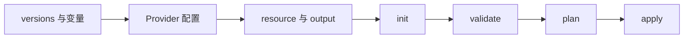

# 04 Terraform 工程与执行流程

用文件职责理解 init、validate、plan 与 apply。



## 核心要点

- **1. 工程为什么常拆成几个 tf 文件？** 便于阅读版本、Provider、变量、资源和输出。同目录文件共同构成一个模块，不是每个文件都独立执行。
- **2. required_providers 负责什么？** 它声明 Provider 来源和版本约束；provider 块提供连接与认证配置。两者是安装选择与运行配置的不同职责。
- **3. init 和 validate 先后怎样理解？** init 准备工作目录与 Provider；validate 检查配置一致性和 Provider 结构。validate 成功不等于账号有权限或远程资源能创建。
- **4. plan 能拿来确认什么？** 它计算预计创建、更新、删除的资源变化，供审阅。需要远程信息时可能访问 API；它不等于已经执行资源变更。
- **5. 怎么让执行针对我审阅过的计划？** 可以将 plan 保存为文件，再 apply 这个文件。计划和 State 可能包含敏感信息，不应随课程源码或真实凭据一起公开提交。

## 场景与示例

**一个最小工程**

terraform/oci-vcn 与 terraform/oke-nginx 是两个独立工程，分别管理云网络和集群内应用；它们不共用一份 State。

```powershell
terraform init
terraform validate
terraform plan -out=review.tfplan
terraform apply review.tfplan
```

## 常见误区

**validate 成功就是云部署成功**

它只证明配置层面通过检查，远程权限、网络和服务支持仍要满足。

## 来源与学习衔接

本章基于用户提供的 Terraform + OCI + OKE 教材重新组织。输入代码块缺失，末尾在负载均衡扩展段落截断；全部完整代码、命令和实验步骤为补充，不是原文代码复原。官方核对依据见 [来源与补充说明.md](来源与补充说明.md)。

下一章：Tenancy、Compartment 与 Namespace。

---

## 本章测验

本章共 5 道单项选择题，每题 1 分。先自行选择，再展开答案；支持 QUIZ_DATA 的播放器应在选择后判题。

### 第 1 题

同目录多个 .tf 文件通常如何被处理？

- A. 共同组成一个模块
- B. 每个文件都是单独 State
- C. 只读取 main.tf
- D. 按文件名各启动一个集群

<details>
<summary>选择完成后展开答案</summary>

正确答案：A

答案解析：便于阅读版本、Provider、变量、资源和输出。同目录文件共同构成一个模块，不是每个文件都独立执行。

</details>

### 第 2 题

required_providers 通常声明什么？

- A. 实际数据库密码
- B. Pod 当前 IP
- C. Provider 来源和版本约束
- D. Node 的业务日志

<details>
<summary>选择完成后展开答案</summary>

正确答案：C

答案解析：它声明 Provider 来源和版本约束；provider 块提供连接与认证配置。两者是安装选择与运行配置的不同职责。

</details>

### 第 3 题

哪条流程合理？

- A. apply 成功后才允许 init
- B. init 后进行配置 validate
- C. 先 destroy 才能 validate
- D. 只查询 Pod 就完成初始化

<details>
<summary>选择完成后展开答案</summary>

正确答案：B

答案解析：init 准备工作目录与 Provider；validate 检查配置一致性和 Provider 结构。validate 成功不等于账号有权限或远程资源能创建。

</details>

### 第 4 题

plan 与 apply 的区别是什么？

- A. 前者创建 Pod，后者只显示文字
- B. 两者都会自动删除全部资源
- C. 前者保存镜像，后者编译源码
- D. 前者规划，后者执行变更

<details>
<summary>选择完成后展开答案</summary>

正确答案：D

答案解析：它计算预计创建、更新、删除的资源变化，供审阅。需要远程信息时可能访问 API；它不等于已经执行资源变更。

</details>

### 第 5 题

审阅计划后执行对应计划，怎样做更明确？

- A. 只记住终端最后一行
- B. 先修改配置再忽略重新规划
- C. plan 保存文件，再 apply 该文件
- D. 把计划转换成 Pod 标签

<details>
<summary>选择完成后展开答案</summary>

正确答案：C

答案解析：可以将 plan 保存为文件，再 apply 这个文件。计划和 State 可能包含敏感信息，不应随课程源码或真实凭据一起公开提交。

</details>

<!-- QUIZ_DATA_START
{
  "chapter": "04",
  "questions": [
    {
      "id": 1,
      "question": "同目录多个 .tf 文件通常如何被处理？",
      "options": {
        "A": "共同组成一个模块",
        "B": "每个文件都是单独 State",
        "C": "只读取 main.tf",
        "D": "按文件名各启动一个集群"
      },
      "answer": "A",
      "explanation": "便于阅读版本、Provider、变量、资源和输出。同目录文件共同构成一个模块，不是每个文件都独立执行。"
    },
    {
      "id": 2,
      "question": "required_providers 通常声明什么？",
      "options": {
        "A": "实际数据库密码",
        "B": "Pod 当前 IP",
        "C": "Provider 来源和版本约束",
        "D": "Node 的业务日志"
      },
      "answer": "C",
      "explanation": "它声明 Provider 来源和版本约束；provider 块提供连接与认证配置。两者是安装选择与运行配置的不同职责。"
    },
    {
      "id": 3,
      "question": "哪条流程合理？",
      "options": {
        "A": "apply 成功后才允许 init",
        "B": "init 后进行配置 validate",
        "C": "先 destroy 才能 validate",
        "D": "只查询 Pod 就完成初始化"
      },
      "answer": "B",
      "explanation": "init 准备工作目录与 Provider；validate 检查配置一致性和 Provider 结构。validate 成功不等于账号有权限或远程资源能创建。"
    },
    {
      "id": 4,
      "question": "plan 与 apply 的区别是什么？",
      "options": {
        "A": "前者创建 Pod，后者只显示文字",
        "B": "两者都会自动删除全部资源",
        "C": "前者保存镜像，后者编译源码",
        "D": "前者规划，后者执行变更"
      },
      "answer": "D",
      "explanation": "它计算预计创建、更新、删除的资源变化，供审阅。需要远程信息时可能访问 API；它不等于已经执行资源变更。"
    },
    {
      "id": 5,
      "question": "审阅计划后执行对应计划，怎样做更明确？",
      "options": {
        "A": "只记住终端最后一行",
        "B": "先修改配置再忽略重新规划",
        "C": "plan 保存文件，再 apply 该文件",
        "D": "把计划转换成 Pod 标签"
      },
      "answer": "C",
      "explanation": "可以将 plan 保存为文件，再 apply 这个文件。计划和 State 可能包含敏感信息，不应随课程源码或真实凭据一起公开提交。"
    }
  ]
}
QUIZ_DATA_END -->
