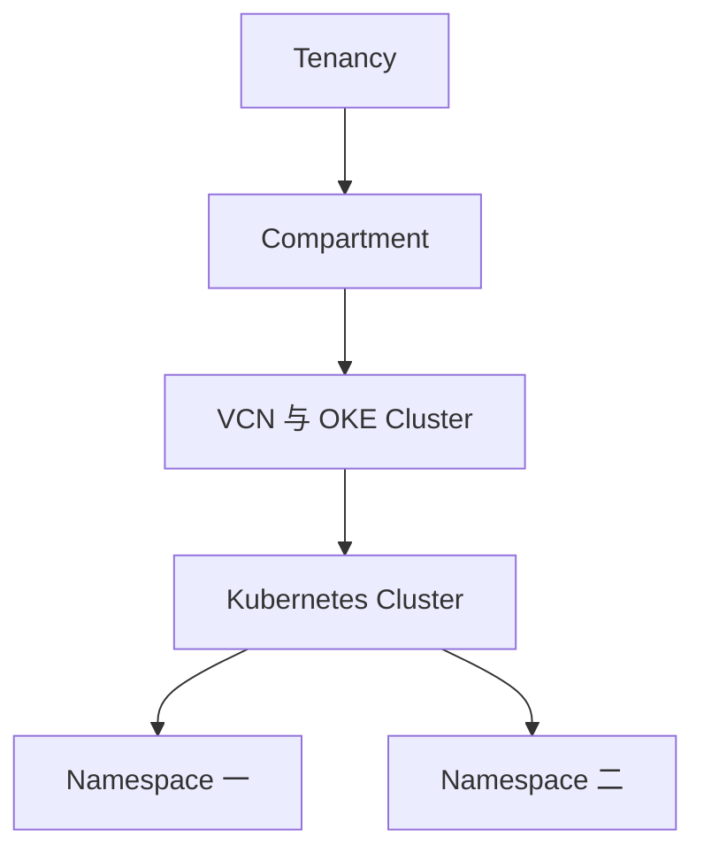

# 05 Tenancy、Compartment 与 Namespace

区分云资源管理范围和集群内资源空间。

## 核心要点

- **1. Tenancy 是一个 Kubernetes Namespace 吗？** 不是。Tenancy 是 OCI 顶层租户环境，Namespace 是单个 Kubernetes 集群里的逻辑资源空间。
- **2. Compartment 用来分什么？** 它对 OCI 资源进行逻辑分组，例如项目网络、计算和 OKE 资源。示意分组不要求所有关联资源都在同一个 Compartment。
- **3. OKE Cluster 放在哪里？** 它作为 OCI 资源归属某个 Compartment，在其 Kubernetes API 内又可以创建多个 Namespace。两个归属层次同时存在。
- **4. 把 Namespace 改名能移动 OCI 网络吗？** 不能。集群内资源空间变化不等于改变云资源的 Compartment 归属，更不会替你搬迁 VCN。
- **5. 项目拆分时怎么避免误读架构图？** 先标明每个对象所属系统，再分开看逻辑分组和运行位置。相似的分组概念不能替换彼此的 API 或权限范围。

## 场景与示例

**一个项目 Compartment 与两个环境 Namespace**

云资源在 OCI 中按项目分组，集群内可以有开发和测试 Namespace；这并不意味着两种隔离的效果完全一样。

## 常见误区

**Compartment 就是 OCI 版 Namespace，可以互换**

它们所属系统、管理内容和权限边界不同，只能用作有限类比。

## 来源与学习衔接

本章基于用户提供的 Terraform + OCI + OKE 教材重新组织。输入代码块缺失，末尾在负载均衡扩展段落截断；全部完整代码、命令和实验步骤为补充，不是原文代码复原。官方核对依据见 [来源与补充说明.md](来源与补充说明.md)。

下一章：Region、AD 与 Fault Domain。

---

## 本章测验

本章共 5 道单项选择题，每题 1 分。先自行选择，再展开答案；支持 QUIZ_DATA 的播放器应在选择后判题。

### 第 1 题

Tenancy 表示什么？

- A. 单个 Pod 的网络空间
- B. OCI 顶层租户环境
- C. 一个 Service 端口
- D. 一份 Terraform 配置文件

选择完成后展开答案

正确答案：B

答案解析：不是。Tenancy 是 OCI 顶层租户环境，Namespace 是单个 Kubernetes 集群里的逻辑资源空间。

### 第 2 题

Compartment 的主要对象是什么？

- A. 只有 Kubernetes Pod
- B. 只有容器日志
- C. 本地 Markdown 文件
- D. OCI 云资源

选择完成后展开答案

正确答案：D

答案解析：它对 OCI 资源进行逻辑分组，例如项目网络、计算和 OKE 资源。示意分组不要求所有关联资源都在同一个 Compartment。

### 第 3 题

同一个 OKE Cluster 可以有多个 Namespace 吗？

- A. 不可以，每个 Namespace 需要一套 OKE
- B. 只有 Terraform State 可以包含 Namespace
- C. 可以
- D. Namespace 只能放在 OCIR

选择完成后展开答案

正确答案：C

答案解析：它作为 OCI 资源归属某个 Compartment，在其 Kubernetes API 内又可以创建多个 Namespace。两个归属层次同时存在。

### 第 4 题

改变集群内 Namespace 能直接做什么？

- A. 组织相应 Kubernetes 资源
- B. 移动 VCN 的 Compartment
- C. 创建一个 OCI Region
- D. 迁移所有 Compute 实例

选择完成后展开答案

正确答案：A

答案解析：不能。集群内资源空间变化不等于改变云资源的 Compartment 归属，更不会替你搬迁 VCN。

### 第 5 题

跨层架构图最应先标明什么？

- A. 只标 Pod IP
- B. 只标文件扩展名
- C. 只标课程章节数量
- D. 资源所属系统与管理范围

选择完成后展开答案

正确答案：D

答案解析：先标明每个对象所属系统，再分开看逻辑分组和运行位置。相似的分组概念不能替换彼此的 API 或权限范围。

<!-- QUIZ_DATA_START
{
  "chapter": "05",
  "questions": [
    {
      "id": 1,
      "question": "Tenancy 表示什么？",
      "options": {
        "A": "单个 Pod 的网络空间",
        "B": "OCI 顶层租户环境",
        "C": "一个 Service 端口",
        "D": "一份 Terraform 配置文件"
      },
      "answer": "B",
      "explanation": "不是。Tenancy 是 OCI 顶层租户环境，Namespace 是单个 Kubernetes 集群里的逻辑资源空间。"
    },
    {
      "id": 2,
      "question": "Compartment 的主要对象是什么？",
      "options": {
        "A": "只有 Kubernetes Pod",
        "B": "只有容器日志",
        "C": "本地 Markdown 文件",
        "D": "OCI 云资源"
      },
      "answer": "D",
      "explanation": "它对 OCI 资源进行逻辑分组，例如项目网络、计算和 OKE 资源。示意分组不要求所有关联资源都在同一个 Compartment。"
    },
    {
      "id": 3,
      "question": "同一个 OKE Cluster 可以有多个 Namespace 吗？",
      "options": {
        "A": "不可以，每个 Namespace 需要一套 OKE",
        "B": "只有 Terraform State 可以包含 Namespace",
        "C": "可以",
        "D": "Namespace 只能放在 OCIR"
      },
      "answer": "C",
      "explanation": "它作为 OCI 资源归属某个 Compartment，在其 Kubernetes API 内又可以创建多个 Namespace。两个归属层次同时存在。"
    },
    {
      "id": 4,
      "question": "改变集群内 Namespace 能直接做什么？",
      "options": {
        "A": "组织相应 Kubernetes 资源",
        "B": "移动 VCN 的 Compartment",
        "C": "创建一个 OCI Region",
        "D": "迁移所有 Compute 实例"
      },
      "answer": "A",
      "explanation": "不能。集群内资源空间变化不等于改变云资源的 Compartment 归属，更不会替你搬迁 VCN。"
    },
    {
      "id": 5,
      "question": "跨层架构图最应先标明什么？",
      "options": {
        "A": "只标 Pod IP",
        "B": "只标文件扩展名",
        "C": "只标课程章节数量",
        "D": "资源所属系统与管理范围"
      },
      "answer": "D",
      "explanation": "先标明每个对象所属系统，再分开看逻辑分组和运行位置。相似的分组概念不能替换彼此的 API 或权限范围。"
    }
  ]
}
QUIZ_DATA_END -->
