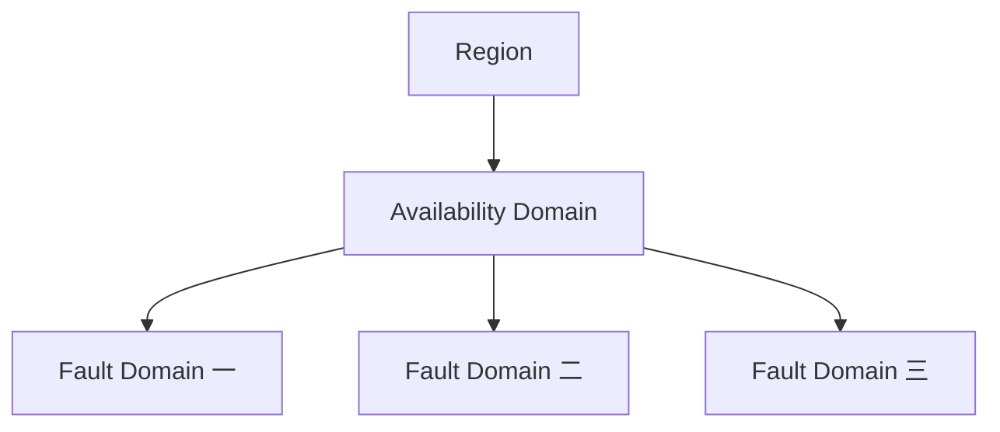

# 06 Region、AD 与 Fault Domain

理解地域、基础设施域和硬件故障分组。



## 核心要点

- **1. Region 首先决定什么？** 它决定云服务所在的地理区域，例如东京区域。选择区域后，还需要确认服务、版本和资源能力是否可用。
- **2. AD 是 Region 内的什么？** Availability Domain 是区域内相对独立的基础设施域。不同 Region 的 AD 数量不同，不能把一个区域的布局直接套到所有区域。
- **3. Fault Domain 的作用是什么？** 它在 AD 内用于分散硬件故障影响。它与 AD 和 Region 是不同层次，不能仅凭不同 Pod 名称判断跨故障域。
- **4. Node Pool 的放置需要哪些信息？** 节点放置可以指定 AD 与 Subnet，实际可用机器类型和镜像还要兼容选择。云节点位置不等于每个 Pod 都固定独占一个域。
- **5. 要跨故障域设计，应先检查什么？** 先查询自己租户和区域的可用资源布局，再结合节点和应用调度需求。不要只增加 Pod 副本而忽略底层节点位置。

## 场景与示例

**在东京区域规划节点**

Region 名称只是选择的一部分，还应核实当前可用 AD、Shape 和 OKE 版本，不把示例名称当成固定部署值。

```powershell
oci iam availability-domain list --compartment-id REPLACE_TENANCY_OCID
```

## 常见误区

**三个 Pod 自动代表三个可用性域**

Pod 数量与云基础设施位置是不同维度，需要查看真实节点布局。

## 来源与学习衔接

本章基于用户提供的 Terraform + OCI + OKE 教材重新组织。输入代码块缺失，末尾在负载均衡扩展段落截断；全部完整代码、命令和实验步骤为补充，不是原文代码复原。官方核对依据见 [来源与补充说明.md](来源与补充说明.md)。

下一章：VCN、Subnet 与 Pod 网络模式。

---

## 本章测验

本章共 5 道单项选择题，每题 1 分。先自行选择，再展开答案；支持 QUIZ_DATA 的播放器应在选择后判题。

### 第 1 题

Region 主要表示什么？

- A. Pod 内部端口空间
- B. Terraform 资源地址
- C. 云服务地理区域
- D. 应用命名空间

<details>
<summary>选择完成后展开答案</summary>

正确答案：C

答案解析：它决定云服务所在的地理区域，例如东京区域。选择区域后，还需要确认服务、版本和资源能力是否可用。

</details>

### 第 2 题

关于 AD 数量，哪项正确？

- A. 不同 Region 可能不同
- B. 每个 Region 固定三个
- C. 每个 Pod 都是一个 AD
- D. AD 数量由 Deployment replicas 决定

<details>
<summary>选择完成后展开答案</summary>

正确答案：A

答案解析：Availability Domain 是区域内相对独立的基础设施域。不同 Region 的 AD 数量不同，不能把一个区域的布局直接套到所有区域。

</details>

### 第 3 题

Fault Domain 的主要用途是什么？

- A. 给 Service 创建 DNS
- B. 保存 Terraform State
- C. 分配容器镜像标签
- D. 在 AD 内分散硬件故障影响

<details>
<summary>选择完成后展开答案</summary>

正确答案：D

答案解析：它在 AD 内用于分散硬件故障影响。它与 AD 和 Region 是不同层次，不能仅凭不同 Pod 名称判断跨故障域。

</details>

### 第 4 题

指定节点放置时常需要哪组信息？

- A. 只有 ConfigMap 名称
- B. AD 与 Subnet
- C. 只有 HTTP 域名
- D. 只有容器日志级别

<details>
<summary>选择完成后展开答案</summary>

正确答案：B

答案解析：节点放置可以指定 AD 与 Subnet，实际可用机器类型和镜像还要兼容选择。云节点位置不等于每个 Pod 都固定独占一个域。

</details>

### 第 5 题

想降低同一硬件故障影响，哪项更合理？

- A. 核对节点布局并结合应用调度
- B. 仅增加镜像标签数量
- C. 仅给 Namespace 改名
- D. 仅增加 Markdown 图的节点

<details>
<summary>选择完成后展开答案</summary>

正确答案：A

答案解析：先查询自己租户和区域的可用资源布局，再结合节点和应用调度需求。不要只增加 Pod 副本而忽略底层节点位置。

</details>

<!-- QUIZ_DATA_START
{
  "chapter": "06",
  "questions": [
    {
      "id": 1,
      "question": "Region 主要表示什么？",
      "options": {
        "A": "Pod 内部端口空间",
        "B": "Terraform 资源地址",
        "C": "云服务地理区域",
        "D": "应用命名空间"
      },
      "answer": "C",
      "explanation": "它决定云服务所在的地理区域，例如东京区域。选择区域后，还需要确认服务、版本和资源能力是否可用。"
    },
    {
      "id": 2,
      "question": "关于 AD 数量，哪项正确？",
      "options": {
        "A": "不同 Region 可能不同",
        "B": "每个 Region 固定三个",
        "C": "每个 Pod 都是一个 AD",
        "D": "AD 数量由 Deployment replicas 决定"
      },
      "answer": "A",
      "explanation": "Availability Domain 是区域内相对独立的基础设施域。不同 Region 的 AD 数量不同，不能把一个区域的布局直接套到所有区域。"
    },
    {
      "id": 3,
      "question": "Fault Domain 的主要用途是什么？",
      "options": {
        "A": "给 Service 创建 DNS",
        "B": "保存 Terraform State",
        "C": "分配容器镜像标签",
        "D": "在 AD 内分散硬件故障影响"
      },
      "answer": "D",
      "explanation": "它在 AD 内用于分散硬件故障影响。它与 AD 和 Region 是不同层次，不能仅凭不同 Pod 名称判断跨故障域。"
    },
    {
      "id": 4,
      "question": "指定节点放置时常需要哪组信息？",
      "options": {
        "A": "只有 ConfigMap 名称",
        "B": "AD 与 Subnet",
        "C": "只有 HTTP 域名",
        "D": "只有容器日志级别"
      },
      "answer": "B",
      "explanation": "节点放置可以指定 AD 与 Subnet，实际可用机器类型和镜像还要兼容选择。云节点位置不等于每个 Pod 都固定独占一个域。"
    },
    {
      "id": 5,
      "question": "想降低同一硬件故障影响，哪项更合理？",
      "options": {
        "A": "核对节点布局并结合应用调度",
        "B": "仅增加镜像标签数量",
        "C": "仅给 Namespace 改名",
        "D": "仅增加 Markdown 图的节点"
      },
      "answer": "A",
      "explanation": "先查询自己租户和区域的可用资源布局，再结合节点和应用调度需求。不要只增加 Pod 副本而忽略底层节点位置。"
    }
  ]
}
QUIZ_DATA_END -->
