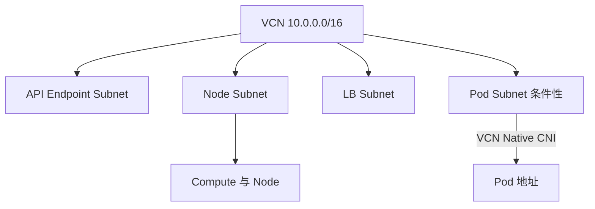

# 07 VCN、Subnet 与 Pod 网络模式

先看底层地址规划，再理解 CNI 决定的 Pod 地址来源。

## 核心要点

- **1. VCN 先解决什么？** 它提供 OCI 的虚拟云网络和地址空间。Subnet 在其中划分不重叠地址段，供相应网络接口和资源使用。
- **2. 为什么示例把 API、Node 和 LB 放在不同子网？** 是为了看清不同角色的网络需求；真实布局需要结合集群模式设计。图中不是能直接照搬的完整网络工程。
- **3. Pod 一定从 OCI Subnet 拿地址吗？** 不一定。VCN-Native Pod Networking 可以让 Pod 从 Pod Subnet 获得地址；其他网络模式可能采用不同方式。
- **4. 为何不能把旧集群网络图原样套过来？** 节点、Pod 和 Service 地址的关系会随网络模式变化。选择模式之后，才应确认所需子网和地址容量。
- **5. 同 VCN 的子网地址重叠有什么问题？** 地址规划应避免重叠，否则会破坏清晰的网络范围设计。还要结合已连接网络地址，不能只看当前项目的一个 CIDR。

## 场景与示例

**一个 VCN 分担多个网络角色**

API Endpoint、节点、LB 和可选 Pod 子网分别说明管理访问、运行、外部入口及 Pod 地址需求；并不意味着每个对象都处于公网。

## 常见误区

**所有 Kubernetes Pod 网络就是 OCI VCN 子网**

这是依赖 CNI 的条件性关系，不能跨所有集群一概而论。

## 来源与学习衔接

本章基于用户提供的 Terraform + OCI + OKE 教材重新组织。输入代码块缺失，末尾在负载均衡扩展段落截断；全部完整代码、命令和实验步骤为补充，不是原文代码复原。官方核对依据见 [来源与补充说明.md](来源与补充说明.md)。

下一章：Gateway、路由与私有节点出站。

---

## 本章测验

本章共 5 道单项选择题，每题 1 分。先自行选择，再展开答案；支持 QUIZ_DATA 的播放器应在选择后判题。

### 第 1 题

VCN 的基本定位是什么？

- A. 容器镜像仓库
- B. Kubernetes 工作负载
- C. Terraform 日志目录
- D. OCI 虚拟云网络

选择完成后展开答案

正确答案：D

答案解析：它提供 OCI 的虚拟云网络和地址空间。Subnet 在其中划分不重叠地址段，供相应网络接口和资源使用。

### 第 2 题

图中的子网划分应怎样理解？

- A. 所有 OKE 必须完全相同
- B. 用于说明角色的一种布局
- C. 每个 Pod 都必须独占子网
- D. 每个 Namespace 都必须创建 VCN

选择完成后展开答案

正确答案：B

答案解析：是为了看清不同角色的网络需求；真实布局需要结合集群模式设计。图中不是能直接照搬的完整网络工程。

### 第 3 题

Pod 地址来源主要受什么影响？

- A. 所选 CNI 网络模式
- B. 只有 Terraform 文件名
- C. 只有应用副本数
- D. 只有 Compartment 显示名

选择完成后展开答案

正确答案：A

答案解析：不一定。VCN-Native Pod Networking 可以让 Pod 从 Pod Subnet 获得地址；其他网络模式可能采用不同方式。

### 第 4 题

准备 OKE 网络时哪种顺序更合理？

- A. 先把所有 Pod IP 写死
- B. 先创建无关公网域名
- C. 先确认网络模式，再规划对应地址与子网
- D. 先增加 Service 名称长度

选择完成后展开答案

正确答案：C

答案解析：节点、Pod 和 Service 地址的关系会随网络模式变化。选择模式之后，才应确认所需子网和地址容量。

### 第 5 题

规划示例 CIDR 时应怎样做？

- A. 只保证名称不同
- B. 检查子网及互联网络地址是否冲突
- C. 只保证 YAML 编号不同
- D. 把所有子网使用同一网段

选择完成后展开答案

正确答案：B

答案解析：地址规划应避免重叠，否则会破坏清晰的网络范围设计。还要结合已连接网络地址，不能只看当前项目的一个 CIDR。

<!-- QUIZ_DATA_START
{
  "chapter": "07",
  "questions": [
    {
      "id": 1,
      "question": "VCN 的基本定位是什么？",
      "options": {
        "A": "容器镜像仓库",
        "B": "Kubernetes 工作负载",
        "C": "Terraform 日志目录",
        "D": "OCI 虚拟云网络"
      },
      "answer": "D",
      "explanation": "它提供 OCI 的虚拟云网络和地址空间。Subnet 在其中划分不重叠地址段，供相应网络接口和资源使用。"
    },
    {
      "id": 2,
      "question": "图中的子网划分应怎样理解？",
      "options": {
        "A": "所有 OKE 必须完全相同",
        "B": "用于说明角色的一种布局",
        "C": "每个 Pod 都必须独占子网",
        "D": "每个 Namespace 都必须创建 VCN"
      },
      "answer": "B",
      "explanation": "是为了看清不同角色的网络需求；真实布局需要结合集群模式设计。图中不是能直接照搬的完整网络工程。"
    },
    {
      "id": 3,
      "question": "Pod 地址来源主要受什么影响？",
      "options": {
        "A": "所选 CNI 网络模式",
        "B": "只有 Terraform 文件名",
        "C": "只有应用副本数",
        "D": "只有 Compartment 显示名"
      },
      "answer": "A",
      "explanation": "不一定。VCN-Native Pod Networking 可以让 Pod 从 Pod Subnet 获得地址；其他网络模式可能采用不同方式。"
    },
    {
      "id": 4,
      "question": "准备 OKE 网络时哪种顺序更合理？",
      "options": {
        "A": "先把所有 Pod IP 写死",
        "B": "先创建无关公网域名",
        "C": "先确认网络模式，再规划对应地址与子网",
        "D": "先增加 Service 名称长度"
      },
      "answer": "C",
      "explanation": "节点、Pod 和 Service 地址的关系会随网络模式变化。选择模式之后，才应确认所需子网和地址容量。"
    },
    {
      "id": 5,
      "question": "规划示例 CIDR 时应怎样做？",
      "options": {
        "A": "只保证名称不同",
        "B": "检查子网及互联网络地址是否冲突",
        "C": "只保证 YAML 编号不同",
        "D": "把所有子网使用同一网段"
      },
      "answer": "B",
      "explanation": "地址规划应避免重叠，否则会破坏清晰的网络范围设计。还要结合已连接网络地址，不能只看当前项目的一个 CIDR。"
    }
  ]
}
QUIZ_DATA_END -->
