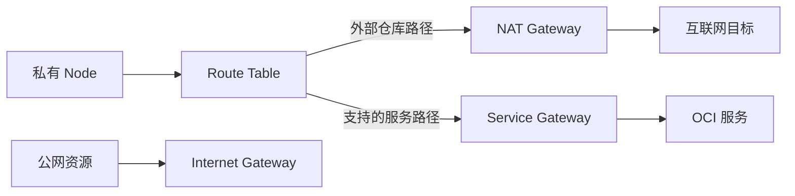

# 08 Gateway、路由与私有节点出站

理解 Internet、NAT、Service Gateway 与 Route Table 的分工。

## 核心要点

- **1. Internet Gateway 就是给任意节点发公网 IP 吗？** 不是。它提供互联网路由能力；资源是否能访问还需要地址、路由和允许的网络规则等条件配合。
- **2. 私有节点访问外部公开镜像仓库时，NAT 做什么？** NAT Gateway 可让没有公网地址的私有资源主动访问互联网。它不把私有节点变成供互联网主动访问的入口。
- **3. Service Gateway 能访问所有互联网网站吗？** 不能这样理解。它提供到支持的 OCI 公共服务的网络路径，目标范围取决于服务支持和路由配置。
- **4. Route Table 与允许流量的规则一样吗？** 不是。路由表根据目标选择下一跳，网络规则决定允许哪些流量；有路线不等于流量一定允许通过。
- **5. OCIR 的流量是不是固定走 NAT？** 不能一概而论。应核实区域、镜像端点和网络路径，区分外部公开仓库与 OCI 服务的实际访问方式。

## 场景与示例

**私有节点拉取镜像**

从节点到目标仓库画出路线，再检查目标解析、下一跳和流量条件。它解释基础关系，不提供完整网络安全配置。

## 常见误区

**创建一个 Gateway 就能让所有资源互通**

Gateway、路由、地址和流量许可是配合条件，不能只看某一个对象存在。

## 来源与学习衔接

本章基于用户提供的 Terraform + OCI + OKE 教材重新组织。输入代码块缺失，末尾在负载均衡扩展段落截断；全部完整代码、命令和实验步骤为补充，不是原文代码复原。官方核对依据见 [来源与补充说明.md](来源与补充说明.md)。

下一章：Terraform 创建独立 VCN 示例。

---

## 本章测验

本章共 5 道单项选择题，每题 1 分。先自行选择，再展开答案；支持 QUIZ_DATA 的播放器应在选择后判题。

### 第 1 题

Internet Gateway 主要提供什么？

- A. 互联网路由能力
- B. 自动给所有 Pod 发公网地址
- C. 自动构建容器镜像
- D. 自动增加 Node Pool 数量

选择完成后展开答案

正确答案：A

答案解析：不是。它提供互联网路由能力；资源是否能访问还需要地址、路由和允许的网络规则等条件配合。

### 第 2 题

NAT Gateway 的典型作用是什么？

- A. 允许所有互联网用户主动访问私有节点
- B. 保存所有镜像内容
- C. 私有资源主动出站访问互联网
- D. 替代 Kubernetes API

选择完成后展开答案

正确答案：C

答案解析：NAT Gateway 可让没有公网地址的私有资源主动访问互联网。它不把私有节点变成供互联网主动访问的入口。

### 第 3 题

Service Gateway 的目标范围是什么？

- A. 任意公网网站
- B. 支持的 OCI 服务
- C. 所有外部用户浏览器
- D. 任何集群内 Pod 标签

选择完成后展开答案

正确答案：B

答案解析：不能这样理解。它提供到支持的 OCI 公共服务的网络路径，目标范围取决于服务支持和路由配置。

### 第 4 题

有路由是否就代表网络一定可达？

- A. 是，路由自动放行全部端口
- B. 是，路由自动提供认证
- C. 是，路由自动拉取镜像
- D. 不是，还需其他网络条件

选择完成后展开答案

正确答案：D

答案解析：不是。路由表根据目标选择下一跳，网络规则决定允许哪些流量；有路线不等于流量一定允许通过。

### 第 5 题

诊断私有节点拉取 OCIR 时，哪个判断更合理？

- A. 认定所有 OCIR 必走 NAT
- B. 认定所有镜像都不需网络
- C. 核对端点与实际网络路径
- D. 直接将 PVC 类型改为公网

选择完成后展开答案

正确答案：C

答案解析：不能一概而论。应核实区域、镜像端点和网络路径，区分外部公开仓库与 OCI 服务的实际访问方式。

<!-- QUIZ_DATA_START
{
  "chapter": "08",
  "questions": [
    {
      "id": 1,
      "question": "Internet Gateway 主要提供什么？",
      "options": {
        "A": "互联网路由能力",
        "B": "自动给所有 Pod 发公网地址",
        "C": "自动构建容器镜像",
        "D": "自动增加 Node Pool 数量"
      },
      "answer": "A",
      "explanation": "不是。它提供互联网路由能力；资源是否能访问还需要地址、路由和允许的网络规则等条件配合。"
    },
    {
      "id": 2,
      "question": "NAT Gateway 的典型作用是什么？",
      "options": {
        "A": "允许所有互联网用户主动访问私有节点",
        "B": "保存所有镜像内容",
        "C": "私有资源主动出站访问互联网",
        "D": "替代 Kubernetes API"
      },
      "answer": "C",
      "explanation": "NAT Gateway 可让没有公网地址的私有资源主动访问互联网。它不把私有节点变成供互联网主动访问的入口。"
    },
    {
      "id": 3,
      "question": "Service Gateway 的目标范围是什么？",
      "options": {
        "A": "任意公网网站",
        "B": "支持的 OCI 服务",
        "C": "所有外部用户浏览器",
        "D": "任何集群内 Pod 标签"
      },
      "answer": "B",
      "explanation": "不能这样理解。它提供到支持的 OCI 公共服务的网络路径，目标范围取决于服务支持和路由配置。"
    },
    {
      "id": 4,
      "question": "有路由是否就代表网络一定可达？",
      "options": {
        "A": "是，路由自动放行全部端口",
        "B": "是，路由自动提供认证",
        "C": "是，路由自动拉取镜像",
        "D": "不是，还需其他网络条件"
      },
      "answer": "D",
      "explanation": "不是。路由表根据目标选择下一跳，网络规则决定允许哪些流量；有路线不等于流量一定允许通过。"
    },
    {
      "id": 5,
      "question": "诊断私有节点拉取 OCIR 时，哪个判断更合理？",
      "options": {
        "A": "认定所有 OCIR 必走 NAT",
        "B": "认定所有镜像都不需网络",
        "C": "核对端点与实际网络路径",
        "D": "直接将 PVC 类型改为公网"
      },
      "answer": "C",
      "explanation": "不能一概而论。应核实区域、镜像端点和网络路径，区分外部公开仓库与 OCI 服务的实际访问方式。"
    }
  ]
}
QUIZ_DATA_END -->
