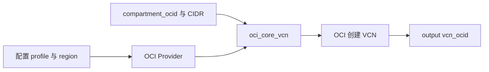

# 09 Terraform 创建独立 VCN 示例

把 OCI Provider、变量、VCN resource 与 output 串起来。



## 核心要点

- **1. 这个完整工程会创建哪些东西？** terraform/oci-vcn 只声明一个 VCN，输出它的 OCID。它不创建 Subnet、Gateway、OKE 或 Node Pool。
- **2. Provider 怎么获得认证？** 示例使用 APIKey 和本机 OCI 配置里的 DEFAULT profile，并显式选择区域。前提是该 profile 已配置且具有相应权限，课程不包含真实凭据。
- **3. Compartment OCID 应写什么？** 填自己有权创建学习资源的实际 Compartment OCID。示例 tfvars 是占位文件，应复制并替换，而不是原样执行。
- **4. VCN 创建成功以后就能运行 OKE 了吗？** 不能。还需要满足所选模式的子网、路由、API Endpoint、节点与其他条件，单个 VCN 只是基础之一。
- **5. 真正执行之前先看什么？** 先 init 和 validate，再审阅 plan，确认只创建预期学习 VCN。输出 OCID 是资源标识，不代表业务接口地址。

## 场景与示例

**从占位变量到真实学习 VCN**

完整文件保存在独立工程目录。只有使用者填好环境并执行 apply 才会创建云资源，本次课件制作不创建 VCN。

完整工程：[terraform/oci-vcn](terraform/oci-vcn/main.tf)。下面只是核心资源，其他文件提供 Provider、版本和变量：

```hcl
resource "oci_core_vcn" "demo" {
  compartment_id = var.compartment_ocid
  cidr_block     = var.vcn_cidr
  display_name   = "terraform-learning-vcn"
  dns_label      = "learnvcn"
}
```

先复制并填写 terraform.tfvars.example，不能将其占位 OCID 原样提交。

## 常见误区

**完整 VCN 示例就是完整 OKE 网络工程**

它只演示一个资源及接口过程，完整集群网络还需要独立设计。

## 来源与学习衔接

本章基于用户提供的 Terraform + OCI + OKE 教材重新组织。输入代码块缺失，末尾在负载均衡扩展段落截断；全部完整代码、命令和实验步骤为补充，不是原文代码复原。官方核对依据见 [来源与补充说明.md](来源与补充说明.md)。

下一章：OKE Cluster 的托管边界与依赖。

---

## 本章测验

本章共 5 道单项选择题，每题 1 分。先自行选择，再展开答案；支持 QUIZ_DATA 的播放器应在选择后判题。

### 第 1 题

本章完整工程的资源范围是什么？

- A. 完整 OKE 与全部应用
- B. 独立 VCN
- C. 两个数据库 StatefulSet
- D. OCI LB 与镜像仓库

<details>
<summary>选择完成后展开答案</summary>

正确答案：B

答案解析：terraform/oci-vcn 只声明一个 VCN，输出它的 OCID。它不创建 Subnet、Gateway、OKE 或 Node Pool。

</details>

### 第 2 题

示例的认证资料来自哪里？

- A. 课程内置生产私钥
- B. Pod 自动生成的数据库密码
- C. Markdown 注释中的访问令牌
- D. 使用者本机 OCI 配置 profile

<details>
<summary>选择完成后展开答案</summary>

正确答案：D

答案解析：示例使用 APIKey 和本机 OCI 配置里的 DEFAULT profile，并显式选择区域。前提是该 profile 已配置且具有相应权限，课程不包含真实凭据。

</details>

### 第 3 题

terraform.tfvars.example 中的 OCID 应怎样处理？

- A. 原样使用占位值
- B. 改成 Kubernetes Namespace
- C. 替换为实际学习 Compartment OCID
- D. 改成容器端口

<details>
<summary>选择完成后展开答案</summary>

正确答案：C

答案解析：填自己有权创建学习资源的实际 Compartment OCID。示例 tfvars 是占位文件，应复制并替换，而不是原样执行。

</details>

### 第 4 题

只有 VCN 成功能否证明 OKE 已可用？

- A. 不能，OKE 相关条件尚未建立
- B. 能，VCN 自动包含 OKE
- C. 能，VCN 自动创建全部 Pod
- D. 能，output 自动部署所有应用

<details>
<summary>选择完成后展开答案</summary>

正确答案：A

答案解析：不能。还需要满足所选模式的子网、路由、API Endpoint、节点与其他条件，单个 VCN 只是基础之一。

</details>

### 第 5 题

plan 显示创建意外资源时应怎样做？

- A. 直接忽略变化执行
- B. 把 OCID 当成网址打开
- C. 先删除 Kubernetes Node
- D. 检查配置和范围后再执行

<details>
<summary>选择完成后展开答案</summary>

正确答案：D

答案解析：先 init 和 validate，再审阅 plan，确认只创建预期学习 VCN。输出 OCID 是资源标识，不代表业务接口地址。

</details>

<!-- QUIZ_DATA_START
{
  "chapter": "09",
  "questions": [
    {
      "id": 1,
      "question": "本章完整工程的资源范围是什么？",
      "options": {
        "A": "完整 OKE 与全部应用",
        "B": "独立 VCN",
        "C": "两个数据库 StatefulSet",
        "D": "OCI LB 与镜像仓库"
      },
      "answer": "B",
      "explanation": "terraform/oci-vcn 只声明一个 VCN，输出它的 OCID。它不创建 Subnet、Gateway、OKE 或 Node Pool。"
    },
    {
      "id": 2,
      "question": "示例的认证资料来自哪里？",
      "options": {
        "A": "课程内置生产私钥",
        "B": "Pod 自动生成的数据库密码",
        "C": "Markdown 注释中的访问令牌",
        "D": "使用者本机 OCI 配置 profile"
      },
      "answer": "D",
      "explanation": "示例使用 APIKey 和本机 OCI 配置里的 DEFAULT profile，并显式选择区域。前提是该 profile 已配置且具有相应权限，课程不包含真实凭据。"
    },
    {
      "id": 3,
      "question": "terraform.tfvars.example 中的 OCID 应怎样处理？",
      "options": {
        "A": "原样使用占位值",
        "B": "改成 Kubernetes Namespace",
        "C": "替换为实际学习 Compartment OCID",
        "D": "改成容器端口"
      },
      "answer": "C",
      "explanation": "填自己有权创建学习资源的实际 Compartment OCID。示例 tfvars 是占位文件，应复制并替换，而不是原样执行。"
    },
    {
      "id": 4,
      "question": "只有 VCN 成功能否证明 OKE 已可用？",
      "options": {
        "A": "不能，OKE 相关条件尚未建立",
        "B": "能，VCN 自动包含 OKE",
        "C": "能，VCN 自动创建全部 Pod",
        "D": "能，output 自动部署所有应用"
      },
      "answer": "A",
      "explanation": "不能。还需要满足所选模式的子网、路由、API Endpoint、节点与其他条件，单个 VCN 只是基础之一。"
    },
    {
      "id": 5,
      "question": "plan 显示创建意外资源时应怎样做？",
      "options": {
        "A": "直接忽略变化执行",
        "B": "把 OCID 当成网址打开",
        "C": "先删除 Kubernetes Node",
        "D": "检查配置和范围后再执行"
      },
      "answer": "D",
      "explanation": "先 init 和 validate，再审阅 plan，确认只创建预期学习 VCN。输出 OCID 是资源标识，不代表业务接口地址。"
    }
  ]
}
QUIZ_DATA_END -->
