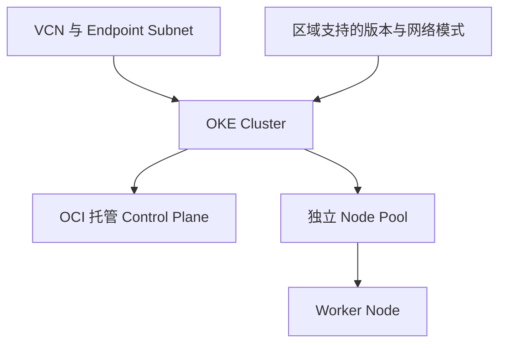

# 10 OKE Cluster 的托管边界与依赖

阅读 Cluster 字段示意，理解网络和版本前提。



## 核心要点

- **1. OKE 托管了哪一层？** 它托管 Kubernetes 控制平面基础设施，并集成 OCI 服务。应用配置、发布和副本目标仍由使用者及 Kubernetes 资源管理。
- **2. oci_containerengine_cluster 主要表示什么？** 它是 OCI Provider 中的集群资源。compartment_id、vcn_id、name 和 kubernetes_version 等字段描述云侧集群声明。
- **3. 版本为什么没有写死一个数字？** 需要选择当前区域支持的 OKE Kubernetes 版本。教材不把示例版本当成所有区域长期都可创建的版本。
- **4. 图中 VCN 和 Endpoint Subnet 是怎样连接的？** Terraform 的属性引用可以表达依赖，Cluster 使用已有网络 ID。完整环境仍需相应子网、网络模式及节点条件。
- **5. 看到 Cluster 资源已经存在，下一步看什么？** 确认集群状态、API 访问路径与工作节点供给。集群存在并不保证已经有可运行应用的 Node 或可达的客户端连接。

## 场景与示例

**阅读而非直接执行集群片段**

examples/oke-cluster-snippet.hcl.txt 只说明主要字段，缺少完整变量与网络工程；它不是一键创建 OKE 的部署包。

关键字段片段，不能直接运行：

```hcl
# 关键字段示意，不是完整模块，不能直接 apply。
# 变量、VCN 和 Endpoint Subnet 需来自实际网络工程。
resource "oci_containerengine_cluster" "demo" {
  compartment_id     = var.compartment_ocid
  name               = "learning-oke"
  kubernetes_version = var.supported_kubernetes_version
  vcn_id             = oci_core_vcn.demo.id
  cluster_pod_network_options {
    cni_type = "OCI_VCN_IP_NATIVE"
  }
  endpoint_config {
    subnet_id            = oci_core_subnet.api.id
    is_public_ip_enabled = false
  }
}
```

## 常见误区

**一个 Cluster resource 就自动包含全部网络和应用**

托管集群、节点供给和应用部署有各自的声明与准备过程。

## 来源与学习衔接

本章基于用户提供的 Terraform + OCI + OKE 教材重新组织。输入代码块缺失，末尾在负载均衡扩展段落截断；全部完整代码、命令和实验步骤为补充，不是原文代码复原。官方核对依据见 [来源与补充说明.md](来源与补充说明.md)。

下一章：Node Pool、Compute Instance 与 Node。

---

## 本章测验

本章共 5 道单项选择题，每题 1 分。先自行选择，再展开答案；支持 QUIZ_DATA 的播放器应在选择后判题。

### 第 1 题

OKE 的托管职责主要涉及什么？

- A. 自动实现所有业务逻辑
- B. 自动生成全部应用源码
- C. 控制平面基础设施与云集成
- D. 自动完成数据库主从复制

<details>
<summary>选择完成后展开答案</summary>

正确答案：C

答案解析：它托管 Kubernetes 控制平面基础设施，并集成 OCI 服务。应用配置、发布和副本目标仍由使用者及 Kubernetes 资源管理。

</details>

### 第 2 题

oci_containerengine_cluster 属于哪一侧资源？

- A. OCI 侧集群资源
- B. Kubernetes Pod
- C. 容器内配置文件
- D. CoreDNS 的单条记录

<details>
<summary>选择完成后展开答案</summary>

正确答案：A

答案解析：它是 OCI Provider 中的集群资源。compartment_id、vcn_id、name 和 kubernetes_version 等字段描述云侧集群声明。

</details>

### 第 3 题

集群 Kubernetes 版本应怎样选择？

- A. 永远使用任意历史版本
- B. 由 Nginx 版本自动决定
- C. 由 PVC 容量自动决定
- D. 确认目标区域当前支持的版本

<details>
<summary>选择完成后展开答案</summary>

正确答案：D

答案解析：需要选择当前区域支持的 OKE Kubernetes 版本。教材不把示例版本当成所有区域长期都可创建的版本。

</details>

### 第 4 题

Cluster 引用 VCN id 说明什么？

- A. 自动补全所有网关与路由
- B. 建立网络使用关系和 Terraform 依赖
- C. 自动创建全部 Node Pool
- D. 自动创建所有业务 Pod

<details>
<summary>选择完成后展开答案</summary>

正确答案：B

答案解析：Terraform 的属性引用可以表达依赖，Cluster 使用已有网络 ID。完整环境仍需相应子网、网络模式及节点条件。

</details>

### 第 5 题

Cloud Console 显示 Cluster 存在后，哪项检查合理？

- A. 继续确认 API 可达及节点运行条件
- B. 认定应用必然已经可用
- C. 只查询 OCIR 镜像标签
- D. 删除本地 kubeconfig

<details>
<summary>选择完成后展开答案</summary>

正确答案：A

答案解析：确认集群状态、API 访问路径与工作节点供给。集群存在并不保证已经有可运行应用的 Node 或可达的客户端连接。

</details>

<!-- QUIZ_DATA_START
{
  "chapter": "10",
  "questions": [
    {
      "id": 1,
      "question": "OKE 的托管职责主要涉及什么？",
      "options": {
        "A": "自动实现所有业务逻辑",
        "B": "自动生成全部应用源码",
        "C": "控制平面基础设施与云集成",
        "D": "自动完成数据库主从复制"
      },
      "answer": "C",
      "explanation": "它托管 Kubernetes 控制平面基础设施，并集成 OCI 服务。应用配置、发布和副本目标仍由使用者及 Kubernetes 资源管理。"
    },
    {
      "id": 2,
      "question": "oci_containerengine_cluster 属于哪一侧资源？",
      "options": {
        "A": "OCI 侧集群资源",
        "B": "Kubernetes Pod",
        "C": "容器内配置文件",
        "D": "CoreDNS 的单条记录"
      },
      "answer": "A",
      "explanation": "它是 OCI Provider 中的集群资源。compartment_id、vcn_id、name 和 kubernetes_version 等字段描述云侧集群声明。"
    },
    {
      "id": 3,
      "question": "集群 Kubernetes 版本应怎样选择？",
      "options": {
        "A": "永远使用任意历史版本",
        "B": "由 Nginx 版本自动决定",
        "C": "由 PVC 容量自动决定",
        "D": "确认目标区域当前支持的版本"
      },
      "answer": "D",
      "explanation": "需要选择当前区域支持的 OKE Kubernetes 版本。教材不把示例版本当成所有区域长期都可创建的版本。"
    },
    {
      "id": 4,
      "question": "Cluster 引用 VCN id 说明什么？",
      "options": {
        "A": "自动补全所有网关与路由",
        "B": "建立网络使用关系和 Terraform 依赖",
        "C": "自动创建全部 Node Pool",
        "D": "自动创建所有业务 Pod"
      },
      "answer": "B",
      "explanation": "Terraform 的属性引用可以表达依赖，Cluster 使用已有网络 ID。完整环境仍需相应子网、网络模式及节点条件。"
    },
    {
      "id": 5,
      "question": "Cloud Console 显示 Cluster 存在后，哪项检查合理？",
      "options": {
        "A": "继续确认 API 可达及节点运行条件",
        "B": "认定应用必然已经可用",
        "C": "只查询 OCIR 镜像标签",
        "D": "删除本地 kubeconfig"
      },
      "answer": "A",
      "explanation": "确认集群状态、API 访问路径与工作节点供给。集群存在并不保证已经有可运行应用的 Node 或可达的客户端连接。"
    }
  ]
}
QUIZ_DATA_END -->
