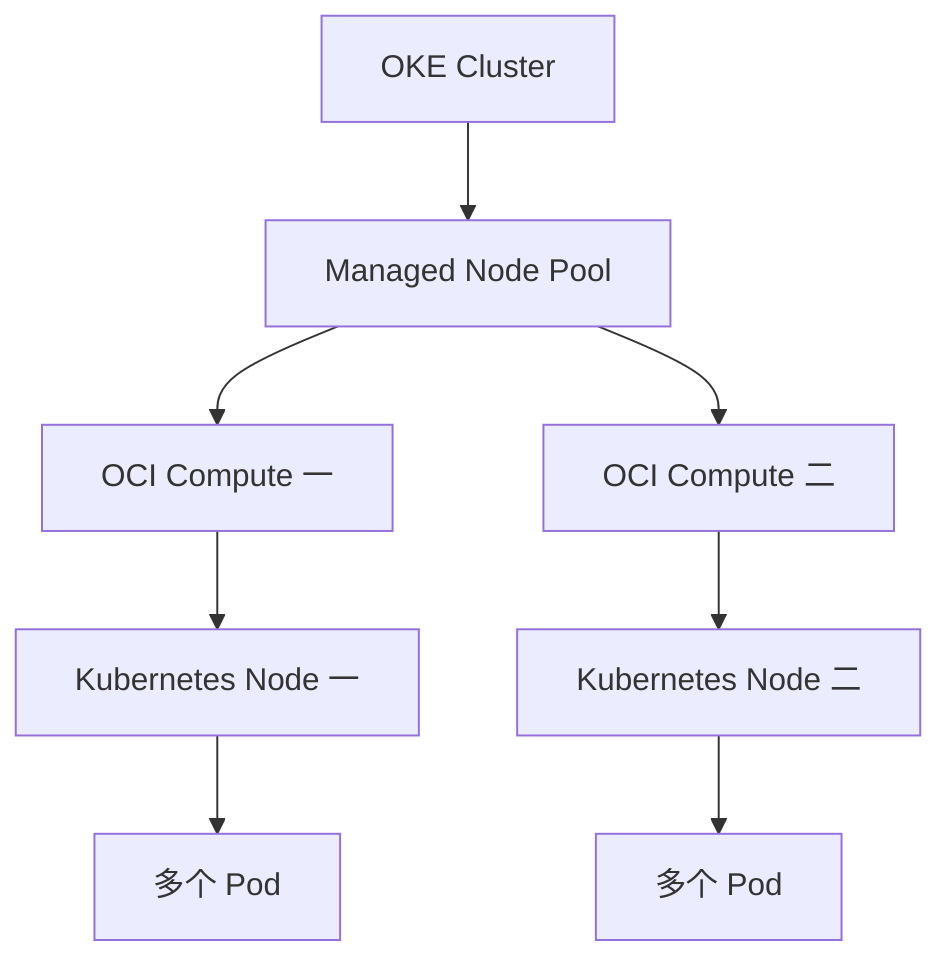

# 11 Node Pool、Compute Instance 与 Node

把节点组、云服务器和 Kubernetes 节点视角对应起来。



## 核心要点

- **1. Node Pool 是什么层次？** 它是一组由 OKE 管理的工作节点配置，决定数量、机器类型、镜像与放置条件。本文以 Managed Nodes 为主。
- **2. Managed Node 在 OCI 中看得到吗？** 通常可以在 Compute 侧看到相应实例。在 Kubernetes 侧，它注册为提供运行资源的 Node，是同一节点的不同管理视角。
- **3. Node Pool 配置会影响哪些东西？** 例如节点数量、Shape、源镜像、AD 与 Subnet。Flex Shape 可能需要 OCPU 和内存配置，镜像要与所选 OKE 版本兼容。
- **4. 两台 Node 是否只能运行两个 Pod？** 不是。一台节点可以运行多个 Pod，具体受资源容量和调度条件影响；节点数量与应用副本数不是同一单位。
- **5. Deployment 扩成五个是否自动创建五台 Compute？** 不会仅凭这个副本声明就得到五台服务器。节点扩容是另一类能力和配置，不能把 Pod 扩容等同于节点扩容。

## 场景与示例

**读 Node Pool 片段**

先看它引用哪个 Cluster，再看节点数量、镜像、Shape 与放置。课程片段不包含当前区域可用镜像和完整网络配置。

关键字段片段，不能直接运行：

```hcl
# Managed Node Pool 关键字段示意，不是完整模块。
# Flex Shape、镜像、AD、Pod 网络和完整网络配置需适配实际环境。
resource "oci_containerengine_node_pool" "demo" {
  compartment_id     = var.compartment_ocid
  cluster_id         = oci_containerengine_cluster.demo.id
  name               = "learning-nodes"
  kubernetes_version = var.supported_kubernetes_version
  node_shape         = var.flex_shape
  node_shape_config {
    ocpus         = 2
    memory_in_gbs = 16
  }
  node_source_details {
    source_type = "IMAGE"
    image_id    = var.compatible_oke_image_ocid
  }
  node_config_details {
    size = 2
    placement_configs {
      availability_domain = var.availability_domain
      subnet_id           = oci_core_subnet.nodes.id
    }
  }
}
```

## 常见误区

**Node Pool 数量、Node 数量、Pod 数量是同一个数字**

它们描述不同层次；应分别查询云节点配置和 Kubernetes 工作负载。

## 来源与学习衔接

本章基于用户提供的 Terraform + OCI + OKE 教材重新组织。输入代码块缺失，末尾在负载均衡扩展段落截断；全部完整代码、命令和实验步骤为补充，不是原文代码复原。官方核对依据见 [来源与补充说明.md](来源与补充说明.md)。

下一章：从云节点到容器执行。

---

## 本章测验

本章共 5 道单项选择题，每题 1 分。先自行选择，再展开答案；支持 QUIZ_DATA 的播放器应在选择后判题。

### 第 1 题

Node Pool 的主要含义是什么？

- A. 一个应用容器
- B. 一个 Namespace
- C. 一条 Service DNS 记录
- D. 一组工作节点及其管理配置

<details>
<summary>选择完成后展开答案</summary>

正确答案：D

答案解析：它是一组由 OKE 管理的工作节点配置，决定数量、机器类型、镜像与放置条件。本文以 Managed Nodes 为主。

</details>

### 第 2 题

Managed Node 的两种常见视角是什么？

- A. ConfigMap 与 Secret
- B. OCI Compute 实例与 Kubernetes Node
- C. Service 与 EndpointSlice
- D. 镜像仓库与镜像标签

<details>
<summary>选择完成后展开答案</summary>

正确答案：B

答案解析：通常可以在 Compute 侧看到相应实例。在 Kubernetes 侧，它注册为提供运行资源的 Node，是同一节点的不同管理视角。

</details>

### 第 3 题

选择 Flex Shape 时可能还需什么？

- A. OCPU 与内存配置
- B. HTTP 域名路径
- C. ConfigMap 日志内容
- D. PVC 的文件名

<details>
<summary>选择完成后展开答案</summary>

正确答案：A

答案解析：例如节点数量、Shape、源镜像、AD 与 Subnet。Flex Shape 可能需要 OCPU 和内存配置，镜像要与所选 OKE 版本兼容。

</details>

### 第 4 题

两个 Node 能否运行五个 Pod？

- A. 永远不能
- B. 必须先创建五个 VCN
- C. 在资源与调度允许时可以
- D. 每个 Pod 都要新增一个 Node Pool

<details>
<summary>选择完成后展开答案</summary>

正确答案：C

答案解析：不是。一台节点可以运行多个 Pod，具体受资源容量和调度条件影响；节点数量与应用副本数不是同一单位。

</details>

### 第 5 题

只把 replicas 改为五，能直接推断什么？

- A. 云里必定新增五台 Compute
- B. 应用目标为五个 Pod 副本
- C. 集群必定跨五个 AD
- D. 每个 Pod 获得独立 Region

<details>
<summary>选择完成后展开答案</summary>

正确答案：B

答案解析：不会仅凭这个副本声明就得到五台服务器。节点扩容是另一类能力和配置，不能把 Pod 扩容等同于节点扩容。

</details>

<!-- QUIZ_DATA_START
{
  "chapter": "11",
  "questions": [
    {
      "id": 1,
      "question": "Node Pool 的主要含义是什么？",
      "options": {
        "A": "一个应用容器",
        "B": "一个 Namespace",
        "C": "一条 Service DNS 记录",
        "D": "一组工作节点及其管理配置"
      },
      "answer": "D",
      "explanation": "它是一组由 OKE 管理的工作节点配置，决定数量、机器类型、镜像与放置条件。本文以 Managed Nodes 为主。"
    },
    {
      "id": 2,
      "question": "Managed Node 的两种常见视角是什么？",
      "options": {
        "A": "ConfigMap 与 Secret",
        "B": "OCI Compute 实例与 Kubernetes Node",
        "C": "Service 与 EndpointSlice",
        "D": "镜像仓库与镜像标签"
      },
      "answer": "B",
      "explanation": "通常可以在 Compute 侧看到相应实例。在 Kubernetes 侧，它注册为提供运行资源的 Node，是同一节点的不同管理视角。"
    },
    {
      "id": 3,
      "question": "选择 Flex Shape 时可能还需什么？",
      "options": {
        "A": "OCPU 与内存配置",
        "B": "HTTP 域名路径",
        "C": "ConfigMap 日志内容",
        "D": "PVC 的文件名"
      },
      "answer": "A",
      "explanation": "例如节点数量、Shape、源镜像、AD 与 Subnet。Flex Shape 可能需要 OCPU 和内存配置，镜像要与所选 OKE 版本兼容。"
    },
    {
      "id": 4,
      "question": "两个 Node 能否运行五个 Pod？",
      "options": {
        "A": "永远不能",
        "B": "必须先创建五个 VCN",
        "C": "在资源与调度允许时可以",
        "D": "每个 Pod 都要新增一个 Node Pool"
      },
      "answer": "C",
      "explanation": "不是。一台节点可以运行多个 Pod，具体受资源容量和调度条件影响；节点数量与应用副本数不是同一单位。"
    },
    {
      "id": 5,
      "question": "只把 replicas 改为五，能直接推断什么？",
      "options": {
        "A": "云里必定新增五台 Compute",
        "B": "应用目标为五个 Pod 副本",
        "C": "集群必定跨五个 AD",
        "D": "每个 Pod 获得独立 Region"
      },
      "answer": "B",
      "explanation": "不会仅凭这个副本声明就得到五台服务器。节点扩容是另一类能力和配置，不能把 Pod 扩容等同于节点扩容。"
    }
  ]
}
QUIZ_DATA_END -->
