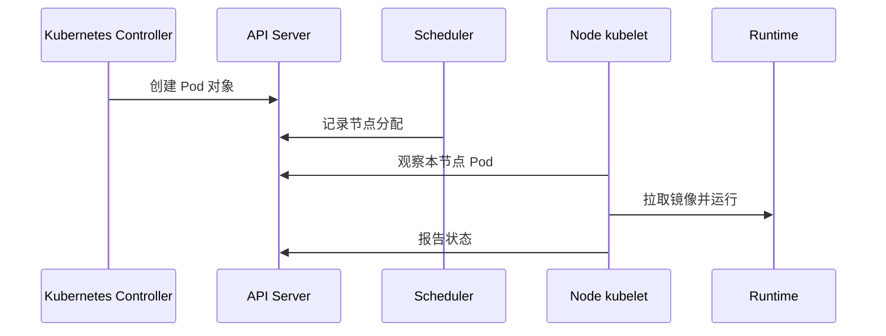

# 12 从云节点到容器执行

串起 Scheduler、kubelet、运行时和资源容量。

## 核心要点

- **1. 谁根据 Deployment 创建实际 Pod？** 相关控制器维护 Deployment、ReplicaSet 和 Pod 的关系。Terraform 若只声明 Deployment，也不必逐个声明 Pod。
- **2. Scheduler 能直接在 OCI 创建服务器吗？** 本章调度器为待调度 Pod 选择已有合适 Node，不是负责创建 Compute 的 Terraform OCI Provider。
- **3. 安排完成后谁执行容器？** Node 上的 kubelet 与容器运行时协作拉取镜像、创建和运行容器，随后继续报告状态。
- **4. Pod 长时间没运行就一定是 Terraform 出错吗？** 不能这样判断。声明提交后仍要考虑节点资源、调度约束、镜像拉取与应用配置等运行条件。
- **5. 增加 Pod 和增加 Node 该怎么比较？** 前者增加工作负载目标，后者增加执行容量。先看实际资源请求与可用节点，再判断是否需要扩容哪一层。

## 场景与示例

**五个目标副本与两台节点**

先观察 Kubernetes 实际调度结果，再检查是否资源允许。只看期望副本不能证明已运行五个实例。

## 常见误区

**Terraform 提交 Deployment 成功就等于容器已经完成业务初始化**

API 对象、调度、镜像和应用就绪是多个阶段，要分别确认。

## 来源与学习衔接

本章基于用户提供的 Terraform + OCI + OKE 教材重新组织。输入代码块缺失，末尾在负载均衡扩展段落截断；全部完整代码、命令和实验步骤为补充，不是原文代码复原。官方核对依据见 [来源与补充说明.md](来源与补充说明.md)。

下一章：kubeconfig、Context 与集群认证。

---

## 本章测验

本章共 5 道单项选择题，每题 1 分。先自行选择，再展开答案；支持 QUIZ_DATA 的播放器应在选择后判题。

### 第 1 题

Deployment 之后的 Pod 通常由谁维护？

- A. Kubernetes 工作负载控制器
- B. VCN 路由表
- C. OCIR 仓库
- D. 本地 tfvars 文件

选择完成后展开答案

正确答案：A

答案解析：相关控制器维护 Deployment、ReplicaSet 和 Pod 的关系。Terraform 若只声明 Deployment，也不必逐个声明 Pod。

### 第 2 题

Scheduler 在本流程中的职责是什么？

- A. 直接构建 OCIR 镜像
- B. 创建 Compartment
- C. 为 Pod 选择合适 Node
- D. 自动扩容所有云磁盘

选择完成后展开答案

正确答案：C

答案解析：本章调度器为待调度 Pod 选择已有合适 Node，不是负责创建 Compute 的 Terraform OCI Provider。

### 第 3 题

实际节点执行链是哪项？

- A. Terraform State 与浏览器
- B. kubelet 与容器运行时
- C. Compartment 与 Region
- D. ConfigMap 与 OCI Console

选择完成后展开答案

正确答案：B

答案解析：Node 上的 kubelet 与容器运行时协作拉取镜像、创建和运行容器，随后继续报告状态。

### 第 4 题

Pod 未运行时应怎样分层理解？

- A. 一律认定 VCN 已删除
- B. 一律认定 State 被清空
- C. 只重命名 Terraform 文件
- D. 声明成功与运行条件需要分开检查

选择完成后展开答案

正确答案：D

答案解析：不能这样判断。声明提交后仍要考虑节点资源、调度约束、镜像拉取与应用配置等运行条件。

### 第 5 题

副本目标超过可调度容量时，哪个认识合理？

- A. Node Pool 一定按副本逐一扩容
- B. 镜像会自动缩小全部内存需求
- C. Pod 目标不等于容量自动增加
- D. Service 会替代节点执行容器

选择完成后展开答案

正确答案：C

答案解析：前者增加工作负载目标，后者增加执行容量。先看实际资源请求与可用节点，再判断是否需要扩容哪一层。

<!-- QUIZ_DATA_START
{
  "chapter": "12",
  "questions": [
    {
      "id": 1,
      "question": "Deployment 之后的 Pod 通常由谁维护？",
      "options": {
        "A": "Kubernetes 工作负载控制器",
        "B": "VCN 路由表",
        "C": "OCIR 仓库",
        "D": "本地 tfvars 文件"
      },
      "answer": "A",
      "explanation": "相关控制器维护 Deployment、ReplicaSet 和 Pod 的关系。Terraform 若只声明 Deployment，也不必逐个声明 Pod。"
    },
    {
      "id": 2,
      "question": "Scheduler 在本流程中的职责是什么？",
      "options": {
        "A": "直接构建 OCIR 镜像",
        "B": "创建 Compartment",
        "C": "为 Pod 选择合适 Node",
        "D": "自动扩容所有云磁盘"
      },
      "answer": "C",
      "explanation": "本章调度器为待调度 Pod 选择已有合适 Node，不是负责创建 Compute 的 Terraform OCI Provider。"
    },
    {
      "id": 3,
      "question": "实际节点执行链是哪项？",
      "options": {
        "A": "Terraform State 与浏览器",
        "B": "kubelet 与容器运行时",
        "C": "Compartment 与 Region",
        "D": "ConfigMap 与 OCI Console"
      },
      "answer": "B",
      "explanation": "Node 上的 kubelet 与容器运行时协作拉取镜像、创建和运行容器，随后继续报告状态。"
    },
    {
      "id": 4,
      "question": "Pod 未运行时应怎样分层理解？",
      "options": {
        "A": "一律认定 VCN 已删除",
        "B": "一律认定 State 被清空",
        "C": "只重命名 Terraform 文件",
        "D": "声明成功与运行条件需要分开检查"
      },
      "answer": "D",
      "explanation": "不能这样判断。声明提交后仍要考虑节点资源、调度约束、镜像拉取与应用配置等运行条件。"
    },
    {
      "id": 5,
      "question": "副本目标超过可调度容量时，哪个认识合理？",
      "options": {
        "A": "Node Pool 一定按副本逐一扩容",
        "B": "镜像会自动缩小全部内存需求",
        "C": "Pod 目标不等于容量自动增加",
        "D": "Service 会替代节点执行容器"
      },
      "answer": "C",
      "explanation": "前者增加工作负载目标，后者增加执行容量。先看实际资源请求与可用节点，再判断是否需要扩容哪一层。"
    }
  ]
}
QUIZ_DATA_END -->
