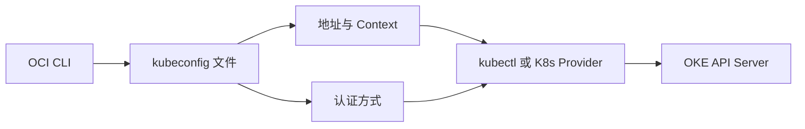

# 13 kubeconfig、Context 与集群认证

说明客户端如何选择 OKE API，而不把连接文件当成服务。



## 核心要点

- **1. kubeconfig 运行在 OKE 内吗？** 它是客户端连接配置文件，保存集群地址、集群标识、认证方式和 Context 等信息，不是 Kubernetes Service。
- **2. Context 帮助选择什么？** 它组织要连接的集群、用户及相关客户端默认设置。操作前确认目标 Context，可以避免连到错误集群。
- **3. OCI CLI 生成配置以后认证就永久有效吗？** 不能保证。OKE 配置通常使用客户端认证机制获取令牌，仍依赖有效的 OCI 认证条件与相应访问权限。
- **4. Provider 和 kubectl 用同一文件就一定同一 Context 吗？** 如果显式或默认 Context 不同，目标也可能不同。本课完整实验要求两者同时指定相同路径与同一 Context。
- **5. kubectl get nodes 成功说明什么？** 说明当前客户端能够通过相应 API 获得节点数据。它不自动证明所有业务入口、镜像和存储都正常。

## 场景与示例

**独立的 oke-learning.config**

示例将 kubeconfig 写到单独文件，并让 Terraform 和 kubectl 明确使用它；避免不知不觉采用默认生产 Context。

```powershell
kubectl --kubeconfig "C:/ACTUAL_PATH/oke-learning.config" config get-contexts
kubectl --kubeconfig "C:/ACTUAL_PATH/oke-learning.config" --context ACTUAL_CONTEXT get nodes
```

## 常见误区

**只要文件存在，网络与认证就都正常**

配置内容、认证条件和 API 网络路径仍要分别满足。

## 来源与学习衔接

本章基于用户提供的 Terraform + OCI + OKE 教材重新组织。输入代码块缺失，末尾在负载均衡扩展段落截断；全部完整代码、命令和实验步骤为补充，不是原文代码复原。官方核对依据见 [来源与补充说明.md](来源与补充说明.md)。

下一章：私有与公开 API Endpoint。

---

## 本章测验

本章共 5 道单项选择题，每题 1 分。先自行选择，再展开答案；支持 QUIZ_DATA 的播放器应在选择后判题。

### 第 1 题

kubeconfig 的定位是什么？

- A. 应用访问 Service
- B. 客户端连接配置
- C. OCI 网络网关
- D. 容器镜像层

<details>
<summary>选择完成后展开答案</summary>

正确答案：B

答案解析：它是客户端连接配置文件，保存集群地址、集群标识、认证方式和 Context 等信息，不是 Kubernetes Service。

</details>

### 第 2 题

执行部署前应确认什么？

- A. Markdown 的字体大小
- B. 镜像仓库网站配色
- C. Pod 名称是否有英文
- D. 目标 Context 是否指向学习集群

<details>
<summary>选择完成后展开答案</summary>

正确答案：D

答案解析：它组织要连接的集群、用户及相关客户端默认设置。操作前确认目标 Context，可以避免连到错误集群。

</details>

### 第 3 题

生成 kubeconfig 是否等于永久有效认证？

- A. 等于，永远不再需要认证
- B. 等于，所有用户共用管理员权限
- C. 不等于，仍需有效认证条件
- D. 等于，文件自动创建 OCI 租户

<details>
<summary>选择完成后展开答案</summary>

正确答案：C

答案解析：不能保证。OKE 配置通常使用客户端认证机制获取令牌，仍依赖有效的 OCI 认证条件与相应访问权限。

</details>

### 第 4 题

如何更明确地对齐两个客户端的目标？

- A. 同时指定相同配置文件和 Context
- B. 只把文件名改成 oke
- C. 只设置相同 Namespace 字符串
- D. 只安装相同版本浏览器

<details>
<summary>选择完成后展开答案</summary>

正确答案：A

答案解析：如果显式或默认 Context 不同，目标也可能不同。本课完整实验要求两者同时指定相同路径与同一 Context。

</details>

### 第 5 题

成功查询 Node 能直接证明什么？

- A. 全部公网应用都已可访问
- B. 所有 PVC 都已读写成功
- C. 所有 OCIR 私有镜像都可拉取
- D. 这次 API 查询可成功完成

<details>
<summary>选择完成后展开答案</summary>

正确答案：D

答案解析：说明当前客户端能够通过相应 API 获得节点数据。它不自动证明所有业务入口、镜像和存储都正常。

</details>

<!-- QUIZ_DATA_START
{
  "chapter": "13",
  "questions": [
    {
      "id": 1,
      "question": "kubeconfig 的定位是什么？",
      "options": {
        "A": "应用访问 Service",
        "B": "客户端连接配置",
        "C": "OCI 网络网关",
        "D": "容器镜像层"
      },
      "answer": "B",
      "explanation": "它是客户端连接配置文件，保存集群地址、集群标识、认证方式和 Context 等信息，不是 Kubernetes Service。"
    },
    {
      "id": 2,
      "question": "执行部署前应确认什么？",
      "options": {
        "A": "Markdown 的字体大小",
        "B": "镜像仓库网站配色",
        "C": "Pod 名称是否有英文",
        "D": "目标 Context 是否指向学习集群"
      },
      "answer": "D",
      "explanation": "它组织要连接的集群、用户及相关客户端默认设置。操作前确认目标 Context，可以避免连到错误集群。"
    },
    {
      "id": 3,
      "question": "生成 kubeconfig 是否等于永久有效认证？",
      "options": {
        "A": "等于，永远不再需要认证",
        "B": "等于，所有用户共用管理员权限",
        "C": "不等于，仍需有效认证条件",
        "D": "等于，文件自动创建 OCI 租户"
      },
      "answer": "C",
      "explanation": "不能保证。OKE 配置通常使用客户端认证机制获取令牌，仍依赖有效的 OCI 认证条件与相应访问权限。"
    },
    {
      "id": 4,
      "question": "如何更明确地对齐两个客户端的目标？",
      "options": {
        "A": "同时指定相同配置文件和 Context",
        "B": "只把文件名改成 oke",
        "C": "只设置相同 Namespace 字符串",
        "D": "只安装相同版本浏览器"
      },
      "answer": "A",
      "explanation": "如果显式或默认 Context 不同，目标也可能不同。本课完整实验要求两者同时指定相同路径与同一 Context。"
    },
    {
      "id": 5,
      "question": "成功查询 Node 能直接证明什么？",
      "options": {
        "A": "全部公网应用都已可访问",
        "B": "所有 PVC 都已读写成功",
        "C": "所有 OCIR 私有镜像都可拉取",
        "D": "这次 API 查询可成功完成"
      },
      "answer": "D",
      "explanation": "说明当前客户端能够通过相应 API 获得节点数据。它不自动证明所有业务入口、镜像和存储都正常。"
    }
  ]
}
QUIZ_DATA_END -->
