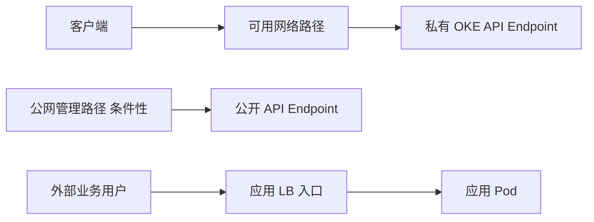

# 14 私有与公开 API Endpoint

区分管理集群的地址与用户访问应用的入口。



## 核心要点

- **1. API Endpoint 和应用外部地址一样吗？** 不是。前者服务 kubectl、Provider 等管理请求；后者服务用户的应用流量。一个可达不能代替另一个可达。
- **2. 私有 Endpoint 怎样访问？** 客户端必须具备通往 VCN 私有地址的网络路径，例如适当的 VCN 管理主机、VPN 或 Bastion 方案。生成配置不会建立这条网络。
- **3. 在 Cloud Shell 运行就一定能连接私有 API 吗？** 不一定。还需采用适当的网络连接方式和配置，不能把执行环境名称当成可达保证。
- **4. 公开 Endpoint 又需哪些条件？** 需要集群实际配置公开端点，并满足访问网络规则与认证权限。PUBLIC_ENDPOINT 参数本身不会把私有集群改造成公开集群。
- **5. 连接超时该先怎样分层？** 先区分连接文件目标、客户端网络路径与认证问题，再看请求是否进入 API。不要因为 Nginx 可访问就推断管理 API 必可达。

## 场景与示例

**私有端点 kubeconfig 的命令示例**

--kube-endpoint PRIVATE_ENDPOINT 选择私有端点；--region 和 --cluster-id 要替换为实际值，命令执行位置必须有网络路径。

```powershell
oci ce cluster create-kubeconfig --cluster-id REPLACE_CLUSTER_OCID --file "C:/ACTUAL_PATH/oke-learning.config" --region REPLACE_REGION --token-version 2.0.0 --kube-endpoint PRIVATE_ENDPOINT
```

路径、Region 与 OCID 都是占位值。生成配置不建立 VPN 或 Bastion 网络。若选择 PUBLIC_ENDPOINT，也需集群实际提供公开端点。

## 常见误区

**PRIVATE_ENDPOINT 参数会自动配置 VPN 或跳板机**

它选择端点，不替代网络连接工程。

## 来源与学习衔接

本章基于用户提供的 Terraform + OCI + OKE 教材重新组织。输入代码块缺失，末尾在负载均衡扩展段落截断；全部完整代码、命令和实验步骤为补充，不是原文代码复原。官方核对依据见 [来源与补充说明.md](来源与补充说明.md)。

下一章：OCI Provider 与 Kubernetes Provider 的分工。

---

## 本章测验

本章共 5 道单项选择题，每题 1 分。先自行选择，再展开答案；支持 QUIZ_DATA 的播放器应在选择后判题。

### 第 1 题

OKE API Endpoint 的主要用途是什么？

- A. 应用数据库文件保存
- B. 业务网页静态图标
- C. 集群管理 API 请求
- D. Terraform 本地日志显示

<details>
<summary>选择完成后展开答案</summary>

正确答案：C

答案解析：不是。前者服务 kubectl、Provider 等管理请求；后者服务用户的应用流量。一个可达不能代替另一个可达。

</details>

### 第 2 题

私有 API Endpoint 的必要条件是什么？

- A. 客户端具备适当私有网络路径
- B. 只要 kubeconfig 文件名正确
- C. 只要存在公网镜像仓库
- D. 只要 Service 类型为 ClusterIP

<details>
<summary>选择完成后展开答案</summary>

正确答案：A

答案解析：客户端必须具备通往 VCN 私有地址的网络路径，例如适当的 VCN 管理主机、VPN 或 Bastion 方案。生成配置不会建立这条网络。

</details>

### 第 3 题

关于 Cloud Shell 访问私有 API，哪项合理？

- A. 默认保证连接任意私有 VCN
- B. 可以完全省略认证
- C. 会自动转成公网 API
- D. 需核对相应网络连接方式

<details>
<summary>选择完成后展开答案</summary>

正确答案：D

答案解析：不一定。还需采用适当的网络连接方式和配置，不能把执行环境名称当成可达保证。

</details>

### 第 4 题

切换生成配置的 endpoint 参数能自动改变集群网络吗？

- A. 能，自动新建 Internet Gateway
- B. 不能，它选择实际存在的访问端点
- C. 能，自动公开所有节点
- D. 能，自动放行全部业务端口

<details>
<summary>选择完成后展开答案</summary>

正确答案：B

答案解析：需要集群实际配置公开端点，并满足访问网络规则与认证权限。PUBLIC_ENDPOINT 参数本身不会把私有集群改造成公开集群。

</details>

### 第 5 题

应用网页能访问但 API 查询失败，应怎样理解？

- A. 两条入口需分别检查
- B. 网页可访问就证明 API 永远可达
- C. 必须删除所有 Deployment
- D. 必须修改 PVC 容量

<details>
<summary>选择完成后展开答案</summary>

正确答案：A

答案解析：先区分连接文件目标、客户端网络路径与认证问题，再看请求是否进入 API。不要因为 Nginx 可访问就推断管理 API 必可达。

</details>

<!-- QUIZ_DATA_START
{
  "chapter": "14",
  "questions": [
    {
      "id": 1,
      "question": "OKE API Endpoint 的主要用途是什么？",
      "options": {
        "A": "应用数据库文件保存",
        "B": "业务网页静态图标",
        "C": "集群管理 API 请求",
        "D": "Terraform 本地日志显示"
      },
      "answer": "C",
      "explanation": "不是。前者服务 kubectl、Provider 等管理请求；后者服务用户的应用流量。一个可达不能代替另一个可达。"
    },
    {
      "id": 2,
      "question": "私有 API Endpoint 的必要条件是什么？",
      "options": {
        "A": "客户端具备适当私有网络路径",
        "B": "只要 kubeconfig 文件名正确",
        "C": "只要存在公网镜像仓库",
        "D": "只要 Service 类型为 ClusterIP"
      },
      "answer": "A",
      "explanation": "客户端必须具备通往 VCN 私有地址的网络路径，例如适当的 VCN 管理主机、VPN 或 Bastion 方案。生成配置不会建立这条网络。"
    },
    {
      "id": 3,
      "question": "关于 Cloud Shell 访问私有 API，哪项合理？",
      "options": {
        "A": "默认保证连接任意私有 VCN",
        "B": "可以完全省略认证",
        "C": "会自动转成公网 API",
        "D": "需核对相应网络连接方式"
      },
      "answer": "D",
      "explanation": "不一定。还需采用适当的网络连接方式和配置，不能把执行环境名称当成可达保证。"
    },
    {
      "id": 4,
      "question": "切换生成配置的 endpoint 参数能自动改变集群网络吗？",
      "options": {
        "A": "能，自动新建 Internet Gateway",
        "B": "不能，它选择实际存在的访问端点",
        "C": "能，自动公开所有节点",
        "D": "能，自动放行全部业务端口"
      },
      "answer": "B",
      "explanation": "需要集群实际配置公开端点，并满足访问网络规则与认证权限。PUBLIC_ENDPOINT 参数本身不会把私有集群改造成公开集群。"
    },
    {
      "id": 5,
      "question": "应用网页能访问但 API 查询失败，应怎样理解？",
      "options": {
        "A": "两条入口需分别检查",
        "B": "网页可访问就证明 API 永远可达",
        "C": "必须删除所有 Deployment",
        "D": "必须修改 PVC 容量"
      },
      "answer": "A",
      "explanation": "先区分连接文件目标、客户端网络路径与认证问题，再看请求是否进入 API。不要因为 Nginx 可访问就推断管理 API 必可达。"
    }
  ]
}
QUIZ_DATA_END -->
