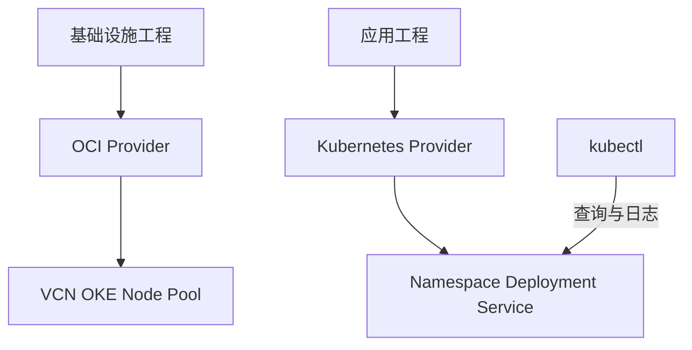

# 15 OCI Provider 与 Kubernetes Provider 的分工

明确两个工程的状态边界与单一声明来源。



## 核心要点

- **1. 两个 Provider 操作相同 API 吗？** 不是。OCI Provider 管理云侧对象，Kubernetes Provider 操作集群资源；它们需要各自适合的认证和网络条件。
- **2. 应用虽然跑在 OCI，Deployment 属于谁？** 它仍属于 Kubernetes API。创建 Namespace 或 Deployment 可以用 Kubernetes Provider，也可以用 kubectl 或 Helm，但要明确声明管理者。
- **3. 基础学习阶段该怎么安排？** 先用 Terraform OCI Provider 管理基础设施，用 kubectl 和 YAML 管理应用。本课后面的完整实验再单独展示 Kubernetes Provider 管应用的做法。
- **4. 能同时用 Terraform 和手工命令长期改同一个对象吗？** 容易导致两边期望状态不一致。临时观察可用 kubectl，但长期变更应回到该对象的声明来源，避免下次 apply 覆盖手工变化。
- **5. 为什么完整实验放在独立应用目录？** 已有集群的应用工程只管理四种 Kubernetes 资源。清理时才容易看懂它的 State 范围，而不误认为会删除完整 OKE。

## 场景与示例

**同一个 Service 的管理来源**

如果它由 Terraform 应用工程声明，修改类型就改变量并 plan；不要另外 apply 一个同名 YAML 当成独立资源。

```hcl
provider "kubernetes" {
  config_path    = pathexpand(var.kubeconfig_path)
  config_context = var.kubeconfig_context
}
```

主实验显式指定 config_path 与 config_context；变量应与用于验证的 kubectl 参数一致。

## 常见误区

**统一工具意味着可以忽略资源所有权**

即使工具相同，也要区分 Provider、State 和每个对象的声明来源。

## 来源与学习衔接

本章基于用户提供的 Terraform + OCI + OKE 教材重新组织。输入代码块缺失，末尾在负载均衡扩展段落截断；全部完整代码、命令和实验步骤为补充，不是原文代码复原。官方核对依据见 [来源与补充说明.md](来源与补充说明.md)。

下一章：Terraform State、Backend 与真实资源。

---

## 本章测验

本章共 5 道单项选择题，每题 1 分。先自行选择，再展开答案；支持 QUIZ_DATA 的播放器应在选择后判题。

### 第 1 题

创建 VCN 使用哪个 Provider？

- A. Kubernetes Provider
- B. 只使用 Helm Chart
- C. 只使用 CoreDNS
- D. OCI Provider

<details>
<summary>选择完成后展开答案</summary>

正确答案：D

答案解析：不是。OCI Provider 管理云侧对象，Kubernetes Provider 操作集群资源；它们需要各自适合的认证和网络条件。

</details>

### 第 2 题

已有 OKE 内创建 Deployment 属于哪项接口？

- A. OCI VCN API
- B. Kubernetes API
- C. 仅 OCI LB API
- D. 仅 OCIR 上传 API

<details>
<summary>选择完成后展开答案</summary>

正确答案：B

答案解析：它仍属于 Kubernetes API。创建 Namespace 或 Deployment 可以用 Kubernetes Provider，也可以用 kubectl 或 Helm，但要明确声明管理者。

</details>

### 第 3 题

学习两个操作面时哪种分工清晰？

- A. 先分清基础设施与应用管理
- B. 所有资源都强制用 kubectl
- C. 全部资源都强制用 OCI Provider
- D. 取消所有期望状态文件

<details>
<summary>选择完成后展开答案</summary>

正确答案：A

答案解析：先用 Terraform OCI Provider 管理基础设施，用 kubectl 和 YAML 管理应用。本课后面的完整实验再单独展示 Kubernetes Provider 管应用的做法。

</details>

### 第 4 题

Terraform 管理的 Deployment 被手工改副本后应怎样维护？

- A. 仅保存 kubectl 终端截图
- B. 永远忽略下一次 plan
- C. 将长期目标同步回 Terraform 配置
- D. 改掉 Provider 来源以隐藏差异

<details>
<summary>选择完成后展开答案</summary>

正确答案：C

答案解析：容易导致两边期望状态不一致。临时观察可用 kubectl，但长期变更应回到该对象的声明来源，避免下次 apply 覆盖手工变化。

</details>

### 第 5 题

判断应用工程清理范围应依据什么？

- A. 只看目录包含 OCI 字样
- B. 工程配置、State 与删除计划
- C. 只看应用使用了 Nginx
- D. 只看当前 Node 数量

<details>
<summary>选择完成后展开答案</summary>

正确答案：B

答案解析：已有集群的应用工程只管理四种 Kubernetes 资源。清理时才容易看懂它的 State 范围，而不误认为会删除完整 OKE。

</details>

<!-- QUIZ_DATA_START
{
  "chapter": "15",
  "questions": [
    {
      "id": 1,
      "question": "创建 VCN 使用哪个 Provider？",
      "options": {
        "A": "Kubernetes Provider",
        "B": "只使用 Helm Chart",
        "C": "只使用 CoreDNS",
        "D": "OCI Provider"
      },
      "answer": "D",
      "explanation": "不是。OCI Provider 管理云侧对象，Kubernetes Provider 操作集群资源；它们需要各自适合的认证和网络条件。"
    },
    {
      "id": 2,
      "question": "已有 OKE 内创建 Deployment 属于哪项接口？",
      "options": {
        "A": "OCI VCN API",
        "B": "Kubernetes API",
        "C": "仅 OCI LB API",
        "D": "仅 OCIR 上传 API"
      },
      "answer": "B",
      "explanation": "它仍属于 Kubernetes API。创建 Namespace 或 Deployment 可以用 Kubernetes Provider，也可以用 kubectl 或 Helm，但要明确声明管理者。"
    },
    {
      "id": 3,
      "question": "学习两个操作面时哪种分工清晰？",
      "options": {
        "A": "先分清基础设施与应用管理",
        "B": "所有资源都强制用 kubectl",
        "C": "全部资源都强制用 OCI Provider",
        "D": "取消所有期望状态文件"
      },
      "answer": "A",
      "explanation": "先用 Terraform OCI Provider 管理基础设施，用 kubectl 和 YAML 管理应用。本课后面的完整实验再单独展示 Kubernetes Provider 管应用的做法。"
    },
    {
      "id": 4,
      "question": "Terraform 管理的 Deployment 被手工改副本后应怎样维护？",
      "options": {
        "A": "仅保存 kubectl 终端截图",
        "B": "永远忽略下一次 plan",
        "C": "将长期目标同步回 Terraform 配置",
        "D": "改掉 Provider 来源以隐藏差异"
      },
      "answer": "C",
      "explanation": "容易导致两边期望状态不一致。临时观察可用 kubectl，但长期变更应回到该对象的声明来源，避免下次 apply 覆盖手工变化。"
    },
    {
      "id": 5,
      "question": "判断应用工程清理范围应依据什么？",
      "options": {
        "A": "只看目录包含 OCI 字样",
        "B": "工程配置、State 与删除计划",
        "C": "只看应用使用了 Nginx",
        "D": "只看当前 Node 数量"
      },
      "answer": "B",
      "explanation": "已有集群的应用工程只管理四种 Kubernetes 资源。清理时才容易看懂它的 State 范围，而不误认为会删除完整 OKE。"
    }
  ]
}
QUIZ_DATA_END -->
