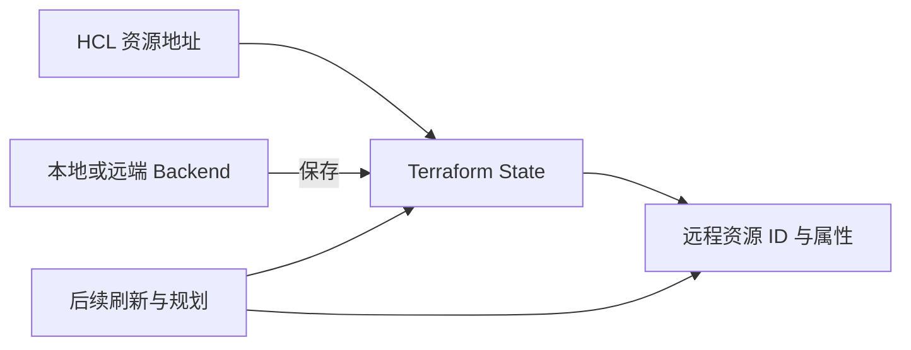

# 16 Terraform State、Backend 与真实资源

说明映射、状态保存与外部变更，不把 State 当成云数据库。

## 核心要点

- **1. State 主要保存什么？** 它记录 Terraform 管理对象与远程资源的对应关系及相关属性，支撑后续规划。它不是整个 OCI 的资源数据库。
- **2. Backend 又是什么？** 它决定 State 等数据的保存位置和访问机制，可是本地或远端。选远端并不把 Kubernetes 的 etcd 转成 State。
- **3. State 会实时知道所有手工修改吗？** 不会默认实时同步所有变化。后续刷新或 plan 会读取相应远程状态并计算与配置的差异。
- **4. 把 State 文件删掉，是不是资源就删了？** 不是。远程资源可能仍存在，但 Terraform 失去原有管理映射；删除状态文件不等同于执行资源删除计划。
- **5. 为什么本课工程忽略 State 文件？** State 和计划可能含敏感信息，不作为普通课件提交。真正团队管理应设计合适 Backend 和协作流程，本章不包含真实远端配置。

## 场景与示例

**两个独立工程各有 State**

VCN 工程的映射不包含完整 OKE；应用工程的映射不自动包含云控制器创建的 LB 或 CSI 创建的磁盘。

| 状态 | 记录与用途 | 更新方式 |
| --- | --- | --- |
| Terraform State | 当前工程管理映射与属性 | 执行相应刷新与规划流程 |
| Kubernetes API / etcd | 集群 API 对象状态 | 组件持续观察与协调 |

Backend 指 State 的保存机制，不能替代集群 etcd。

## 常见误区

**State 里没写的资源就一定不存在**

它只覆盖当前 Terraform 管理范围，其他工具与控制器可以创建额外资源。

## 来源与学习衔接

本章基于用户提供的 Terraform + OCI + OKE 教材重新组织。输入代码块缺失，末尾在负载均衡扩展段落截断；全部完整代码、命令和实验步骤为补充，不是原文代码复原。官方核对依据见 [来源与补充说明.md](来源与补充说明.md)。

下一章：Plan、Apply、Destroy 与删除范围。

---

## 本章测验

本章共 5 道单项选择题，每题 1 分。先自行选择，再展开答案；支持 QUIZ_DATA 的播放器应在选择后判题。

### 第 1 题

State 的主要用途是什么？

- A. 记录管理对象与远程资源的映射
- B. 保存全部 OCI 业务数据
- C. 运行 Kubernetes 控制器
- D. 保存所有镜像文件

选择完成后展开答案

正确答案：A

答案解析：它记录 Terraform 管理对象与远程资源的对应关系及相关属性，支撑后续规划。它不是整个 OCI 的资源数据库。

### 第 2 题

Backend 主要涉及什么？

- A. 应用 Pod 的 HTTP 端口
- B. 镜像仓库的构建命令
- C. State 的存储与访问
- D. Cluster 的 Kubernetes 版本

选择完成后展开答案

正确答案：C

答案解析：它决定 State 等数据的保存位置和访问机制，可是本地或远端。选远端并不把 Kubernetes 的 etcd 转成 State。

### 第 3 题

手工改变远程对象后怎样发现差异？

- A. 等本地文件自动自改
- B. 通过后续刷新与规划
- C. 通过 CoreDNS 同步全部云资源
- D. 靠浏览器访问一次网页

选择完成后展开答案

正确答案：B

答案解析：不会默认实时同步所有变化。后续刷新或 plan 会读取相应远程状态并计算与配置的差异。

### 第 4 题

删除本地 State 文件能直接推断什么？

- A. 所有云资源一定同步删除
- B. 所有 Pod 一定立即停止
- C. OCI 自动清空整个 Tenancy
- D. 管理映射可能丢失而资源仍在

选择完成后展开答案

正确答案：D

答案解析：不是。远程资源可能仍存在，但 Terraform 失去原有管理映射；删除状态文件不等同于执行资源删除计划。

### 第 5 题

准备提交课件代码时，哪些文件不应按普通教材上传？

- A. 脱敏示例 tf 文件
- B. 章节 Mermaid 代码
- C. 真实 State、计划与凭据
- D. 测验 JSON 数据

选择完成后展开答案

正确答案：C

答案解析：State 和计划可能含敏感信息，不作为普通课件提交。真正团队管理应设计合适 Backend 和协作流程，本章不包含真实远端配置。

<!-- QUIZ_DATA_START
{
  "chapter": "16",
  "questions": [
    {
      "id": 1,
      "question": "State 的主要用途是什么？",
      "options": {
        "A": "记录管理对象与远程资源的映射",
        "B": "保存全部 OCI 业务数据",
        "C": "运行 Kubernetes 控制器",
        "D": "保存所有镜像文件"
      },
      "answer": "A",
      "explanation": "它记录 Terraform 管理对象与远程资源的对应关系及相关属性，支撑后续规划。它不是整个 OCI 的资源数据库。"
    },
    {
      "id": 2,
      "question": "Backend 主要涉及什么？",
      "options": {
        "A": "应用 Pod 的 HTTP 端口",
        "B": "镜像仓库的构建命令",
        "C": "State 的存储与访问",
        "D": "Cluster 的 Kubernetes 版本"
      },
      "answer": "C",
      "explanation": "它决定 State 等数据的保存位置和访问机制，可是本地或远端。选远端并不把 Kubernetes 的 etcd 转成 State。"
    },
    {
      "id": 3,
      "question": "手工改变远程对象后怎样发现差异？",
      "options": {
        "A": "等本地文件自动自改",
        "B": "通过后续刷新与规划",
        "C": "通过 CoreDNS 同步全部云资源",
        "D": "靠浏览器访问一次网页"
      },
      "answer": "B",
      "explanation": "不会默认实时同步所有变化。后续刷新或 plan 会读取相应远程状态并计算与配置的差异。"
    },
    {
      "id": 4,
      "question": "删除本地 State 文件能直接推断什么？",
      "options": {
        "A": "所有云资源一定同步删除",
        "B": "所有 Pod 一定立即停止",
        "C": "OCI 自动清空整个 Tenancy",
        "D": "管理映射可能丢失而资源仍在"
      },
      "answer": "D",
      "explanation": "不是。远程资源可能仍存在，但 Terraform 失去原有管理映射；删除状态文件不等同于执行资源删除计划。"
    },
    {
      "id": 5,
      "question": "准备提交课件代码时，哪些文件不应按普通教材上传？",
      "options": {
        "A": "脱敏示例 tf 文件",
        "B": "章节 Mermaid 代码",
        "C": "真实 State、计划与凭据",
        "D": "测验 JSON 数据"
      },
      "answer": "C",
      "explanation": "State 和计划可能含敏感信息，不作为普通课件提交。真正团队管理应设计合适 Backend 和协作流程，本章不包含真实远端配置。"
    }
  ]
}
QUIZ_DATA_END -->
