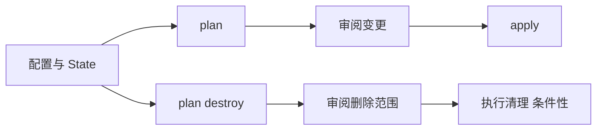

# 17 Plan、Apply、Destroy 与删除范围

先读变化计划，再理解级联对象和资源归属。



## 核心要点

- **1. plan 里的创建、更新、删除分别代表什么？** 它们是预计的资源变化，可能包括替换对象时的创建与删除。应结合资源地址和属性读，而不是只看最后一句数量。
- **2. apply 会操作什么范围？** 它执行当前计划涉及的对象，经过相关 Provider 调用目标接口。应用工程与基础设施工程的 API 和范围不同。
- **3. destroy 是删除整个 OCI 吗？** 不是。它面向当前工程 State 管理、符合删除计划的对象；但删除上层资源还可能影响相关依赖或控制器创建的对象。
- **4. 删除一个 Service 为什么要继续看 OCI？** 它可能由云控制器关联负载均衡器，删除时还需观察相应云侧清理。State 的直接列表和间接影响不总是一回事。
- **5. 本课示例怎么提供清理命令？** 先输出 plan -destroy 的可审阅计划，再由学习者决定执行。对不属于自己实验范围的资源不能照抄删除，也不能假定云侧清理同步完成。

## 场景与示例

**已有 OKE 上的应用清理**

应用工程只直接管理 Namespace、ConfigMap、Deployment、Service；若 Namespace 内又放了其他对象，它们也可能受命名空间删除影响。

```powershell
terraform plan -destroy -out=cleanup.tfplan
# 审阅目标与影响后，才选择执行：
terraform apply cleanup.tfplan
```

## 常见误区

**应用工程 destroy 永远没有间接影响**

要考虑 Namespace 内对象、云集成和存储生命周期，不能只看显式声明数量。

## 来源与学习衔接

本章基于用户提供的 Terraform + OCI + OKE 教材重新组织。输入代码块缺失，末尾在负载均衡扩展段落截断；全部完整代码、命令和实验步骤为补充，不是原文代码复原。官方核对依据见 [来源与补充说明.md](来源与补充说明.md)。

下一章：Deployment 的云上运行与配置关系。

---

## 本章测验

本章共 5 道单项选择题，每题 1 分。先自行选择，再展开答案；支持 QUIZ_DATA 的播放器应在选择后判题。

### 第 1 题

plan 的主要价值是什么？

- A. 直接证明应用业务成功
- B. 审阅预计资源变更
- C. 替代整个 State
- D. 自动生成数据库备份

<details>
<summary>选择完成后展开答案</summary>

正确答案：B

答案解析：它们是预计的资源变化，可能包括替换对象时的创建与删除。应结合资源地址和属性读，而不是只看最后一句数量。

</details>

### 第 2 题

apply 的作用是什么？

- A. 只格式化 HCL 文本
- B. 只生成 Mermaid 图
- C. 只查询容器日志
- D. 执行计划中的资源变更

<details>
<summary>选择完成后展开答案</summary>

正确答案：D

答案解析：它执行当前计划涉及的对象，经过相关 Provider 调用目标接口。应用工程与基础设施工程的 API 和范围不同。

</details>

### 第 3 题

destroy 的直接计划范围以什么为主？

- A. 整个 Tenancy 的全部资源
- B. 所有同名镜像仓库
- C. 当前工程管理的资源
- D. 所有互联的 VCN

<details>
<summary>选择完成后展开答案</summary>

正确答案：C

答案解析：不是。它面向当前工程 State 管理、符合删除计划的对象；但删除上层资源还可能影响相关依赖或控制器创建的对象。

</details>

### 第 4 题

清理 LoadBalancer Service 时，应额外确认什么？

- A. 关联云侧 LB 的实际清理结果
- B. 只确认 Markdown 文件删除
- C. 只确认浏览器关闭
- D. 只确认镜像版本变短

<details>
<summary>选择完成后展开答案</summary>

正确答案：A

答案解析：它可能由云控制器关联负载均衡器，删除时还需观察相应云侧清理。State 的直接列表和间接影响不总是一回事。

</details>

### 第 5 题

清理自己的学习工程前应怎样做？

- A. 直接在任意目录 destroy
- B. 先把全部 State 清空
- C. 先删除全部 Compartment
- D. 先核对目标、State 与删除计划

<details>
<summary>选择完成后展开答案</summary>

正确答案：D

答案解析：先输出 plan -destroy 的可审阅计划，再由学习者决定执行。对不属于自己实验范围的资源不能照抄删除，也不能假定云侧清理同步完成。

</details>

<!-- QUIZ_DATA_START
{
  "chapter": "17",
  "questions": [
    {
      "id": 1,
      "question": "plan 的主要价值是什么？",
      "options": {
        "A": "直接证明应用业务成功",
        "B": "审阅预计资源变更",
        "C": "替代整个 State",
        "D": "自动生成数据库备份"
      },
      "answer": "B",
      "explanation": "它们是预计的资源变化，可能包括替换对象时的创建与删除。应结合资源地址和属性读，而不是只看最后一句数量。"
    },
    {
      "id": 2,
      "question": "apply 的作用是什么？",
      "options": {
        "A": "只格式化 HCL 文本",
        "B": "只生成 Mermaid 图",
        "C": "只查询容器日志",
        "D": "执行计划中的资源变更"
      },
      "answer": "D",
      "explanation": "它执行当前计划涉及的对象，经过相关 Provider 调用目标接口。应用工程与基础设施工程的 API 和范围不同。"
    },
    {
      "id": 3,
      "question": "destroy 的直接计划范围以什么为主？",
      "options": {
        "A": "整个 Tenancy 的全部资源",
        "B": "所有同名镜像仓库",
        "C": "当前工程管理的资源",
        "D": "所有互联的 VCN"
      },
      "answer": "C",
      "explanation": "不是。它面向当前工程 State 管理、符合删除计划的对象；但删除上层资源还可能影响相关依赖或控制器创建的对象。"
    },
    {
      "id": 4,
      "question": "清理 LoadBalancer Service 时，应额外确认什么？",
      "options": {
        "A": "关联云侧 LB 的实际清理结果",
        "B": "只确认 Markdown 文件删除",
        "C": "只确认浏览器关闭",
        "D": "只确认镜像版本变短"
      },
      "answer": "A",
      "explanation": "它可能由云控制器关联负载均衡器，删除时还需观察相应云侧清理。State 的直接列表和间接影响不总是一回事。"
    },
    {
      "id": 5,
      "question": "清理自己的学习工程前应怎样做？",
      "options": {
        "A": "直接在任意目录 destroy",
        "B": "先把全部 State 清空",
        "C": "先删除全部 Compartment",
        "D": "先核对目标、State 与删除计划"
      },
      "answer": "D",
      "explanation": "先输出 plan -destroy 的可审阅计划，再由学习者决定执行。对不属于自己实验范围的资源不能照抄删除，也不能假定云侧清理同步完成。"
    }
  ]
}
QUIZ_DATA_END -->
