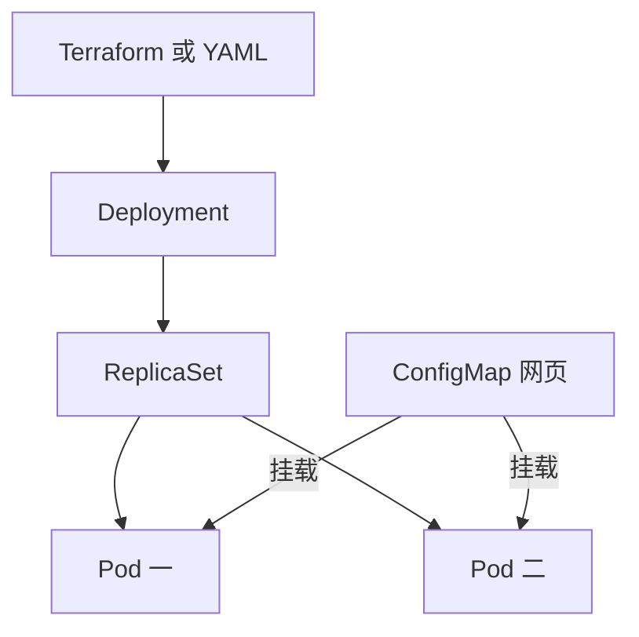

# 18 Deployment 的云上运行与配置关系

OCI 环境中仍由 Kubernetes 控制器管理应用副本。



## 核心要点

- **1. Terraform 需要写两个 Pod resource 吗？** 不需要。本课声明一个 Deployment 和两个副本，Kubernetes 创建对应 ReplicaSet 与 Pod。显式资源与自动派生资源要分开统计。
- **2. 两个副本运行在哪里？** Scheduler 在满足条件的 Node 上安排 Pod。可以分散，也可能同节点，replicas 本身不保证跨节点分布。
- **3. selector 和 template 标签有什么要求？** Deployment 的匹配条件要与模板 Pod 标签对应。本实验统一 app=oke-nginx，Service 也按相同标签选择后端。
- **4. ConfigMap 怎样变成 Nginx 页面？** 它保存 index.html，再作为 Volume 挂载到网页目录。Nginx 读取文件响应页面，不是 ConfigMap 自己运行 Web 服务器。
- **5. 部署显示成功还要看什么？** 要观察两个 Pod 就绪和实际 HTTP 页面。应用文件挂载、镜像与探针都参与运行结果，资源提交成功只是过程的一部分。

## 场景与示例

**两个 Nginx 副本与一份网页配置**

完整实验把 ConfigMap 挂在 /usr/share/nginx/html，网页显示 Terraform、OCI、OKE 和 Kubernetes 的协作主线。

主实验的四个显式资源：

```text
kubernetes_namespace_v1.demo
kubernetes_config_map_v1.page
kubernetes_deployment_v1.web
kubernetes_service_v1.web
```

ConfigMap 的 index.html 被挂载到 /usr/share/nginx/html；readinessProbe 检查根路径响应，不能代替完整业务验证。

## 常见误区

**Terraform State 显式包含全部 ReplicaSet 与 Pod**

未单独声明的派生对象由控制器维护，不自动成为 Terraform 独立管理资源。

## 来源与学习衔接

本章基于用户提供的 Terraform + OCI + OKE 教材重新组织。输入代码块缺失，末尾在负载均衡扩展段落截断；全部完整代码、命令和实验步骤为补充，不是原文代码复原。官方核对依据见 [来源与补充说明.md](来源与补充说明.md)。

下一章：Service、EndpointSlice 与 CoreDNS。

---

## 本章测验

本章共 5 道单项选择题，每题 1 分。先自行选择，再展开答案；支持 QUIZ_DATA 的播放器应在选择后判题。

### 第 1 题

实验显式声明 Deployment 后，Pod 通常怎样产生？

- A. 由 OCI VCN 自动创建
- B. 由 ConfigMap 自动创建
- C. 由 Kubernetes 工作负载控制器创建
- D. 由浏览器首次访问时创建

<details>
<summary>选择完成后展开答案</summary>

正确答案：C

答案解析：不需要。本课声明一个 Deployment 和两个副本，Kubernetes 创建对应 ReplicaSet 与 Pod。显式资源与自动派生资源要分开统计。

</details>

### 第 2 题

replicas: 2 能保证什么目标？

- A. 两个应用 Pod 副本目标
- B. 两个独立 Region
- C. 两台全新 Compute
- D. 两个公网负载均衡器

<details>
<summary>选择完成后展开答案</summary>

正确答案：A

答案解析：Scheduler 在满足条件的 Node 上安排 Pod。可以分散，也可能同节点，replicas 本身不保证跨节点分布。

</details>

### 第 3 题

选择条件 app=oke-nginx 时模板应怎样？

- A. 必须删掉所有 Label
- B. 只写 Region 标签
- C. 把端口改为标签值
- D. 包含对应 app 标签

<details>
<summary>选择完成后展开答案</summary>

正确答案：D

答案解析：Deployment 的匹配条件要与模板 Pod 标签对应。本实验统一 app=oke-nginx，Service 也按相同标签选择后端。

</details>

### 第 4 题

访问示例页面时由谁返回网页内容？

- A. ConfigMap 对象本身
- B. Nginx 容器
- C. Terraform State
- D. OCI Compartment

<details>
<summary>选择完成后展开答案</summary>

正确答案：B

答案解析：它保存 index.html，再作为 Volume 挂载到网页目录。Nginx 读取文件响应页面，不是 ConfigMap 自己运行 Web 服务器。

</details>

### 第 5 题

验证示例最终可用，哪组检查合适？

- A. 副本就绪与实际网页响应
- B. 只看 tf 文件存在
- C. 只看 Namespace 有名字
- D. 只看 Region 名称正确

<details>
<summary>选择完成后展开答案</summary>

正确答案：A

答案解析：要观察两个 Pod 就绪和实际 HTTP 页面。应用文件挂载、镜像与探针都参与运行结果，资源提交成功只是过程的一部分。

</details>

<!-- QUIZ_DATA_START
{
  "chapter": "18",
  "questions": [
    {
      "id": 1,
      "question": "实验显式声明 Deployment 后，Pod 通常怎样产生？",
      "options": {
        "A": "由 OCI VCN 自动创建",
        "B": "由 ConfigMap 自动创建",
        "C": "由 Kubernetes 工作负载控制器创建",
        "D": "由浏览器首次访问时创建"
      },
      "answer": "C",
      "explanation": "不需要。本课声明一个 Deployment 和两个副本，Kubernetes 创建对应 ReplicaSet 与 Pod。显式资源与自动派生资源要分开统计。"
    },
    {
      "id": 2,
      "question": "replicas: 2 能保证什么目标？",
      "options": {
        "A": "两个应用 Pod 副本目标",
        "B": "两个独立 Region",
        "C": "两台全新 Compute",
        "D": "两个公网负载均衡器"
      },
      "answer": "A",
      "explanation": "Scheduler 在满足条件的 Node 上安排 Pod。可以分散，也可能同节点，replicas 本身不保证跨节点分布。"
    },
    {
      "id": 3,
      "question": "选择条件 app=oke-nginx 时模板应怎样？",
      "options": {
        "A": "必须删掉所有 Label",
        "B": "只写 Region 标签",
        "C": "把端口改为标签值",
        "D": "包含对应 app 标签"
      },
      "answer": "D",
      "explanation": "Deployment 的匹配条件要与模板 Pod 标签对应。本实验统一 app=oke-nginx，Service 也按相同标签选择后端。"
    },
    {
      "id": 4,
      "question": "访问示例页面时由谁返回网页内容？",
      "options": {
        "A": "ConfigMap 对象本身",
        "B": "Nginx 容器",
        "C": "Terraform State",
        "D": "OCI Compartment"
      },
      "answer": "B",
      "explanation": "它保存 index.html，再作为 Volume 挂载到网页目录。Nginx 读取文件响应页面，不是 ConfigMap 自己运行 Web 服务器。"
    },
    {
      "id": 5,
      "question": "验证示例最终可用，哪组检查合适？",
      "options": {
        "A": "副本就绪与实际网页响应",
        "B": "只看 tf 文件存在",
        "C": "只看 Namespace 有名字",
        "D": "只看 Region 名称正确"
      },
      "answer": "A",
      "explanation": "要观察两个 Pod 就绪和实际 HTTP 页面。应用文件挂载、镜像与探针都参与运行结果，资源提交成功只是过程的一部分。"
    }
  ]
}
QUIZ_DATA_END -->
