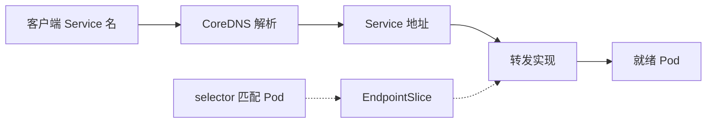

# 19 Service、EndpointSlice 与 CoreDNS

跟随稳定服务名到可用应用后端的关系。



## 核心要点

- **1. Pod 地址变了怎样访问？** 客户端使用 Service 的稳定访问抽象和服务名称，而不是记住所有 Pod IP。DNS 负责解析，转发机制负责后续流量。
- **2. 它是找到 Deployment 还是 Pod？** 带 selector 的 Service 通常按 Pod 标签匹配后端。匹配条件与对象归属是不同关系，Service 不负责创建 Pod。
- **3. EndpointSlice 和 DNS 做一样的事吗？** EndpointSlice 保存后端端点信息，DNS 把服务名称解析为地址。相关控制器维护端点，流量按相应转发实现进入后端。
- **4. 在同 Namespace 用什么名称？** 通常可以直接用服务短名。跨 Namespace 可以用 service.namespace，完整名还包含 svc 与实际集群域名。
- **5. Service 存在却没有就绪后端怎么办？** 先核对标签和实际 Pod 就绪状态，入口对象存在不保证业务成功。不要让 Service 承担补副本或运行应用的职责。

## 场景与示例

**内部访问 oke-nginx**

实验默认 ClusterIP，用 port-forward 临时提供本地验证；它并不创建 OCI 公网负载均衡器。

```powershell
kubectl get service -n tf-oke-learn
kubectl get endpointslices -n tf-oke-learn -l kubernetes.io/service-name=oke-nginx
```

实际执行时仍须加上正确的 kubeconfig 与 Context 参数。

## 常见误区

**CoreDNS 会代替 Service 转发全部 HTTP 流量**

它解析名称，业务请求仍走应用访问路径。

## 来源与学习衔接

本章基于用户提供的 Terraform + OCI + OKE 教材重新组织。输入代码块缺失，末尾在负载均衡扩展段落截断；全部完整代码、命令和实验步骤为补充，不是原文代码复原。官方核对依据见 [来源与补充说明.md](来源与补充说明.md)。

下一章：LoadBalancer Service 如何创建 OCI LB。

---

## 本章测验

本章共 5 道单项选择题，每题 1 分。先自行选择，再展开答案；支持 QUIZ_DATA 的播放器应在选择后判题。

### 第 1 题

Service 主要解决什么？

- A. 固定所有 Pod 的 UID
- B. 编译应用镜像
- C. 保存云认证私钥
- D. 为可变后端提供稳定访问抽象

<details>
<summary>选择完成后展开答案</summary>

正确答案：D

答案解析：客户端使用 Service 的稳定访问抽象和服务名称，而不是记住所有 Pod IP。DNS 负责解析，转发机制负责后续流量。

</details>

### 第 2 题

Service selector 通常匹配什么？

- A. Terraform 文件名
- B. Pod Label
- C. OCI Cluster OCID
- D. 浏览器 Context

<details>
<summary>选择完成后展开答案</summary>

正确答案：B

答案解析：带 selector 的 Service 通常按 Pod 标签匹配后端。匹配条件与对象归属是不同关系，Service 不负责创建 Pod。

</details>

### 第 3 题

EndpointSlice 的主要信息是什么？

- A. 后端网络端点与条件
- B. 镜像全部文件
- C. State 加密口令
- D. VCN CIDR 历史版本

<details>
<summary>选择完成后展开答案</summary>

正确答案：A

答案解析：EndpointSlice 保存后端端点信息，DNS 把服务名称解析为地址。相关控制器维护端点，流量按相应转发实现进入后端。

</details>

### 第 4 题

跨 Namespace 找 Service 时哪种名称结构常见？

- A. region.shape
- B. provider.tf
- C. service.namespace
- D. compartment.port

<details>
<summary>选择完成后展开答案</summary>

正确答案：C

答案解析：通常可以直接用服务短名。跨 Namespace 可以用 service.namespace，完整名还包含 svc 与实际集群域名。

</details>

### 第 5 题

标签正确但所有后端未就绪，怎样理解？

- A. Service 自己会执行应用逻辑
- B. 访问抽象存在但业务可用条件不足
- C. CoreDNS 会自动复制数据库
- D. Terraform 文件自动成为 HTTP 服务器

<details>
<summary>选择完成后展开答案</summary>

正确答案：B

答案解析：先核对标签和实际 Pod 就绪状态，入口对象存在不保证业务成功。不要让 Service 承担补副本或运行应用的职责。

</details>

<!-- QUIZ_DATA_START
{
  "chapter": "19",
  "questions": [
    {
      "id": 1,
      "question": "Service 主要解决什么？",
      "options": {
        "A": "固定所有 Pod 的 UID",
        "B": "编译应用镜像",
        "C": "保存云认证私钥",
        "D": "为可变后端提供稳定访问抽象"
      },
      "answer": "D",
      "explanation": "客户端使用 Service 的稳定访问抽象和服务名称，而不是记住所有 Pod IP。DNS 负责解析，转发机制负责后续流量。"
    },
    {
      "id": 2,
      "question": "Service selector 通常匹配什么？",
      "options": {
        "A": "Terraform 文件名",
        "B": "Pod Label",
        "C": "OCI Cluster OCID",
        "D": "浏览器 Context"
      },
      "answer": "B",
      "explanation": "带 selector 的 Service 通常按 Pod 标签匹配后端。匹配条件与对象归属是不同关系，Service 不负责创建 Pod。"
    },
    {
      "id": 3,
      "question": "EndpointSlice 的主要信息是什么？",
      "options": {
        "A": "后端网络端点与条件",
        "B": "镜像全部文件",
        "C": "State 加密口令",
        "D": "VCN CIDR 历史版本"
      },
      "answer": "A",
      "explanation": "EndpointSlice 保存后端端点信息，DNS 把服务名称解析为地址。相关控制器维护端点，流量按相应转发实现进入后端。"
    },
    {
      "id": 4,
      "question": "跨 Namespace 找 Service 时哪种名称结构常见？",
      "options": {
        "A": "region.shape",
        "B": "provider.tf",
        "C": "service.namespace",
        "D": "compartment.port"
      },
      "answer": "C",
      "explanation": "通常可以直接用服务短名。跨 Namespace 可以用 service.namespace，完整名还包含 svc 与实际集群域名。"
    },
    {
      "id": 5,
      "question": "标签正确但所有后端未就绪，怎样理解？",
      "options": {
        "A": "Service 自己会执行应用逻辑",
        "B": "访问抽象存在但业务可用条件不足",
        "C": "CoreDNS 会自动复制数据库",
        "D": "Terraform 文件自动成为 HTTP 服务器"
      },
      "answer": "B",
      "explanation": "先核对标签和实际 Pod 就绪状态，入口对象存在不保证业务成功。不要让 Service 承担补副本或运行应用的职责。"
    }
  ]
}
QUIZ_DATA_END -->
