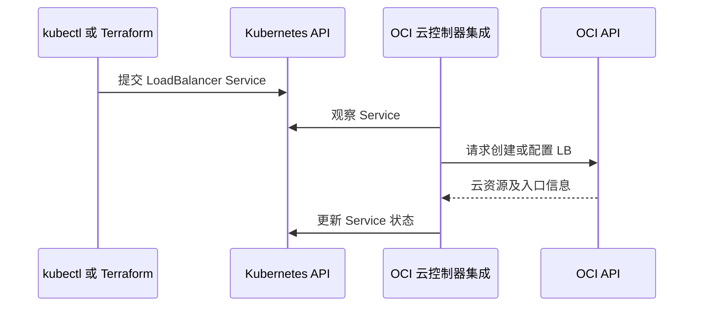

# 20 LoadBalancer Service 如何创建 OCI LB

区分 Kubernetes 声明、云控制器和实际负载均衡器。



## 核心要点

- **1. 没有写 Terraform OCI LB resource，怎么会出现 LB？** OKE 云控制器集成可以观察 LoadBalancer 类型的 Service，经 OCI API 创建或配置云入口。创建者不一定是 Terraform OCI Provider。
- **2. Service 与 OCI LB 是一个对象吗？** 不是。一个属于 Kubernetes API，一个是 OCI 云网络资源；它们通过云集成关联，不能互相代替查询与管理。
- **3. 什么时候必须看集成前提？** 集群、子网、网络和访问 OCI API 的条件都影响供给。声明有效不意味着入口立即出现，状态更新也需要时间。
- **4. LB 后端一定是 Node 吗？** 不应一概而论。后端和流量路径取决于 CNI、LB 类型和配置，可能涉及不同的节点或 Pod 路径。
- **5. 删除或变更 Service 后应怎样追踪？** 仍沿 Kubernetes 与 OCI 两侧查看资源状态。关联 LB 不会因未在当前 Terraform State 显式列出就不存在或无需清理。

## 场景与示例

**从 ClusterIP 改为 LoadBalancer**

改本课应用工程 service_type 变量再 plan，会改变 Service；实际 LB 由云集成处理，可能产生云资源费用。

由 Terraform 管理的 Service，应修改同一工程变量而非另 apply 同名 YAML：

```hcl
service_type = "LoadBalancer"
lb_type      = "lb"
```

再次 plan 后执行会改变云集成需求，可能产生收费云资源；本次制作不执行该变更。

## 常见误区

**所有云资源都必须在当前 Terraform State 中显式声明**

控制器也能通过云 API 供给资源，应区别直接管理与间接创建。

## 来源与学习衔接

本章基于用户提供的 Terraform + OCI + OKE 教材重新组织。输入代码块缺失，末尾在负载均衡扩展段落截断；全部完整代码、命令和实验步骤为补充，不是原文代码复原。官方核对依据见 [来源与补充说明.md](来源与补充说明.md)。

下一章：OCI LB、NLB 与入口类型选择。

---

## 本章测验

本章共 5 道单项选择题，每题 1 分。先自行选择，再展开答案；支持 QUIZ_DATA 的播放器应在选择后判题。

### 第 1 题

可能触发 OCI LB 创建的 Kubernetes 条件是什么？

- A. Service 类型为 LoadBalancer 且集成条件满足
- B. Pod 名称含 lb
- C. ConfigMap 文件名含云
- D. Namespace 叫 production

<details>
<summary>选择完成后展开答案</summary>

正确答案：A

答案解析：OKE 云控制器集成可以观察 LoadBalancer 类型的 Service，经 OCI API 创建或配置云入口。创建者不一定是 Terraform OCI Provider。

</details>

### 第 2 题

Service 与 OCI LB 的关系是什么？

- A. 同一对象的两个名称
- B. 同一份 HCL 的两个变量
- C. 两个不同系统中的关联对象
- D. 两种镜像标签

<details>
<summary>选择完成后展开答案</summary>

正确答案：C

答案解析：不是。一个属于 Kubernetes API，一个是 OCI 云网络资源；它们通过云集成关联，不能互相代替查询与管理。

</details>

### 第 3 题

Service 仍等待外部入口时应怎样理解？

- A. 一定表示 Terraform 没有 init
- B. 需检查云集成与网络等条件
- C. 一定表示镜像文件不存在
- D. 必须把 kind 改成 VCN

<details>
<summary>选择完成后展开答案</summary>

正确答案：B

答案解析：集群、子网、网络和访问 OCI API 的条件都影响供给。声明有效不意味着入口立即出现，状态更新也需要时间。

</details>

### 第 4 题

后端路径由什么影响？

- A. 只由 Namespace 字符长度
- B. 只由 .tf 文件顺序
- C. 只由网页标题
- D. CNI、LB 类型与网络配置

<details>
<summary>选择完成后展开答案</summary>

正确答案：D

答案解析：不应一概而论。后端和流量路径取决于 CNI、LB 类型和配置，可能涉及不同的节点或 Pod 路径。

</details>

### 第 5 题

State 没有显式 OCI LB 地址，能推断 LB 不存在吗？

- A. 能，State 包含全部云资源
- B. 能，Service 不可能创建云对象
- C. 不能，它可能由云控制器创建
- D. 能，LB 只能由 Console 创建

<details>
<summary>选择完成后展开答案</summary>

正确答案：C

答案解析：仍沿 Kubernetes 与 OCI 两侧查看资源状态。关联 LB 不会因未在当前 Terraform State 显式列出就不存在或无需清理。

</details>

<!-- QUIZ_DATA_START
{
  "chapter": "20",
  "questions": [
    {
      "id": 1,
      "question": "可能触发 OCI LB 创建的 Kubernetes 条件是什么？",
      "options": {
        "A": "Service 类型为 LoadBalancer 且集成条件满足",
        "B": "Pod 名称含 lb",
        "C": "ConfigMap 文件名含云",
        "D": "Namespace 叫 production"
      },
      "answer": "A",
      "explanation": "OKE 云控制器集成可以观察 LoadBalancer 类型的 Service，经 OCI API 创建或配置云入口。创建者不一定是 Terraform OCI Provider。"
    },
    {
      "id": 2,
      "question": "Service 与 OCI LB 的关系是什么？",
      "options": {
        "A": "同一对象的两个名称",
        "B": "同一份 HCL 的两个变量",
        "C": "两个不同系统中的关联对象",
        "D": "两种镜像标签"
      },
      "answer": "C",
      "explanation": "不是。一个属于 Kubernetes API，一个是 OCI 云网络资源；它们通过云集成关联，不能互相代替查询与管理。"
    },
    {
      "id": 3,
      "question": "Service 仍等待外部入口时应怎样理解？",
      "options": {
        "A": "一定表示 Terraform 没有 init",
        "B": "需检查云集成与网络等条件",
        "C": "一定表示镜像文件不存在",
        "D": "必须把 kind 改成 VCN"
      },
      "answer": "B",
      "explanation": "集群、子网、网络和访问 OCI API 的条件都影响供给。声明有效不意味着入口立即出现，状态更新也需要时间。"
    },
    {
      "id": 4,
      "question": "后端路径由什么影响？",
      "options": {
        "A": "只由 Namespace 字符长度",
        "B": "只由 .tf 文件顺序",
        "C": "只由网页标题",
        "D": "CNI、LB 类型与网络配置"
      },
      "answer": "D",
      "explanation": "不应一概而论。后端和流量路径取决于 CNI、LB 类型和配置，可能涉及不同的节点或 Pod 路径。"
    },
    {
      "id": 5,
      "question": "State 没有显式 OCI LB 地址，能推断 LB 不存在吗？",
      "options": {
        "A": "能，State 包含全部云资源",
        "B": "能，Service 不可能创建云对象",
        "C": "不能，它可能由云控制器创建",
        "D": "能，LB 只能由 Console 创建"
      },
      "answer": "C",
      "explanation": "仍沿 Kubernetes 与 OCI 两侧查看资源状态。关联 LB 不会因未在当前 Terraform State 显式列出就不存在或无需清理。"
    }
  ]
}
QUIZ_DATA_END -->
