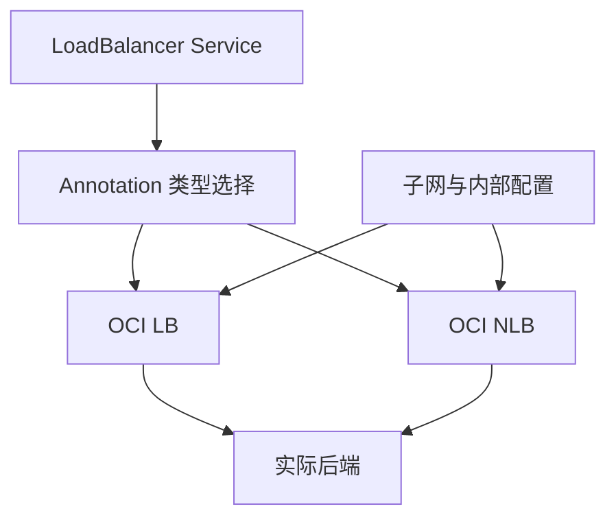

# 21 OCI LB、NLB 与入口类型选择

用 Service Annotation 说明类型选择与公网、私网的区别。



## 核心要点

- **1. LB 和 NLB 的基本差别怎样理解？** OCI LB 提供代理型负载均衡能力，NLB 偏向网络层转发能力。选择要结合协议与实际服务要求，不按资源名字猜功能。
- **2. 怎样声明 OCI 的负载均衡类型？** Service metadata.annotations 可以使用 oci.oraclecloud.com/load-balancer-type，值 lb 或 nlb。它属于云集成配置，不是 Deployment 的副本字段。
- **3. 没写类型是否默认都是 NLB？** 官方集成以 lb 为默认类型，nlb 需明确指定。还要结合当前集群支持和文档，不把它混成 Ingress 自动决定的选择。
- **4. LoadBalancer 类型是否一定是公网入口？** 不是。LB 可以有内部或公开入口，具体取决于相应配置和网络。拿到地址后仍要从正确网络位置验证。
- **5. 改为 NLB 后就无需网络规则了吗？** 不能这样理解。仍要满足对应实现的网络和流量条件，类型选择本身不会解决全部可达性问题。

## 场景与示例

**两份条件性 YAML**

examples 中分别提供 lb 和 nlb Service 示例，仅供独立学习；不要覆盖 Terraform 主实验中的同名受管对象。

```yaml
apiVersion: v1
kind: Service
metadata:
  name: standalone-nlb-demo
  namespace: oke-cloud-examples
  annotations:
    oci.oraclecloud.com/load-balancer-type: "nlb"
spec:
  type: LoadBalancer
  selector:
    app: standalone-web
  ports:
    - port: 80
      targetPort: 80
      protocol: TCP
```

条件性独立示例，要求已有 oke-cloud-examples Namespace、app=standalone-web 的就绪后端及相应云网络条件。不要覆盖主实验受 Terraform 管理的 Service。

## 常见误区

**Ingress 规则会自动决定 OCI 是 LB 还是 NLB**

类型选择属于具体入口方案和集成配置，Ingress 的 HTTP 规则是另一个职责。

## 来源与学习衔接

本章基于用户提供的 Terraform + OCI + OKE 教材重新组织。输入代码块缺失，末尾在负载均衡扩展段落截断；全部完整代码、命令和实验步骤为补充，不是原文代码复原。官方核对依据见 [来源与补充说明.md](来源与补充说明.md)。

下一章：Ingress、Controller、Service 与 OCI 入口。

---

## 本章测验

本章共 5 道单项选择题，每题 1 分。先自行选择，再展开答案；支持 QUIZ_DATA 的播放器应在选择后判题。

### 第 1 题

本章对 NLB 的基础定位是什么？

- A. 用于生成 Terraform State
- B. 偏向网络层流量转发
- C. 自动运行应用源码
- D. 专门创建 PVC

<details>
<summary>选择完成后展开答案</summary>

正确答案：B

答案解析：OCI LB 提供代理型负载均衡能力，NLB 偏向网络层转发能力。选择要结合协议与实际服务要求，不按资源名字猜功能。

</details>

### 第 2 题

选择类型的 Annotation 放在哪里？

- A. Pod spec.replicas
- B. VCN cidr_block
- C. Terraform output.description
- D. Service metadata.annotations

<details>
<summary>选择完成后展开答案</summary>

正确答案：D

答案解析：Service metadata.annotations 可以使用 oci.oraclecloud.com/load-balancer-type，值 lb 或 nlb。它属于云集成配置，不是 Deployment 的副本字段。

</details>

### 第 3 题

想明确选择 NLB，应设置什么值？

- A. ClusterIP
- B. StatefulSet
- C. nlb
- D. Asia/Tokyo

<details>
<summary>选择完成后展开答案</summary>

正确答案：C

答案解析：官方集成以 lb 为默认类型，nlb 需明确指定。还要结合当前集群支持和文档，不把它混成 Ingress 自动决定的选择。

</details>

### 第 4 题

看到 LoadBalancer Service 能否断定入口是公网？

- A. 不能，需要确认入口与网络配置
- B. 能，类型强制所有节点公网
- C. 能，LB 总使用浏览器域名
- D. 能，所有私有子网都会自动公开

<details>
<summary>选择完成后展开答案</summary>

正确答案：A

答案解析：不是。LB 可以有内部或公开入口，具体取决于相应配置和网络。拿到地址后仍要从正确网络位置验证。

</details>

### 第 5 题

入口类型已选但无法访问，接下来应怎样做？

- A. 只修改测验 JSON
- B. 只增加 replica 标签长度
- C. 删除 Terraform 版本约束
- D. 检查对应网络路径和流量条件

<details>
<summary>选择完成后展开答案</summary>

正确答案：D

答案解析：不能这样理解。仍要满足对应实现的网络和流量条件，类型选择本身不会解决全部可达性问题。

</details>

<!-- QUIZ_DATA_START
{
  "chapter": "21",
  "questions": [
    {
      "id": 1,
      "question": "本章对 NLB 的基础定位是什么？",
      "options": {
        "A": "用于生成 Terraform State",
        "B": "偏向网络层流量转发",
        "C": "自动运行应用源码",
        "D": "专门创建 PVC"
      },
      "answer": "B",
      "explanation": "OCI LB 提供代理型负载均衡能力，NLB 偏向网络层转发能力。选择要结合协议与实际服务要求，不按资源名字猜功能。"
    },
    {
      "id": 2,
      "question": "选择类型的 Annotation 放在哪里？",
      "options": {
        "A": "Pod spec.replicas",
        "B": "VCN cidr_block",
        "C": "Terraform output.description",
        "D": "Service metadata.annotations"
      },
      "answer": "D",
      "explanation": "Service metadata.annotations 可以使用 oci.oraclecloud.com/load-balancer-type，值 lb 或 nlb。它属于云集成配置，不是 Deployment 的副本字段。"
    },
    {
      "id": 3,
      "question": "想明确选择 NLB，应设置什么值？",
      "options": {
        "A": "ClusterIP",
        "B": "StatefulSet",
        "C": "nlb",
        "D": "Asia/Tokyo"
      },
      "answer": "C",
      "explanation": "官方集成以 lb 为默认类型，nlb 需明确指定。还要结合当前集群支持和文档，不把它混成 Ingress 自动决定的选择。"
    },
    {
      "id": 4,
      "question": "看到 LoadBalancer Service 能否断定入口是公网？",
      "options": {
        "A": "不能，需要确认入口与网络配置",
        "B": "能，类型强制所有节点公网",
        "C": "能，LB 总使用浏览器域名",
        "D": "能，所有私有子网都会自动公开"
      },
      "answer": "A",
      "explanation": "不是。LB 可以有内部或公开入口，具体取决于相应配置和网络。拿到地址后仍要从正确网络位置验证。"
    },
    {
      "id": 5,
      "question": "入口类型已选但无法访问，接下来应怎样做？",
      "options": {
        "A": "只修改测验 JSON",
        "B": "只增加 replica 标签长度",
        "C": "删除 Terraform 版本约束",
        "D": "检查对应网络路径和流量条件"
      },
      "answer": "D",
      "explanation": "不能这样理解。仍要满足对应实现的网络和流量条件，类型选择本身不会解决全部可达性问题。"
    }
  ]
}
QUIZ_DATA_END -->
