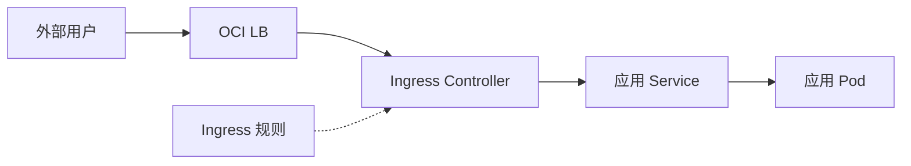

# 22 Ingress、Controller、Service 与 OCI 入口

把四种对象放在一次外部 HTTP 请求中。



## 核心要点

- **1. 这张图是所有 OKE 的唯一架构吗？** 不是。它展示一种常见组合：OCI LB 提供入口，Controller 执行 HTTP 路由，Service 对接应用后端。原生 Controller 或 Gateway API 方案可能不同。
- **2. Ingress 资源负责什么？** 它声明按域名或路径分流的 HTTP 规则。Controller 才是读取规则并实现路由的程序，不能只创建 YAML 就认为入口已经运行。
- **3. OCI LB 与应用 Service 怎样不同？** LB 属于实际云入口，应用 Service 属于集群内服务访问抽象。在组合里可以有多个 Service，不能把全部对象缩成一个名字。
- **4. 要让两个域名分流到两个应用，先看什么？** 确认可用 Controller、匹配的 IngressClass、路由后端与域名解析。不同控制器实现的注解和入口配置不能盲目混用。
- **5. 为什么没有给出一键安装全部入口？** 实现依赖使用者选择与现有环境。本课程给出规则片段与组合关系，不把未安装 Controller 的课件说成已可访问入口。

## 场景与示例

**www.example.com 指向一个应用**

域名是示例值，IngressClass 也是占位值；实际 Controller、解析与后端须预先具备。

```yaml
apiVersion: networking.k8s.io/v1
kind: Ingress
metadata:
  name: standalone-entry
  namespace: oke-cloud-examples
spec:
  ingressClassName: REPLACE_WITH_EXISTING_CLASS
  rules:
    - host: www.example.com
      http:
        paths:
          - path: /
            pathType: Prefix
            backend:
              service:
                name: standalone-web
                port:
                  number: 80
```

替换已有类名并准备真实 Controller、后端与域名解析后才能运行。

## 常见误区

**云 LB、Ingress、Controller 和 Service 是同一个组件**

它们分别代表云资源、规则、执行程序和服务访问抽象。

## 来源与学习衔接

本章基于用户提供的 Terraform + OCI + OKE 教材重新组织。输入代码块缺失，末尾在负载均衡扩展段落截断；全部完整代码、命令和实验步骤为补充，不是原文代码复原。官方核对依据见 [来源与补充说明.md](来源与补充说明.md)。

下一章：OCIR 镜像与私有拉取。

---

## 本章测验

本章共 5 道单项选择题，每题 1 分。先自行选择，再展开答案；支持 QUIZ_DATA 的播放器应在选择后判题。

### 第 1 题

本章图形应怎样理解？

- A. 所有 OKE 唯一强制路径
- B. 所有 TCP 流量固定路径
- C. 一种常见组合架构
- D. Terraform State 的完整结构

<details>
<summary>选择完成后展开答案</summary>

正确答案：C

答案解析：不是。它展示一种常见组合：OCI LB 提供入口，Controller 执行 HTTP 路由，Service 对接应用后端。原生 Controller 或 Gateway API 方案可能不同。

</details>

### 第 2 题

Ingress 与 Controller 怎样区分？

- A. 前者是规则，后者实现路由
- B. 前者保存镜像，后者保存 State
- C. 前者创建 Region，后者创建 AD
- D. 两者都是数据库卷

<details>
<summary>选择完成后展开答案</summary>

正确答案：A

答案解析：它声明按域名或路径分流的 HTTP 规则。Controller 才是读取规则并实现路由的程序，不能只创建 YAML 就认为入口已经运行。

</details>

### 第 3 题

外部云入口对象与应用访问抽象分别是什么？

- A. PVC 与 ConfigMap
- B. Region 与 Helm release
- C. Node Pool 与 Terraform Backend
- D. OCI LB 与 Kubernetes Service

<details>
<summary>选择完成后展开答案</summary>

正确答案：D

答案解析：LB 属于实际云入口，应用 Service 属于集群内服务访问抽象。在组合里可以有多个 Service，不能把全部对象缩成一个名字。

</details>

### 第 4 题

多域名路由实验的必要条件之一是什么？

- A. 只存在两个镜像标签
- B. 有可用 Controller 和匹配的类
- C. 只把副本数改成二
- D. 只创建一个空 Compartment

<details>
<summary>选择完成后展开答案</summary>

正确答案：B

答案解析：确认可用 Controller、匹配的 IngressClass、路由后端与域名解析。不同控制器实现的注解和入口配置不能盲目混用。

</details>

### 第 5 题

只有 Ingress YAML 能保证外部访问吗？

- A. 不能，还需要实现与可达入口
- B. 能，YAML 自动构建云网络
- C. 能，Ingress 自动执行容器
- D. 能，域名会自动注册

<details>
<summary>选择完成后展开答案</summary>

正确答案：A

答案解析：实现依赖使用者选择与现有环境。本课程给出规则片段与组合关系，不把未安装 Controller 的课件说成已可访问入口。

</details>

<!-- QUIZ_DATA_START
{
  "chapter": "22",
  "questions": [
    {
      "id": 1,
      "question": "本章图形应怎样理解？",
      "options": {
        "A": "所有 OKE 唯一强制路径",
        "B": "所有 TCP 流量固定路径",
        "C": "一种常见组合架构",
        "D": "Terraform State 的完整结构"
      },
      "answer": "C",
      "explanation": "不是。它展示一种常见组合：OCI LB 提供入口，Controller 执行 HTTP 路由，Service 对接应用后端。原生 Controller 或 Gateway API 方案可能不同。"
    },
    {
      "id": 2,
      "question": "Ingress 与 Controller 怎样区分？",
      "options": {
        "A": "前者是规则，后者实现路由",
        "B": "前者保存镜像，后者保存 State",
        "C": "前者创建 Region，后者创建 AD",
        "D": "两者都是数据库卷"
      },
      "answer": "A",
      "explanation": "它声明按域名或路径分流的 HTTP 规则。Controller 才是读取规则并实现路由的程序，不能只创建 YAML 就认为入口已经运行。"
    },
    {
      "id": 3,
      "question": "外部云入口对象与应用访问抽象分别是什么？",
      "options": {
        "A": "PVC 与 ConfigMap",
        "B": "Region 与 Helm release",
        "C": "Node Pool 与 Terraform Backend",
        "D": "OCI LB 与 Kubernetes Service"
      },
      "answer": "D",
      "explanation": "LB 属于实际云入口，应用 Service 属于集群内服务访问抽象。在组合里可以有多个 Service，不能把全部对象缩成一个名字。"
    },
    {
      "id": 4,
      "question": "多域名路由实验的必要条件之一是什么？",
      "options": {
        "A": "只存在两个镜像标签",
        "B": "有可用 Controller 和匹配的类",
        "C": "只把副本数改成二",
        "D": "只创建一个空 Compartment"
      },
      "answer": "B",
      "explanation": "确认可用 Controller、匹配的 IngressClass、路由后端与域名解析。不同控制器实现的注解和入口配置不能盲目混用。"
    },
    {
      "id": 5,
      "question": "只有 Ingress YAML 能保证外部访问吗？",
      "options": {
        "A": "不能，还需要实现与可达入口",
        "B": "能，YAML 自动构建云网络",
        "C": "能，Ingress 自动执行容器",
        "D": "能，域名会自动注册"
      },
      "answer": "A",
      "explanation": "实现依赖使用者选择与现有环境。本课程给出规则片段与组合关系，不把未安装 Controller 的课件说成已可访问入口。"
    }
  ]
}
QUIZ_DATA_END -->
