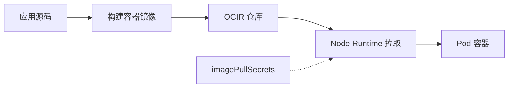

# 23 OCIR 镜像与私有拉取

串起源码、镜像仓库、节点运行时和拉取认证。



## 核心要点

- **1. OKE 可以直接运行源码目录吗？** Kubernetes 通常部署镜像，源码需要先构建为容器镜像，再推送到可访问仓库。构建与云集群创建是不同步骤。
- **2. OCIR 负责运行容器吗？** 它保存镜像等仓库对象；运行镜像的是 Node 上的容器运行时。镜像在仓库里存在不等于应用已经部署。
- **3. 镜像地址由哪些部分组成？** 通常包括实际区域 Registry 域名、Tenancy 的仓库命名空间、仓库路径与标签。仓库命名空间不是 Kubernetes Namespace，也不总是 Tenancy 显示名。
- **4. 私有仓库怎样提供拉取能力？** 可按环境配置相应认证；常见做法是在 Pod 所在 Namespace 创建 registry Secret，再用 imagePullSecrets 引用。Secret 存在还不替代到仓库的网络路径。
- **5. 拉取失败时能只盯着 Deployment 名字吗？** 不够。要核对实际镜像地址、标签、拉取凭据、目标架构与网络可达条件；本课程示意地址不能原样运行。

## 场景与示例

**部署自己的 FastAPI 镜像**

先推送真实镜像，再在 Deployment 中写实际地址；示例故意使用占位域名，并明确需要预先创建 ocir-pull Secret。

```yaml
apiVersion: v1
kind: Pod
metadata:
  name: ocir-demo
  namespace: oke-cloud-examples
spec:
  imagePullSecrets:
    - name: ocir-pull
  containers:
    - name: api
      image: REPLACE_REGISTRY_DOMAIN/REPLACE_TENANCY_NAMESPACE/REPLACE_REPOSITORY:v1
      ports:
        - containerPort: 8080
```

先准备实际镜像并替换域名和仓库路径，在同 Namespace 创建可用 ocir-pull Secret。课程不包含真实 Token 或登录命令中的真实凭据。

## 常见误区

**OCIR namespace 与 Kubernetes Namespace 是同一个对象**

它们属于不同系统，镜像路径和集群资源空间不能互相替代。

## 来源与学习衔接

本章基于用户提供的 Terraform + OCI + OKE 教材重新组织。输入代码块缺失，末尾在负载均衡扩展段落截断；全部完整代码、命令和实验步骤为补充，不是原文代码复原。官方核对依据见 [来源与补充说明.md](来源与补充说明.md)。

下一章：ConfigMap、Secret 与云上应用参数。

---

## 本章测验

本章共 5 道单项选择题，每题 1 分。先自行选择，再展开答案；支持 QUIZ_DATA 的播放器应在选择后判题。

### 第 1 题

源码到 Pod 的正确基本路径是什么？

- A. 把源码放入 Terraform State
- B. 把源码写进 VCN 路由
- C. 由 Compartment 自动编译
- D. 构建镜像、存仓库、节点拉取运行

<details>
<summary>选择完成后展开答案</summary>

正确答案：D

答案解析：Kubernetes 通常部署镜像，源码需要先构建为容器镜像，再推送到可访问仓库。构建与云集群创建是不同步骤。

</details>

### 第 2 题

OCIR 在本流程的职责是什么？

- A. 调度全部 Pod
- B. 保存容器镜像
- C. 提供 PVC 文件系统
- D. 直接运行 Nginx 副本

<details>
<summary>选择完成后展开答案</summary>

正确答案：B

答案解析：它保存镜像等仓库对象；运行镜像的是 Node 上的容器运行时。镜像在仓库里存在不等于应用已经部署。

</details>

### 第 3 题

镜像地址中的 Tenancy namespace 应怎样理解？

- A. OCI 仓库所用的实际命名空间
- B. 必定是 Kubernetes default
- C. 必定是 Compartment 名
- D. 必定是 Pod 所在 Node 名

<details>
<summary>选择完成后展开答案</summary>

正确答案：A

答案解析：通常包括实际区域 Registry 域名、Tenancy 的仓库命名空间、仓库路径与标签。仓库命名空间不是 Kubernetes Namespace，也不总是 Tenancy 显示名。

</details>

### 第 4 题

imagePullSecrets 通常引用什么？

- A. VCN 的 Route Table
- B. Node Pool 的数量
- C. 同 Namespace 的镜像拉取 Secret
- D. Terraform 的 output 字符串

<details>
<summary>选择完成后展开答案</summary>

正确答案：C

答案解析：可按环境配置相应认证；常见做法是在 Pod 所在 Namespace 创建 registry Secret，再用 imagePullSecrets 引用。Secret 存在还不替代到仓库的网络路径。

</details>

### 第 5 题

私有镜像不能拉取，哪组条件值得核对？

- A. 只看章节编号
- B. 地址标签、凭据与网络路径
- C. 只看网页颜色
- D. 只看 Region 名字是否短

<details>
<summary>选择完成后展开答案</summary>

正确答案：B

答案解析：不够。要核对实际镜像地址、标签、拉取凭据、目标架构与网络可达条件；本课程示意地址不能原样运行。

</details>

<!-- QUIZ_DATA_START
{
  "chapter": "23",
  "questions": [
    {
      "id": 1,
      "question": "源码到 Pod 的正确基本路径是什么？",
      "options": {
        "A": "把源码放入 Terraform State",
        "B": "把源码写进 VCN 路由",
        "C": "由 Compartment 自动编译",
        "D": "构建镜像、存仓库、节点拉取运行"
      },
      "answer": "D",
      "explanation": "Kubernetes 通常部署镜像，源码需要先构建为容器镜像，再推送到可访问仓库。构建与云集群创建是不同步骤。"
    },
    {
      "id": 2,
      "question": "OCIR 在本流程的职责是什么？",
      "options": {
        "A": "调度全部 Pod",
        "B": "保存容器镜像",
        "C": "提供 PVC 文件系统",
        "D": "直接运行 Nginx 副本"
      },
      "answer": "B",
      "explanation": "它保存镜像等仓库对象；运行镜像的是 Node 上的容器运行时。镜像在仓库里存在不等于应用已经部署。"
    },
    {
      "id": 3,
      "question": "镜像地址中的 Tenancy namespace 应怎样理解？",
      "options": {
        "A": "OCI 仓库所用的实际命名空间",
        "B": "必定是 Kubernetes default",
        "C": "必定是 Compartment 名",
        "D": "必定是 Pod 所在 Node 名"
      },
      "answer": "A",
      "explanation": "通常包括实际区域 Registry 域名、Tenancy 的仓库命名空间、仓库路径与标签。仓库命名空间不是 Kubernetes Namespace，也不总是 Tenancy 显示名。"
    },
    {
      "id": 4,
      "question": "imagePullSecrets 通常引用什么？",
      "options": {
        "A": "VCN 的 Route Table",
        "B": "Node Pool 的数量",
        "C": "同 Namespace 的镜像拉取 Secret",
        "D": "Terraform 的 output 字符串"
      },
      "answer": "C",
      "explanation": "可按环境配置相应认证；常见做法是在 Pod 所在 Namespace 创建 registry Secret，再用 imagePullSecrets 引用。Secret 存在还不替代到仓库的网络路径。"
    },
    {
      "id": 5,
      "question": "私有镜像不能拉取，哪组条件值得核对？",
      "options": {
        "A": "只看章节编号",
        "B": "地址标签、凭据与网络路径",
        "C": "只看网页颜色",
        "D": "只看 Region 名字是否短"
      },
      "answer": "B",
      "explanation": "不够。要核对实际镜像地址、标签、拉取凭据、目标架构与网络可达条件；本课程示意地址不能原样运行。"
    }
  ]
}
QUIZ_DATA_END -->
