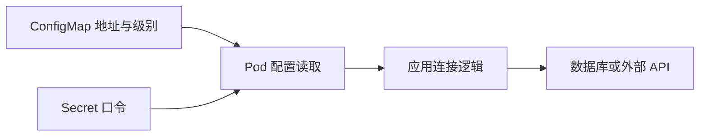

# 24 ConfigMap、Secret 与云上应用参数

OCI 上的数据库也可通过 Kubernetes 原生配置注入。



## 核心要点

- **1. 部署在 OCI 后还用 ConfigMap 吗？** 可以。ConfigMap 与 Secret 仍是 Kubernetes 资源，云平台改变不意味着要放弃应用原生的配置方式。
- **2. 数据库地址与口令分别放哪儿？** 非敏感地址和日志级别适合 ConfigMap，密码等敏感值适合 Secret。注入参数与建立数据库服务是两件事。
- **3. Secret 的 base64 表示加密吗？** 不是。编码不等于加密，也不能仅凭 Secret 类型认定保护措施已经齐全；本课只说明基础引用关系。
- **4. 配置一改，已有环境变量会立刻变吗？** 通常不会。环境变量注入需要重新创建容器后获得新值；文件挂载更新也需考虑机制与应用重新读取。
- **5. 地址和密码都注入，数据库就连通了吗？** 仍需应用实现连接逻辑，并满足数据库访问和认证条件。课程没有真实数据库，不把配置示例当成业务连接成功证明。

## 场景与示例

**主实验只挂载非敏感网页**

Nginx 实验的 ConfigMap 保存网页；另提供参数与 Secret 的教学 YAML，不把真实口令纳入 Terraform 示例或课件。

```yaml
env:
  - name: DB_HOST
    valueFrom:
      configMapKeyRef:
        name: api-config
        key: DB_HOST
  - name: DB_PASSWORD
    valueFrom:
      secretKeyRef:
        name: api-secret
        key: DB_PASSWORD
```

这是 containers 列表某个容器内的片段，要求引用对象已经存在；它不是完整数据库工程。

## 常见误区

**使用 Terraform 的 sensitive 标记就一定让 State 不含数据**

标记与显示隐藏不同于不存储，实际 State 仍可能包含敏感信息。

## 来源与学习衔接

本章基于用户提供的 Terraform + OCI + OKE 教材重新组织。输入代码块缺失，末尾在负载均衡扩展段落截断；全部完整代码、命令和实验步骤为补充，不是原文代码复原。官方核对依据见 [来源与补充说明.md](来源与补充说明.md)。

下一章：PVC、CSI、PV 与 OCI Block Volume。

---

## 本章测验

本章共 5 道单项选择题，每题 1 分。先自行选择，再展开答案；支持 QUIZ_DATA 的播放器应在选择后判题。

### 第 1 题

OCI 上的 Pod 是否还能使用 ConfigMap？

- A. 可以，仍是 Kubernetes 原生资源
- B. 不能，只能写进 Compute 镜像
- C. 不能，必须放进 VCN
- D. 只有公网 Node 可以

<details>
<summary>选择完成后展开答案</summary>

正确答案：A

答案解析：可以。ConfigMap 与 Secret 仍是 Kubernetes 资源，云平台改变不意味着要放弃应用原生的配置方式。

</details>

### 第 2 题

哪组配置分配较合理？

- A. 全部密码放 Service selector
- B. 全部地址放 PVC 状态
- C. 地址用 ConfigMap，口令用 Secret
- D. 把口令放 Region 名称

<details>
<summary>选择完成后展开答案</summary>

正确答案：C

答案解析：非敏感地址和日志级别适合 ConfigMap，密码等敏感值适合 Secret。注入参数与建立数据库服务是两件事。

</details>

### 第 3 题

base64 在这里说明什么？

- A. 已经强加密全部数据
- B. 一种数据编码
- C. 自动提供业务备份
- D. 完成数据库认证授权

<details>
<summary>选择完成后展开答案</summary>

正确答案：B

答案解析：不是。编码不等于加密，也不能仅凭 Secret 类型认定保护措施已经齐全；本课只说明基础引用关系。

</details>

### 第 4 题

环境变量方式更新配置后通常还需什么？

- A. 只重命名 Service
- B. 只关闭 OCI Console
- C. 只改 tf 文件扩展名
- D. 重新创建容器并读取新值

<details>
<summary>选择完成后展开答案</summary>

正确答案：D

答案解析：通常不会。环境变量注入需要重新创建容器后获得新值；文件挂载更新也需考虑机制与应用重新读取。

</details>

### 第 5 题

已经注入连接参数，能否断定数据库可用？

- A. 能，Secret 自动执行 SQL
- B. 能，ConfigMap 自动创建数据库
- C. 不能，仍需连接逻辑与实际访问条件
- D. 能，Terraform output 会完成业务查询

<details>
<summary>选择完成后展开答案</summary>

正确答案：C

答案解析：仍需应用实现连接逻辑，并满足数据库访问和认证条件。课程没有真实数据库，不把配置示例当成业务连接成功证明。

</details>

<!-- QUIZ_DATA_START
{
  "chapter": "24",
  "questions": [
    {
      "id": 1,
      "question": "OCI 上的 Pod 是否还能使用 ConfigMap？",
      "options": {
        "A": "可以，仍是 Kubernetes 原生资源",
        "B": "不能，只能写进 Compute 镜像",
        "C": "不能，必须放进 VCN",
        "D": "只有公网 Node 可以"
      },
      "answer": "A",
      "explanation": "可以。ConfigMap 与 Secret 仍是 Kubernetes 资源，云平台改变不意味着要放弃应用原生的配置方式。"
    },
    {
      "id": 2,
      "question": "哪组配置分配较合理？",
      "options": {
        "A": "全部密码放 Service selector",
        "B": "全部地址放 PVC 状态",
        "C": "地址用 ConfigMap，口令用 Secret",
        "D": "把口令放 Region 名称"
      },
      "answer": "C",
      "explanation": "非敏感地址和日志级别适合 ConfigMap，密码等敏感值适合 Secret。注入参数与建立数据库服务是两件事。"
    },
    {
      "id": 3,
      "question": "base64 在这里说明什么？",
      "options": {
        "A": "已经强加密全部数据",
        "B": "一种数据编码",
        "C": "自动提供业务备份",
        "D": "完成数据库认证授权"
      },
      "answer": "B",
      "explanation": "不是。编码不等于加密，也不能仅凭 Secret 类型认定保护措施已经齐全；本课只说明基础引用关系。"
    },
    {
      "id": 4,
      "question": "环境变量方式更新配置后通常还需什么？",
      "options": {
        "A": "只重命名 Service",
        "B": "只关闭 OCI Console",
        "C": "只改 tf 文件扩展名",
        "D": "重新创建容器并读取新值"
      },
      "answer": "D",
      "explanation": "通常不会。环境变量注入需要重新创建容器后获得新值；文件挂载更新也需考虑机制与应用重新读取。"
    },
    {
      "id": 5,
      "question": "已经注入连接参数，能否断定数据库可用？",
      "options": {
        "A": "能，Secret 自动执行 SQL",
        "B": "能，ConfigMap 自动创建数据库",
        "C": "不能，仍需连接逻辑与实际访问条件",
        "D": "能，Terraform output 会完成业务查询"
      },
      "answer": "C",
      "explanation": "仍需应用实现连接逻辑，并满足数据库访问和认证条件。课程没有真实数据库，不把配置示例当成业务连接成功证明。"
    }
  ]
}
QUIZ_DATA_END -->
